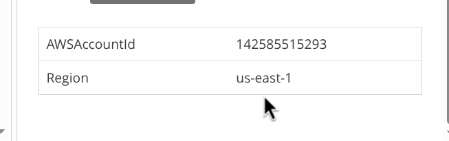
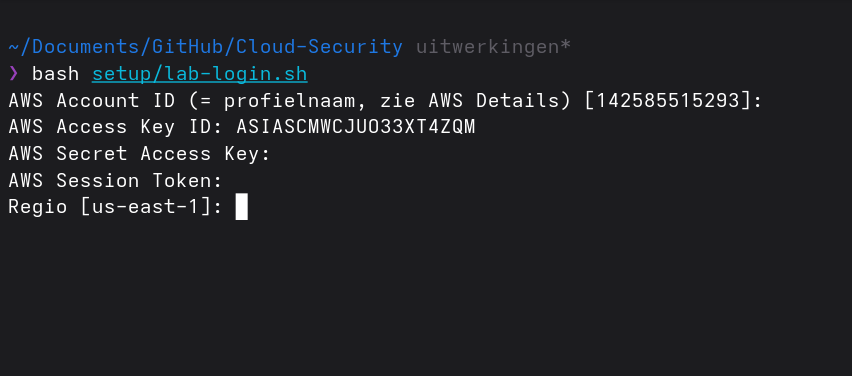
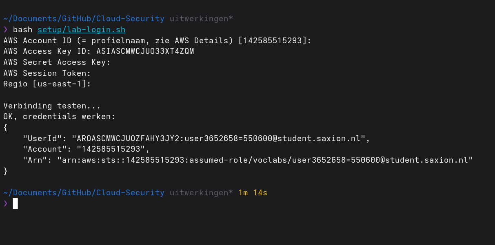
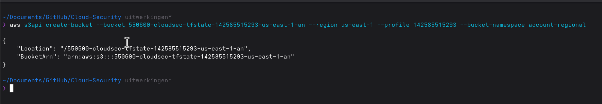

# Setup

Eigen, herschreven versie van de install guide van school (`school docs/handleiding/Cloud Sec module launch begin environment V1.docx`, origineel `main.tf`/`rds.tf` in dezelfde map). Stap voor stap hoe ik de omgeving vanaf nul opzet. Weekopdrachten + bewijs staan in `week-1/` t/m `week-7/`; dit is puur de installatiehandleiding.

## Wat ik anders doe dan de handleiding

- **OpenTofu in plaats van Terraform.** Zelfde taal, zelfde providers. Zie [week-1/README.md](../week-1/README.md) voor waarom.
- **Nieuwere AWS-provider (6.70.0 i.p.v. 3.66.0).** Daarvoor moest `aws_db_instance`'s `name` naar `db_name`. Zie [week-1/README.md](../week-1/README.md).
- **Variabelen in plaats van waardes in `main.tf`.** Keypair-naam, bucketnaam, account-ID en mijn eigen IP staan in `terraform.tfvars`/`backend.hcl` (niet gecommit) en in `labnotes.txt`, nooit in de `.tf`-bestanden zelf — dat gaat naar een publieke repo.
- **tofuenv in plaats van tfenv** om OpenTofu te installeren (zelfde soort tool, ander project).
- **Lokaal werken i.p.v. in CloudShell.** Ik draai alles vanaf mijn eigen laptop, met een eigen scriptje (`setup/lab-login.sh`) om telkens nieuwe lab-credentials in te stellen. Zie "Lab-credentials verversen" hieronder.

## Lab-credentials verversen

Een Learner Lab-sessie verloopt na een paar uur. [`setup/lab-login.sh`](lab-login.sh) vraagt interactief om nieuwe credentials, zet ze in `~/.aws/credentials`, test meteen met `aws sts get-caller-identity`. Hetzelfde scriptje staat ook in [DevOps-Security](https://github.com/Stensel8/DevOps-Security/blob/main/setup/lab-login.sh) (ander vak, zelfde AWS Academy Learner Lab), zodat ik het niet twee keer hoef te schrijven.

```bash
./setup/lab-login.sh
```

In de lab-omgeving: **AWS Details → AWS CLI** (of "Cloud Access"), daar staan `aws_access_key_id`, `aws_secret_access_key` en `aws_session_token`, plus de AccountId en regio die als profielnaam dienen:



Die waardes plak je los in de prompts van het script. Secret Access Key en Session Token worden niet op het scherm getoond tijdens het typen (`read -s`):



Script zet de credentials onder het juiste profiel en test meteen de verbinding:



Faalt de verbindingstest, dan zijn de credentials verlopen of verkeerd gekopieerd — gewoon opnieuw ophalen en het script nog eens draaien.

Voor hulp bij het schrijven van dit script heb ik Claude Sonnet 5 gebruikt (met hoge redeneerinspanning).

## Stap voor stap

1. AWS Academy Learner Lab starten.
2. `./setup/lab-login.sh` draaien (zie hierboven).
3. EC2 → Key Pairs → eigen keypair aanmaken, naam in `labnotes.txt`.
4. Eigen bucket voor de OpenTofu state, naam in `labnotes.txt`. Bewust geen OpenTofu-resource (kip-en-ei: OpenTofu kan niet de bucket beheren waar het zijn eigen state in bewaart), dus los via de CLI:

```bash
aws s3api create-bucket --bucket <unieke-naam> --region us-east-1 --profile <lab_profile> --bucket-namespace account-regional
```

**`--bucket-namespace account-regional` is nodig** zodra de bucketnaam het patroon `prefix-accountId-regio-an` volgt — AWS introduceerde Account Regional Namespaces voor S3 rond maart 2026, zonder deze header volgt `MissingNamespaceHeader`. Zie de [AWS-aankondiging](https://aws.amazon.com/blogs/aws/introducing-account-regional-namespaces-for-amazon-s3-general-purpose-buckets).



5. `opentofu/terraform.tfvars` en `opentofu/backend.hcl` aanmaken (kopieer de `.example`-bestanden) met die waardes.

```bash
# 6. OpenTofu installeren
git clone https://github.com/tofuutils/tofuenv.git ~/.tofuenv
mkdir ~/bin
ln -s ~/.tofuenv/bin/* ~/bin/
tofuenv install 1.13.2
tofuenv use 1.13.2
tofu --version

# 7. Eerst alléén rds-bootstrap/rds.tf draaien (los project, geen remote backend)
cd opentofu/rds-bootstrap
tofu init
tofu apply
# -> endpoint, db_vpc_id (aws_vpc.saxit_vpc_db.id) en de route table ID van de db-VPC
#    noteren in labnotes.txt en in opentofu/terraform.tfvars
# -> daarna lokale .terraform/ en terraform.tfstate* van dit script verwijderen,
#    zodat een latere "tofu destroy" op main.tf deze database nooit meeneemt

# 8. main.tf (plus bastion.tf)
cd ../
tofu init -backend-config=backend.hcl
tofu apply
# -> minimaal 10 minuten wachten: de VM's installeren Docker en bouwen de containers bij het opstarten
```

9. Testen: DNS-naam van de presentation-load-balancer in de browser.

## Wat wel/niet mag in de Learner Lab

Een paar dingen liepen vast door de bewuste Learner Lab-beperkingen. Verzameld hier zodat ik het niet per week opnieuw hoef uit te zoeken:

| Actie | Mag het? | Toelichting |
|---|---|---|
| Eigen IAM-rol/policy aanmaken (`iam:CreateRole`, `iam:CreatePolicy`) | ❌ Nee | AccessDenied: "no identity-based policy allows the iam:CreateRole action". Zie [week-2/README.md](../week-2/README.md) en `opentofu/iam.tf`. |
| Voorgedefinieerde `LabRole`/`LabInstanceProfile` aan een EC2-instance koppelen | ✅ Ja | Geverifieerd met `aws ec2 run-instances --iam-instance-profile Name=LabInstanceProfile --dry-run` → "Request would have succeeded". Dit is de AWS Academy-manier om compute IAM-permissies te geven, zie `opentofu/iam.tf`/`main.tf`. |
| Policy-document van `LabRole` zelf inzien (`iam:GetPolicy`) | ❌ Nee | Expliciet geblokkeerd in een eigen identity-policy (`Pvoclabs1`), los van de IAM-rolbeperking hierboven. |
| S3-bucket aanmaken, policy/encryptie/public-access-block erop zetten | ✅ Ja | |
| Object lock-configuratie van een S3-bucket uitlezen (`s3:GetBucketObjectLockConfiguration`) | ❌ Nee | Expliciete deny via een **Service Control Policy op organisatieniveau** (AWS Academy/Vocareum-account), dus niet op te lossen met IAM-rechten op je eigen rol. De `aws_s3_bucket`-resource in de AWS-provider probeert dit automatisch uit te lezen na het aanmaken (legacy/computed attribuut), waardoor `tofu apply`/`plan` een foutmelding geeft op buckets die in werkelijkheid gewoon zijn aangemaakt. Zie [week-4/README.md](../week-4/README.md) en `opentofu/data-protection.tf`. |

**Gevolg voor `tofu apply`/`destroy` op `main.tf`:** speelde toen de buckets nog gewone OpenTofu-resources waren. Staan nu in [`week-4/scripts/data-protection-setup.sh`](../week-4/scripts/data-protection-setup.sh) (zie [week-4/README.md](../week-4/README.md#42-drie-buckets-één-per-classificatie)), dus `main.tf` raakt dit niet meer. Blijft hier staan als achtergrond, voor wie het via OpenTofu zelf wil doen:

- **`tofu destroy`** ververst eerst altijd de hele state, dus liep met de 4 buckets erin altijd vast vóór er een plan kwam. Fix: eerst `tofu state rm aws_s3_bucket.<naam>`, dan destroy, buckets los opruimen met `aws s3 rb s3://<bucket> --force` (werkt — de SCP blokkeert alleen de leesactie, niet een delete).
- **`tofu apply`** (eerste keer): buckets worden aangemaakt, maar de mislukte post-create leesactie blokkeert daarna alles dat ervan afhangt (policies, encryptie, CloudTrail, dashboard, EventBridge) — elke volgende `plan`/`apply` probeert opnieuw te verversen en loopt weer vast.
- **Fix:** `tofu apply -refresh=false` erachteraan — slaat de refresh over, gaat verder met laatst bekende waardes.
- **Als dat niet werkt** (bv. complete rebuild): buckets staan dan **"tainted"**, een volgende apply probeert ze te vervangen, raakt dezelfde leesfout, oneindige lus. Fix: `tofu untaint aws_s3_bucket.<naam>` op alle 4 buckets vóór de volgende `-refresh=false`-apply. Soms nodig voor `cloudtrail_logs` nog een extra keer apart. Herhalen tot `tofu plan -refresh=false` alleen nog de 3 bekende IAM-items toont.

## IPv6-only-experiment (en waarom alles nu dual-stack is)

Geprobeerd: `web01`/`web02`/`app01`/`app02` IPv6-only laten draaien (geen publiek IPv4, geen NAT gateway) om NAT-kosten te besparen — zelfde idee als NAT64/464XLAT bij mobiele providers. De load balancers staan dual-stack en bleven gewoon over IPv4 én IPv6 bereikbaar; dat deel werkte.

Eerste probleem: **`github.com` heeft geen AAAA-record**, dus geen IPv6. `git clone` in `user_data` liep na 135 seconden vast. GitHub blijft mijn single source of truth, maar voor het ophalen in `user_data` heb ik een IPv6-bereikbare mirror (`repos.codetrunk.eu`, Forgejo): een plat `curl`+`unzip` van een zip-export, geen AWS-credentials nodig. Die mirror gebruik ik nog steeds, ook nu de instances weer gewoon IPv4 hebben — simpeler dan een `git clone`, werkt ongeacht of een subnet IPv6, IPv4 of allebei heeft.

Wat het IPv6-only-deel uiteindelijk brak: **Docker's build-netwerk is standaard IPv4-only**, los van de host. `docker pull` werkt prima (loopt via de daemon over het host-netwerk), maar een `RUN`-stap (hier: `npm install`) draait in een geïsoleerde bridge-container met alleen IPv4 NAT — zonder NAT gateway dus geen pad naar buiten. Raakt elke Dockerfile met een internet-afhankelijke `RUN`-stap, ook de backend (`mvn`).

Conclusie: NAT gateway staat er weer, alle 4 instances zijn dual-stack, niet IPv6-only. De egress-only internet gateway (gratis, voor IPv6) staat er nog naast. Docker's daemon kan met `ipv6`/`ip6tables` in `daemon.json` wél IPv6-only — niet iets om blind midden in een deadline te debuggen.

## NAT gateway-race condition bij een verse `tofu apply`

Bij een complete rebuild vanaf nul worden de NAT gateway en de vier EC2's in dezelfde `tofu apply` aangemaakt. `user_data` start zodra een instance opstart, maar een NAT gateway heeft na "creation complete" nog een paar minuten nodig voor echt verkeer. Omdat `user_data` maar één keer draait, herstelt een netwerktimeout zich nooit vanzelf — build blijft kapot, ook al is de NAT gateway even later gewoon klaar.

Concreet: `docker build` voor de backend faalde op `mvnw clean package` met `java.net.ConnectException: Operation timed out` (Maven Wrapper heeft geen retry-logica), terwijl `apt-get`/de git-mirror-download eerder in hetzelfde script wél doorkwamen (apt heeft wel eigen retries).

**Fix:** een wachtlus vooraan in elk `user_data`-script:

```bash
for i in $(seq 1 30); do
  curl -fsS --max-time 5 https://repos.codetrunk.eu >/dev/null 2>&1 && break
  sleep 10
done
```

Wacht tot 5 minuten voordat de rest van het script start. Ruim genoeg, en kost niets extra zodra de gateway al klaar is.

## Alternatief voor S3: Bunny.net

Deze casus gebruikt AWS S3. Voor mezelf gebruik ik voor opslag/CDN meestal [Bunny.net](https://bunny.net), Sloveens/EU — goedkoper dan AWS per GB/verkeer, data standaard in de EU (relevant voor soevereiniteit/GDPR).

Bunny Storage heeft een S3-compatible API ([docs](https://bunny.net/docs/storage/s3)). Geen IAM-achtig policysysteem, wel een read-only en een write key per storage zone. Ontbreekt nog: SSE/SSE-C-encryptie (botst met de BYOK-encryptie uit week 4), object versioning, ACL's.

Bunny.net is meer een webproduct dan een security-product: CDN, WAF, DNS, static file storage. Advies: security/IAM bij AWS houden, Bunny.net ernaast als snelle CDN/WAF/DNS-laag, niet als vervanging voor de security-kritieke dataflows hier.
