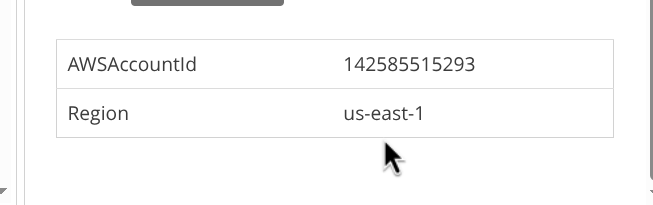
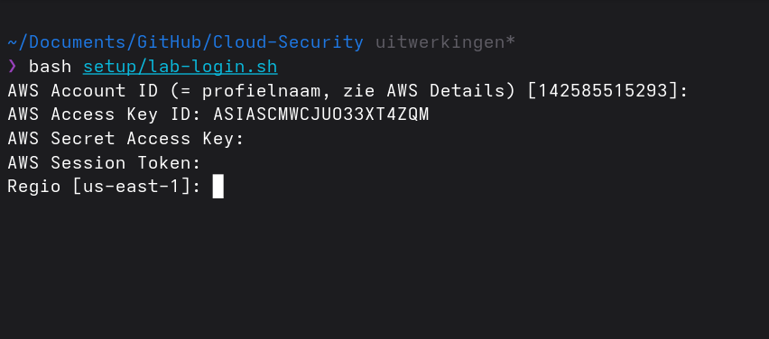
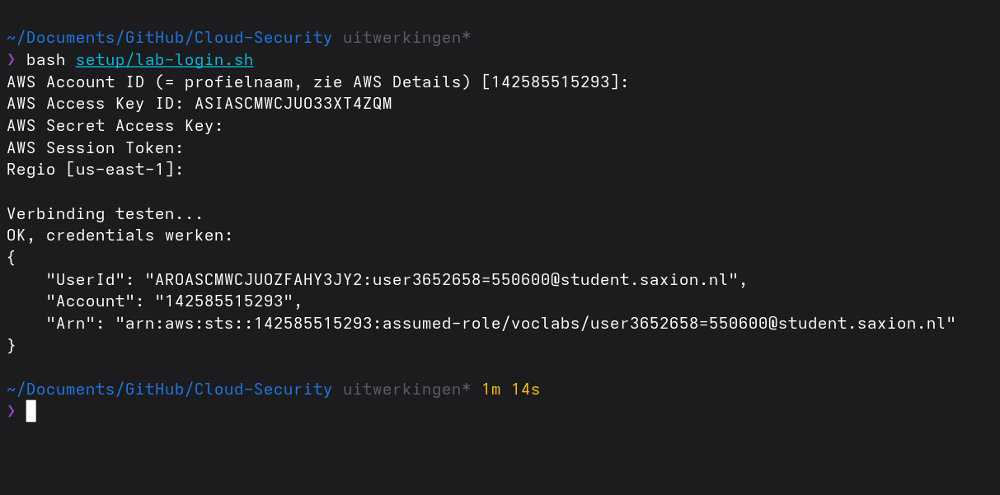

# Setup

Dit is mijn eigen, herschreven versie van de install guide van school (`school docs/handleiding/Cloud Sec module launch begin environment V1.docx`, origineel `main.tf`/`rds.tf` staan in dezelfde map). Stap voor stap hoe ik de omgeving vanaf nul opzet. De weekopdrachten zelf (en het bewijs) staan in `week-1/` t/m `week-7/`; dit is puur de installatiehandleiding.

## Wat ik anders doe dan de handleiding

- **OpenTofu in plaats van Terraform.** Zelfde taal, zelfde providers. Zie [week-1/README.md](../week-1/README.md) voor waarom.
- **Nieuwere AWS-provider (6.70.0 i.p.v. 3.66.0).** Daarvoor moest `aws_db_instance`'s `name` naar `db_name`. Zie [week-1/README.md](../week-1/README.md).
- **Variabelen in plaats van waardes in `main.tf`.** Keypair-naam, bucketnaam, account-ID en mijn eigen IP staan in `terraform.tfvars`/`backend.hcl` (niet gecommit) en in `labnotes.txt`, nooit in de `.tf`-bestanden zelf — dat gaat naar een publieke repo.
- **tofuenv in plaats van tfenv** om OpenTofu te installeren (zelfde soort tool, ander project).
- **Lokaal werken i.p.v. in CloudShell.** Ik draai alles vanaf mijn eigen laptop, met een eigen scriptje (`setup/lab-login.sh`) om telkens nieuwe lab-credentials in te stellen. Zie "Lab-credentials verversen" hieronder.

## Lab-credentials verversen

Een AWS Academy Learner Lab-sessie verloopt na een paar uur — daarna werken de CLI-credentials niet meer en moet je nieuwe ophalen. Ik gebruik daarvoor een eigen scriptje, [`setup/lab-login.sh`](lab-login.sh): het vraagt interactief om de credentials, zet ze in `~/.aws/credentials` onder het juiste profiel, en test meteen de verbinding met `aws sts get-caller-identity`.

```bash
./setup/lab-login.sh
```

In de lab-omgeving: **AWS Details → AWS CLI** (of "Cloud Access"), daar staan `aws_access_key_id`, `aws_secret_access_key` en `aws_session_token`, plus de AccountId en regio die als profielnaam dienen:



Die waardes plak je los in de prompts van het script. Secret Access Key en Session Token worden niet op het scherm getoond tijdens het typen (`read -s`):



Script zet de credentials onder het juiste profiel en test meteen de verbinding:



Faalt de verbindingstest, dan zijn de credentials verlopen of verkeerd gekopieerd — gewoon opnieuw ophalen en het script nog eens draaien.

Voor hulp bij het schrijven van dit script heb ik Claude Sonnet 5 gebruikt (met hoge redeneerinspanning).

## Stap voor stap

1. AWS Academy Learner Lab starten.
2. `./setup/lab-login.sh` draaien (zie hierboven).
3. EC2 → Key Pairs → eigen keypair aanmaken, naam in `labnotes.txt`.
4. S3 → eigen bucket aanmaken voor de OpenTofu state, naam in `labnotes.txt`.
5. `opentofu/terraform.tfvars` en `opentofu/backend.hcl` aanmaken (kopieer de `.example`-bestanden) met die waardes.

```bash
# 6. OpenTofu installeren
git clone https://github.com/tofuutils/tofuenv.git ~/.tofuenv
mkdir ~/bin
ln -s ~/.tofuenv/bin/* ~/bin/
tofuenv install 1.13.2
tofuenv use 1.13.2
tofu --version

# 7. Eerst alléén rds-bootstrap/rds.tf draaien (los project, geen remote backend)
cd opentofu/rds-bootstrap
tofu init
tofu apply
# -> endpoint, db_vpc_id (aws_vpc.saxit_vpc_db.id) en de route table ID van de db-VPC
#    noteren in labnotes.txt en in opentofu/terraform.tfvars
# -> daarna lokale .terraform/ en terraform.tfstate* van dit script verwijderen,
#    zodat een latere "tofu destroy" op main.tf deze database nooit meeneemt

# 8. main.tf (plus bastion.tf)
cd ../
tofu init -backend-config=backend.hcl
tofu apply
# -> minimaal 10 minuten wachten: de VM's installeren Docker en bouwen de containers bij het opstarten
```

9. Testen: DNS-naam van de presentation-load-balancer in de browser.

## Wat wel/niet mag in de Learner Lab

Een paar dingen liepen vast tijdens het draaien van `main.tf`/`iam.tf`/`data-protection.tf` doordat de Learner Lab-omgeving bewust beperkt is. Verzameld hier, zodat ik (of iemand anders) het niet opnieuw hoeft uit te zoeken per week:

| Actie | Mag het? | Toelichting |
|---|---|---|
| Eigen IAM-rol/policy aanmaken (`iam:CreateRole`, `iam:CreatePolicy`) | ❌ Nee | AccessDenied: "no identity-based policy allows the iam:CreateRole action". Zie [week-2/README.md](../week-2/README.md) en `opentofu/iam.tf`. |
| Voorgedefinieerde `LabRole`/`LabInstanceProfile` aan een EC2-instance koppelen | ✅ Ja | Geverifieerd met `aws ec2 run-instances --iam-instance-profile Name=LabInstanceProfile --dry-run` → "Request would have succeeded". Dit is de AWS Academy-manier om compute IAM-permissies te geven, zie `opentofu/iam.tf`/`main.tf`. |
| Policy-document van `LabRole` zelf inzien (`iam:GetPolicy`) | ❌ Nee | Expliciet geblokkeerd in een eigen identity-policy (`Pvoclabs1`), los van de IAM-rolbeperking hierboven. |
| S3-bucket aanmaken, policy/encryptie/public-access-block erop zetten | ✅ Ja | |
| Object lock-configuratie van een S3-bucket uitlezen (`s3:GetBucketObjectLockConfiguration`) | ❌ Nee | Expliciete deny via een **Service Control Policy op organisatieniveau** (AWS Academy/Vocareum-account), dus niet op te lossen met IAM-rechten op je eigen rol. De `aws_s3_bucket`-resource in de AWS-provider probeert dit automatisch uit te lezen na het aanmaken (legacy/computed attribuut), waardoor `tofu apply`/`plan` een foutmelding geeft op buckets die in werkelijkheid gewoon zijn aangemaakt. Zie [week-4/README.md](../week-4/README.md) en `opentofu/data-protection.tf`. |

**Gevolg hiervan voor `tofu apply`/`destroy` op `main.tf` (belangrijk, kost anders tijd):**

- **`tofu destroy`** ververst bij het opbouwen van het destroy-plan áltijd eerst de volledige state, dus loopt met de 4 buckets erin altijd vast vóórdat er een plan getoond wordt. Fix: eerst `tofu state rm aws_s3_bucket.openbaar aws_s3_bucket.intern aws_s3_bucket.geheim aws_s3_bucket.cloudtrail_logs`, dan destroy, en de buckets zelf los opruimen met `aws s3 rb s3://<bucket> --force` (werkt gewoon, de SCP blokkeert alleen Terraform's eigen leesactie, niet een normale delete).
- **`tofu apply`** (eerste keer): de buckets worden prima aangemaakt, maar omdat de post-create leesactie faalt, blokkeert OpenTofu daarna álles dat van die buckets afhangt — bucket-policies, encryptie-config, public-access-block, de CloudTrail-trail, het CloudWatch-dashboard, de EventBridge-rule. Dat gebeurt niet door de foutmelding zelf, maar doordat elke volgende `plan`/`apply` de buckets opnieuw probeert te verversen en daar steeds opnieuw op vastloopt.
- **Fix:** direct daarna nog een keer `tofu apply -refresh=false` draaien. Dat slaat de refresh van de hele state over (dus ook geen drift-detectie dit keer, voor dit ene apply onschuldig) en laat OpenTofu verdergaan met de laatst bekende waardes van de buckets, waarna de rest alsnog aangemaakt wordt.
- **Als dat niet meteen werkt** (bv. bij een complete rebuild vanaf een lege state): de buckets komen dan uit een verse `CreateBucket`-aanroep en staan daardoor **"tainted"** (Terraform/OpenTofu markeert elke resource waarvan de `Create`-aanroep een fout teruggaf als niet-vertrouwd, ook al bestaat de bucket écht). Een volgende apply probeert zo'n tainted bucket dan te **vervangen** (afbreken + opnieuw aanmaken) - wat weer precies dezelfde leesfout raakt, en dus weer tainted wordt: een oneindige lus. Doorbreken met `tofu untaint aws_s3_bucket.<naam>` op alle 4 buckets vóór de volgende `tofu apply -refresh=false` - untaint zegt "vertrouw de bestaande bucket, niet vervangen". Kan nodig zijn voor alle 4 tegelijk, of nog een keer losjes voor `cloudtrail_logs` (die loopt vaak een rondje achter op de andere drie). Net zo lang herhalen tot `tofu plan -refresh=false` alleen nog de 3 bekende IAM-items toont.

## IPv6-only-experiment (en waarom alles nu dual-stack is)

Geprobeerd: `web01`/`web02`/`app01`/`app02` IPv6-only laten draaien (geen publiek IPv4, geen NAT gateway) om de NAT-kosten te besparen — zelfde idee als NAT64/464XLAT bij mobiele providers: intern alleen IPv6, vertaling/dualstack alleen aan de rand. De load balancers (`presentation-lb`/`application-lb`) staan dual-stack en zijn van buiten gewoon over IPv4 én IPv6 bereikbaar; dat deel werkte en is ook zo gebleven.

Wat daarbij meteen bleek: **`github.com` heeft geen AAAA-record**, dus geen IPv6. Een `git clone` in `user_data` liep daar na 135 seconden op vast. Oplossing: de code komt nu via een download van een IPv6-bereikbare Git-mirror (`repos.codetrunk.eu`, Forgejo-based) in plaats van rechtstreeks van GitHub — gewoon een `curl`+`unzip`, geen AWS-credentials nodig. Blijft zo, ook nu de instances weer IPv4 hebben (minder bewegende delen dan `git clone`).

Wat het IPv6-only-deel uiteindelijk brak: **Docker's eigen build-netwerk is standaard IPv4-only**, los van de host. `docker pull` (de node/nginx base-images) werkt prima, want dat loopt via de daemon over het netwerk van de hóst. Maar een `RUN`-stap in een Dockerfile (hier: `npm install` voor de frontend) draait in een eigen, geïsoleerde bridge-container die alleen IPv4 NAT doet — en zonder NAT gateway heeft die dus geen enkel pad naar buiten. Dat raakt elke Dockerfile met een internet-afhankelijke `RUN`-stap, dus ook de backend (`mvn`).

Conclusie: de NAT gateway staat er nu gewoon weer bij, en alle 4 instances zijn dual-stack (IPv4 + IPv6), niet IPv6-only. De egress-only internet gateway (gratis, voor IPv6) staat er ook nog naast. Had dit verder uitgezocht moeten worden (Docker's daemon kan met `ipv6`/`ip6tables` in `daemon.json` wél IPv6-only draaien), maar dat is precies het soort configuratie dat je niet blind midden in een deadline wil debuggen.

## Alternatief voor S3: Bunny.net

Deze casus gebruikt AWS S3, dus dat houd ik aan. Voor mezelf gebruik ik voor opslag/CDN meestal [Bunny.net](https://bunny.net), een Sloveens (EU) bedrijf — qua prijs per GB en dataverkeer goedkoper dan AWS, en data staat standaard in de EU, wat voor een Europese partij als SaxIT relevant kan zijn voor soevereiniteit/GDPR.

Bunny Storage heeft ook een S3-compatible API ([docs](https://bunny.net/docs/storage/s3)), dus qua protocol is het geen ander verhaal dan S3 zelf, en Bunny breidt die storage-laag nog actief uit met nieuwe features. Geen IAM-achtig policysysteem met fijnmazige rechten, wel een read-only en een write key per storage zone — daar kun je zelf iets omheen bouwen (zelfde idee als de aparte read-only pull-PAT die ik in mijn andere vak voor Docker Hub gebruik). Wat er volgens de eigen docs nog niet in zit: SSE/SSE-C-encryptie (botst met de BYOK-encryptie uit week 4), object versioning, en ACL's.

Bunny.net is in de kern ook meer een webproduct dan een security-product: CDN, WAF, DNS en static file storage, en snel — Nederland ligt midden in hun servernetwerk. Voor SaxIT zou ik het zo adviseren: security en IAM gewoon bij AWS (of een andere cloud) houden, en Bunny.net ernaast inzetten als snelle CDN/WAF/DNS-laag met static file storage, niet als vervanging voor de security-kritieke dataflows uit deze casus.
