# Week 1

Ik richt de initiële 3-tier infrastructuur in AWS in met het Terraform-script uit de module (`rds.tf` en `main.tf`), teken het netwerk, en schrijf twee adviezen voor SaxIT: het Shared Responsibility Model (1.2) en een bastion host (1.3).

**Terraform versus OpenTofu:** de module levert `main.tf`/`rds.tf` aan als HashiCorp Terraform-script. Ik draai dit zelf met **OpenTofu** in plaats van Terraform: dezelfde HCL-taal, dezelfde providers (ook gewoon `hashicorp/aws`), dus de `.tf`-bestanden zelf blijven identiek. Het enige verschil is welke CLI ik gebruik (`tofu` in plaats van `terraform`) en hoe ik die installeer (zie 1.1). Reden: OpenTofu is de open-source fork van Terraform en blijft dat ook, in tegenstelling tot Terraform zelf sinds de licentiewijziging van HashiCorp.

**AWS-provider-versie:** de module pint `hashicorp/aws` op `3.66.0`. Ik gebruik zelf de actuele `6.70.0` (Dependabot had dit al voorgesteld, zie [PR #133](https://github.com/Stensel8/Cloud-Security/pull/133)). Tussen v3 en v6 zijn er echte breaking changes; de enige die mijn code echt raakte was `aws_db_instance`: het argument `name` heette vanaf v5 `db_name` ([upgradegids](https://registry.terraform.io/providers/hashicorp/aws/latest/docs/guides/version-5-upgrade)). Dat heb ik aangepast in [`rds-bootstrap/rds.tf`](../opentofu/rds-bootstrap/rds.tf), en meteen ook een expliciete `identifier = "cloudsecdb"` toegevoegd (stond er nog niet in, waardoor de data-lookup in `iam.tf` nooit de juiste instance zou vinden).

## 1.1 Bootomgeving: de 3-tier infrastructuur

De omgeving bestaat uit twee OpenTofu-scripts, precies zoals de handleiding voorschrijft (die het over Terraform heeft, zie hierboven waarom ik voor OpenTofu koos):

1. **[`rds-bootstrap/rds.tf`](../opentofu/rds-bootstrap/rds.tf)** maakt een eigen VPC (`10.1.0.0/16`) met een MariaDB RDS-instance erin. Dit script staat bewust in een eigen map, los van `main.tf`, en draait zonder remote backend. Na het aanmaken van de database noteer ik het endpoint en verwijder ik de lokale OpenTofu-state van dit script, zodat een latere `tofu destroy` op `main.tf` deze database nooit per ongeluk meeneemt. Zo raakt ook de pipeline van week 3 (3.3), die alleen `main.tf`/`bastion.tf` opnieuw uitrolt, deze map nooit aan.
2. **[`main.tf`](../opentofu/main.tf)** (plus [`bastion.tf`](../opentofu/bastion.tf)) maakt de rest: een eigen VPC (`10.0.0.0/16`) met presentation- en applicationtier-subnets verspreid over twee availability zones, twee Application Load Balancers, vier EC2's (`web01`, `web02`, `app01`, `app02`) die bij het opstarten via `user_data` Docker installeren en mijn fork van de applicatie bouwen en draaien, en een VPC-peering naar de db-VPC van `rds.tf`.

### Toegang tot de AWS Learner Lab

Ik heb toegang tot de module via AWS Academy, en heb de Learner Lab-sessie gestart:

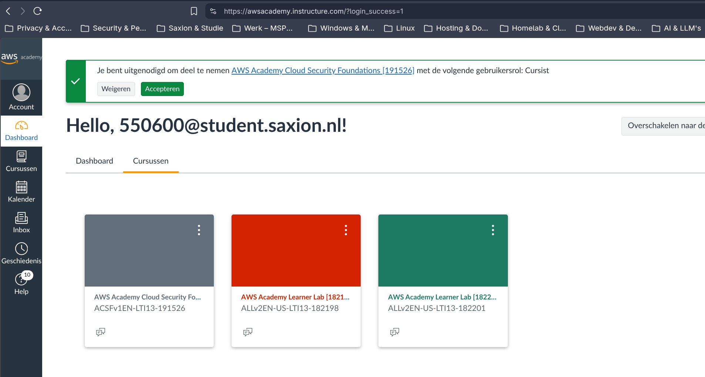

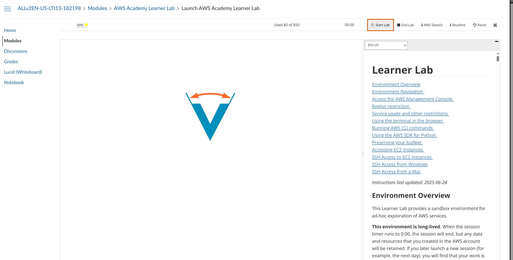

Eenmaal gestart (timer loopt) geeft de lab tijdelijke AWS-credentials via "AWS Details" → "Cloud Access". Het credentials-blok zelf staat hieronder bewust afgeschermd met een ondoorzichtig vlak, niet geblurd: dat zijn actieve sleutels, en blur op dit soort monospace-tekst is met wat moeite soms terug te herleiden.

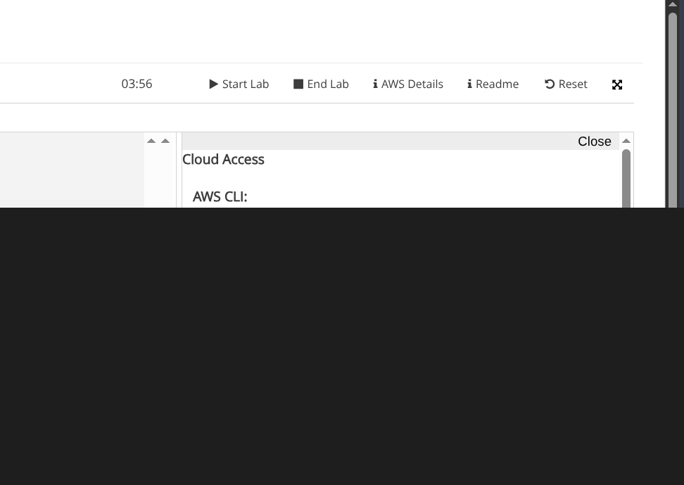

### AWS CLI lokaal + lab-credentials verversen

Ik werk niet in CloudShell maar lokaal, met OpenTofu en de AWS CLI op mijn eigen laptop:

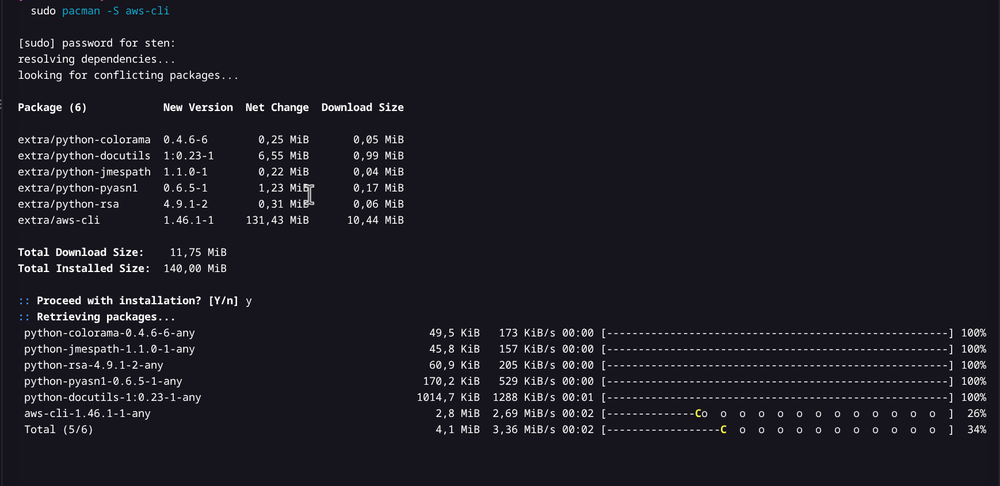

Een Learner Lab-sessie geeft tijdelijke credentials die na een paar uur verlopen. Account-ID en regio vind ik terug onder "AWS Details":

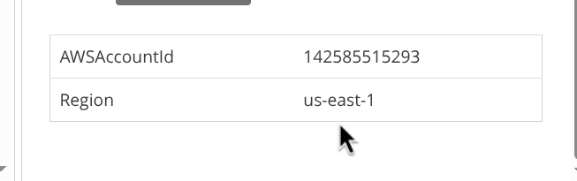

Om die credentials niet elke keer met de hand in `~/.aws/credentials` te zetten, heb ik [`setup/lab-login.sh`](../setup/lab-login.sh) geschreven: het script vraagt de Access Key ID, Secret Access Key en Session Token op uit "AWS Details" → "Cloud Access", zet ze onder het juiste profiel, en test de verbinding meteen met `aws sts get-caller-identity`.

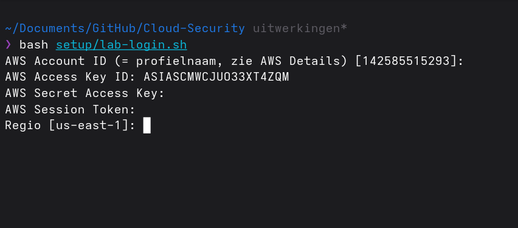

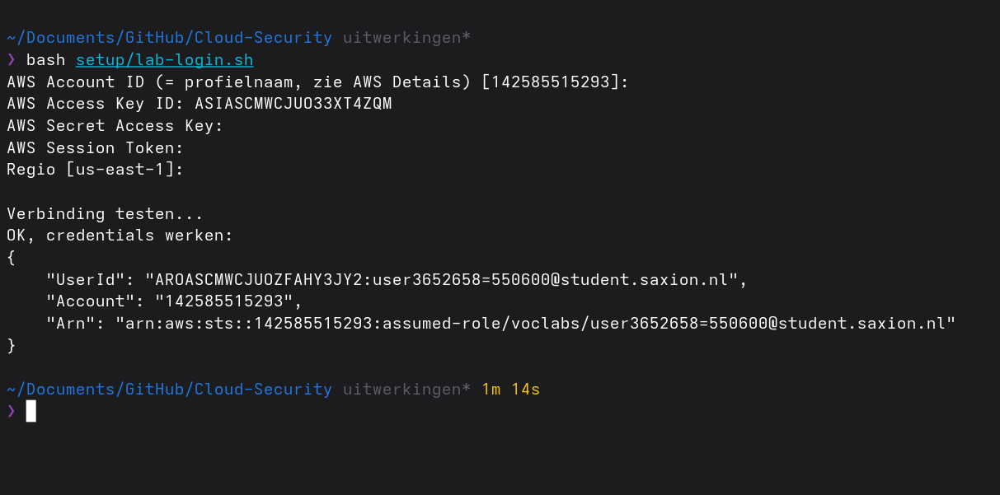

Secret Access Key en Session Token worden niet op het scherm getoond tijdens het typen (`read -s`). Voor hulp bij dit script heb ik Claude Sonnet 5 gebruikt; uitleg erover staat in [`setup/README.md`](../setup/README.md).

### Keypair aanmaken

Eerst een eigen EC2-keypair voor dit project, via EC2 → Key Pairs:

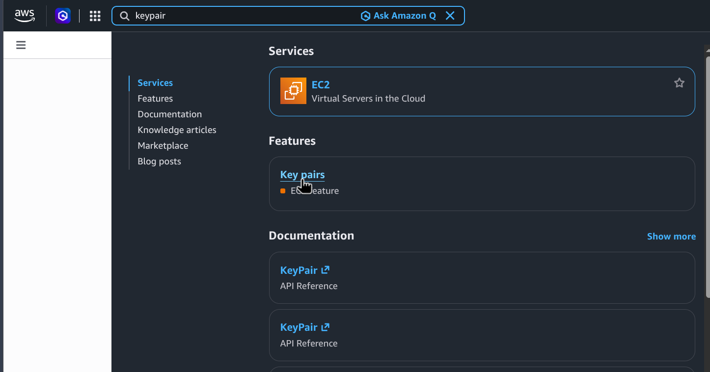

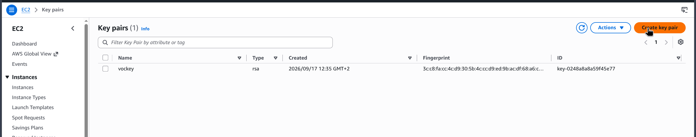

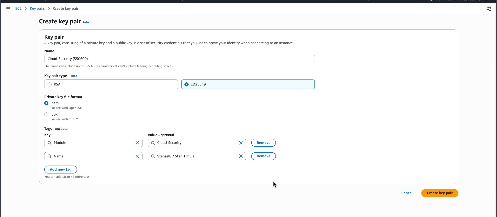

Deze keypair gebruik ik om op de EC2-instances in te loggen. De naam noteer ik in `labnotes.txt`. De private key bewaar ik lokaal, niet in de repository.

### S3-bucket voor de OpenTofu state

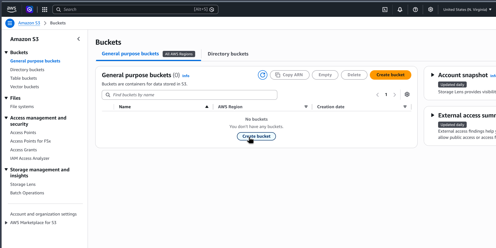

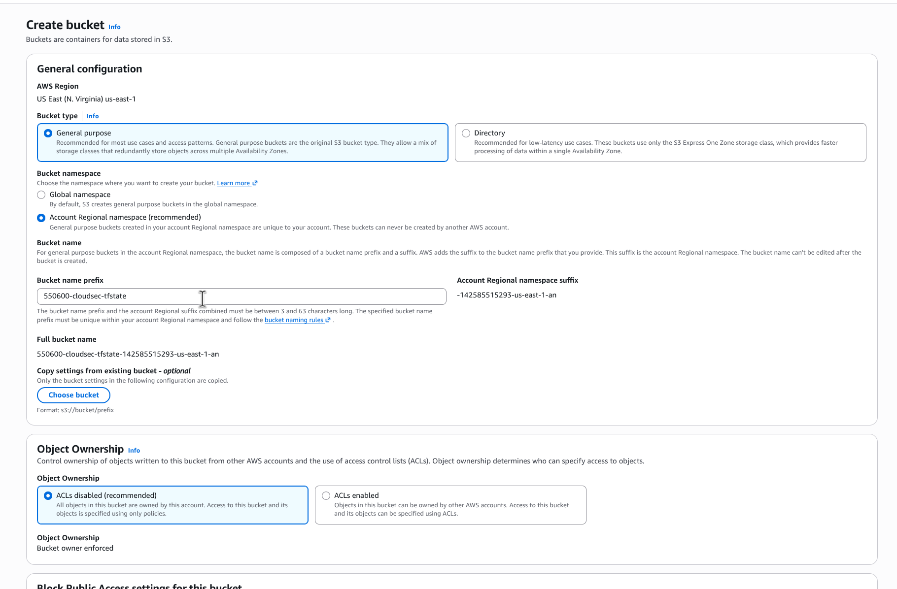

Regio `us-east-1`, zelfde regio als in `main.tf`/`rds.tf`. Voor de naamgeving kies ik Account Regional namespace in plaats van Global namespace: AWS plakt er automatisch een account-specifieke suffix achter, wat de bucketnaam lastiger te gokken maakt voor scanners die bekende naampatronen afgaan. Dat is een extra laag bovenop Block Public Access (staat aan), niet de beveiliging zelf. Volledige naam (`550600-cloudsec-tfstate-142585515293-us-east-1-an`) noteer ik in `labnotes.txt`.

Rest van de instellingen laat ik op de AWS-standaard staan: Object Ownership op "ACLs disabled", Block all public access aan, en SSE-S3-encryptie met Bucket Key aan. Versioning zet ik niet aan, niet nodig voor dit project.

Keypair-naam, bucketnaam, account-ID en mijn eigen IP staan nergens in `main.tf` zelf, maar in `terraform.tfvars`/`backend.hcl` (niet gecommit) en in `labnotes.txt`. Volledige installatiehandleiding, stap voor stap: [`setup/README.md`](../setup/README.md).

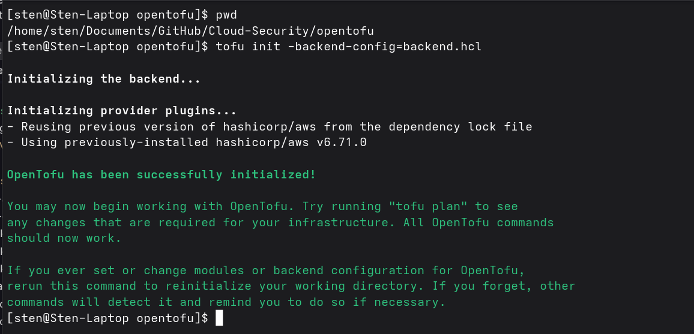

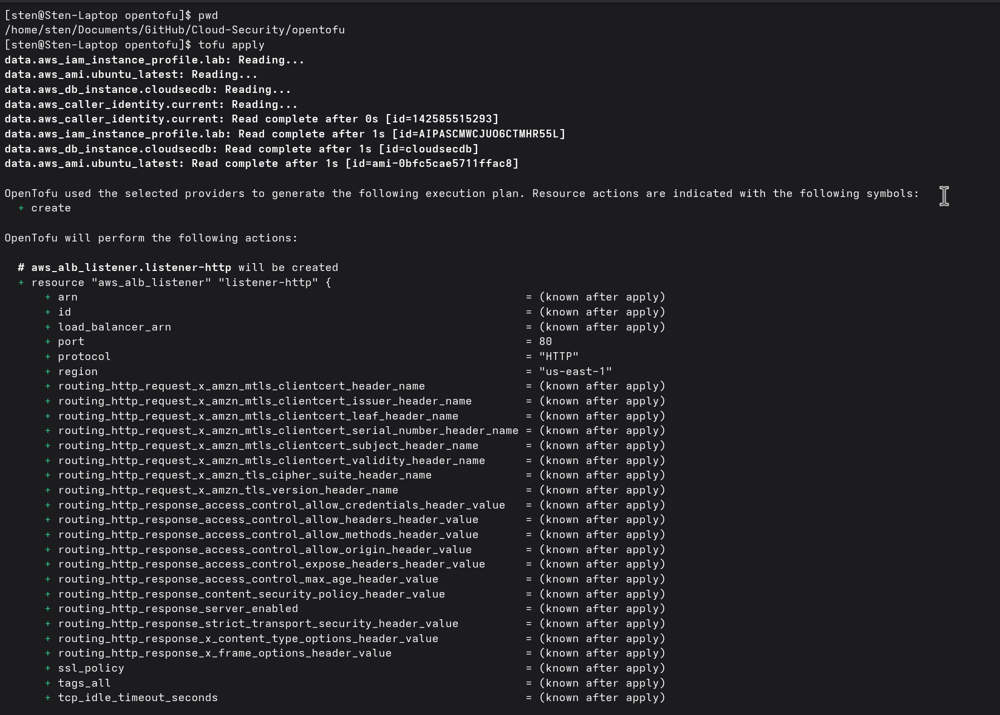

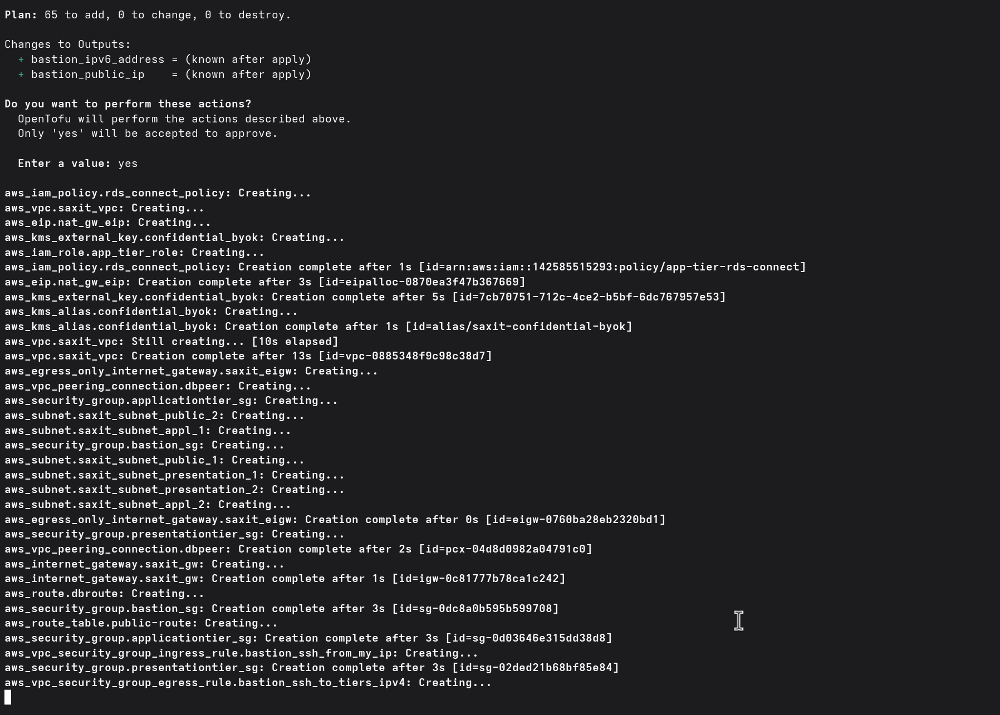

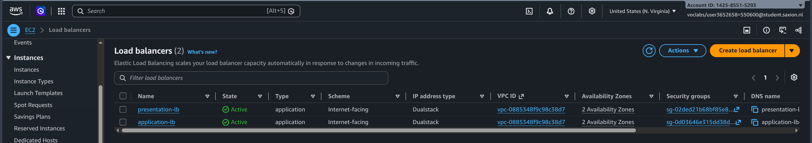

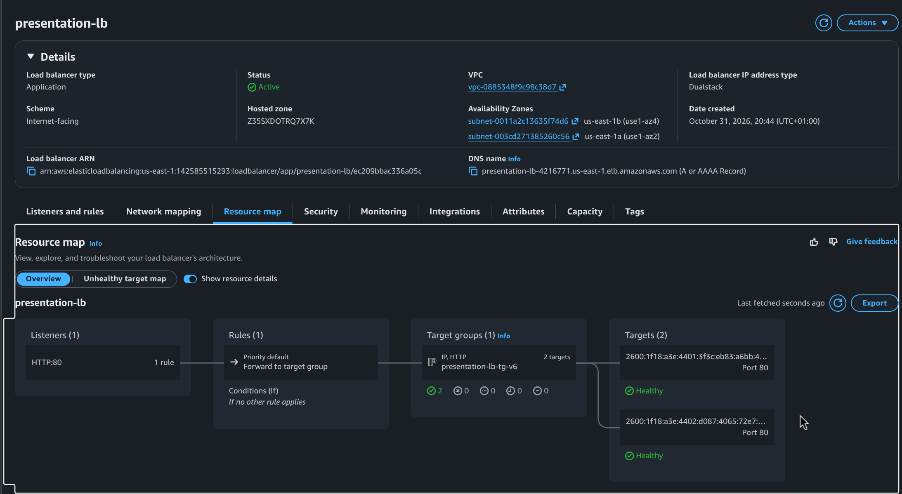 target group -> 2 targets, beide Healthy" width="900">

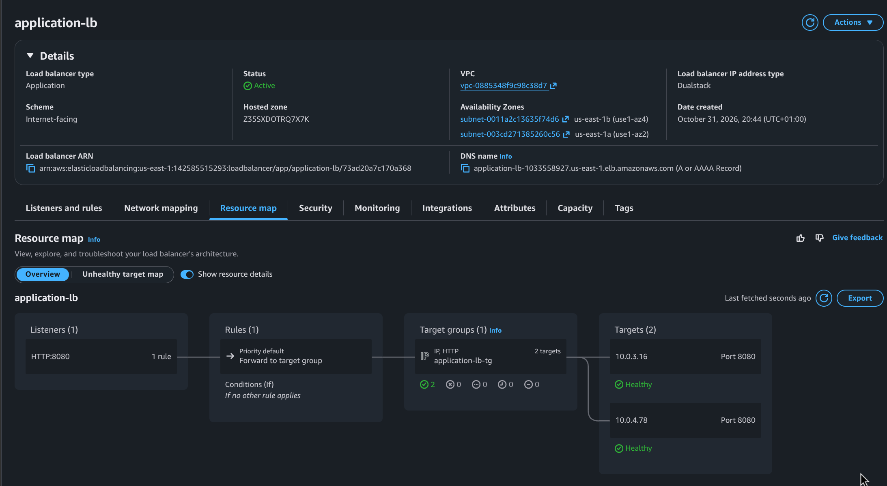 target group -> 2 targets, beide Healthy" width="900">

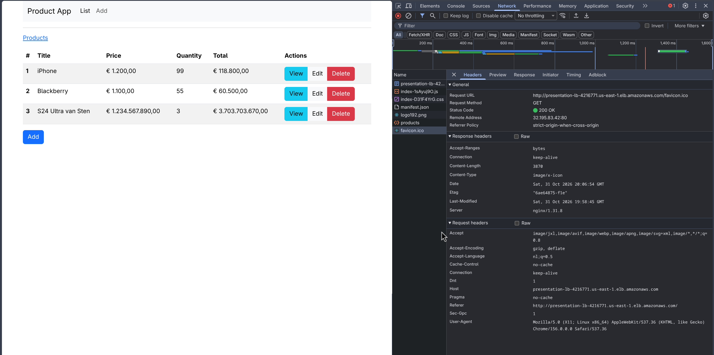

Alle "Nog te doen (bewijs)"-punten van 1.1 zijn hiermee compleet.

### RDS-bootstrap draaien, en daarna de lokale state weggooien

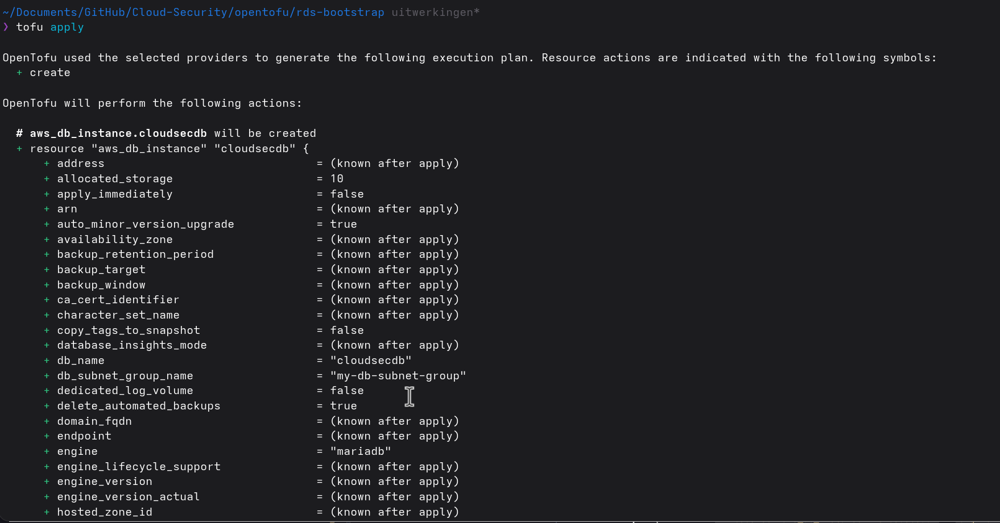

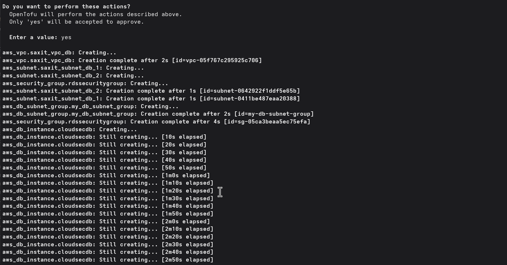

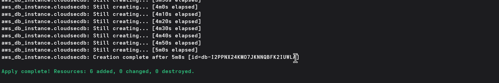

Endpoint, db-VPC-ID en de route table-ID van die VPC noteer ik in `labnotes.txt` en zet ik in `opentofu/terraform.tfvars`, zodat `main.tf` straks de VPC-peering naar de juiste database kan maken.

Daarna verwijder ik de lokale `.terraform/` en `terraform.tfstate*` van dit losse script. Dat is geen eigen voorzichtigheidsmaatregel, maar letterlijk wat de handleiding van school voorschrijft (`school docs/handleiding/Cloud Sec module launch begin environment V1.docx`):

> *"We don't want the database instance to be deleted with a Terraform destroy command, so we delete all files in the directory that are related to Terraform, including the state file."*

```bash
rm -rf opentofu/rds-bootstrap/.terraform opentofu/rds-bootstrap/terraform.tfstate*
```

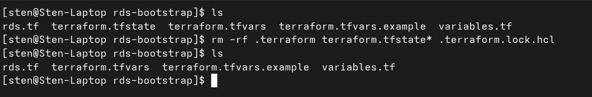

De database zelf blijft gewoon bestaan in AWS; alleen OpenTofu's eigen boekhouding van dit losse script is weg. Een `tofu destroy` op `main.tf` kent deze resources dus niet en kan ze nooit meenemen.

### Netwerktekening

In plaats van Cloudcraft gebruik ik een Mermaid-diagram, zodat de tekening meteen in deze repository meekomt en meeverandert met de OpenTofu-code. De security groups en de CIDR-ranges staan in de tekening; mijn eigen IP-adres (in `bastion_sg`) laat ik later als screenshot zien, niet hier in platte tekst.

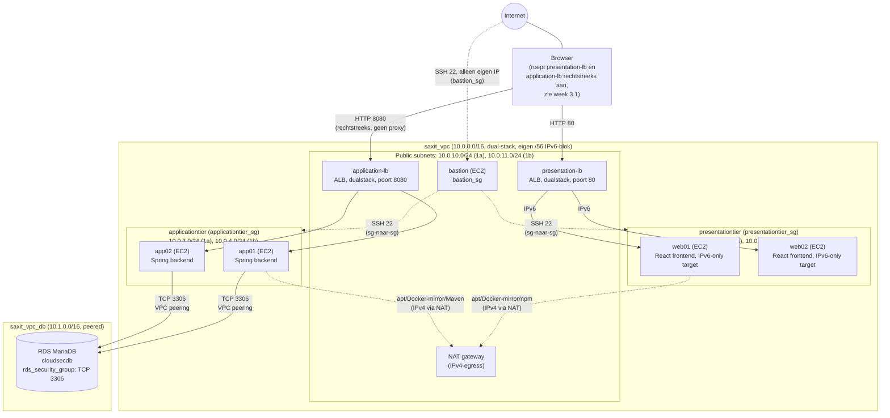

IPv6-egress (via een gratis egress-only internet gateway, niet apart getekend) loopt parallel aan de NAT gateway-pijlen hierboven - zie [setup/README.md](../setup/README.md#ipv6-only-experiment-en-waarom-alles-nu-dual-stack-is) voor waarom alles dual-stack is in plaats van IPv6-only.

## 1.2 Advies: het Shared Responsibility Model voor SaxIT

Dit ontwerp draait op EC2, RDS en Elastic Load Balancing: allemaal IaaS/managed-services, geen serverless. Voor AWS betekent dat "Security **of** the Cloud": AWS is verantwoordelijk voor de fysieke datacenters, het netwerk van de hypervisor naar beneden, de hardware van RDS en de beschikbaarheid van de load balancer-service zelf. Voor alles wat ik er bovenop zet geldt "Security **in** the Cloud": dat is mijn verantwoordelijkheid.

Concreet, per onderdeel in dit ontwerp:

| Onderdeel | AWS doet | SaxIT (ik) doet |
| --- | --- | --- |
| VPC, subnets, routering | Het fysieke netwerk en de isolatie tussen VPC's van verschillende klanten | De indeling in tiers, de routetabellen, de VPC-peering |
| Security groups | De firewall-functionaliteit zelf werkt altijd | Welke poorten open staan en voor wie (nu nog te ruim, zie 1.3 en week 3) |
| EC2 (web01/02, app01/02, bastion) | Het fysieke hostplatform, de hypervisor | Het besturingssysteem, patches, welke software erop draait, de Docker-containers, user-data met (nu nog) een wachtwoord in platte tekst |
| RDS (MariaDB) | De database-engine draaiende houden, onderliggende patches van het DB-platform, back-ups van de infrastructuur | Het databasewachtwoord, wie er toegang toe heeft, of encryptie aan staat, het databaseschema |
| Elastic Load Balancer | De beschikbaarheid en schaling van de load balancer zelf | Welke listeners en targetgroups ik configureer, of er TLS op zit (nu nog niet: alles is HTTP) |
| IAM | De IAM-service zelf werkt en is beschikbaar | Welke gebruikers, rollen en policies ik aanmaak en hoe strikt least privilege is (zie week 2) |

Mijn advies aan SaxIT: AWS zorgt dat de bakstenen stevig zijn, maar het huis zelf (wie er binnen mag, welke deuren er zijn, of de brandkast op slot zit) is aan ons. Dat betekent dat een "het staat in de cloud dus het is beveiligd"-aanname niet klopt: de security groups, IAM-rollen, encryptie en patching in dit ontwerp zijn allemaal dingen die ík fout kan laten staan, en AWS lost dat niet voor me op. Ik zou dit verder uitwerken door dit schema als uitgangspunt te nemen bij elke nieuwe AWS-dienst die SaxIT toevoegt: eerst vaststellen wat AWS regelt, dan expliciet maken wat er aan onze kant nog open staat.

Bronnen: [AWS Shared Responsibility Model](https://aws.amazon.com/compliance/shared-responsibility-model/), [AWS Well-Architected Security Pillar: Shared Responsibility](https://docs.aws.amazon.com/wellarchitected/latest/security-pillar/shared-responsibility.html), [Wat is cloud security (Check Point)](https://www.checkpoint.com/cyber-hub/cloud-security/what-is-cloud-security/).

## 1.3 Advies en implementatie: bastion host

Een bastion host (ook wel jump host) is één, bewust kleine en goed bewaakte server die als enige poort naar buiten voor SSH-verkeer dient. In plaats van dat elke VM in de presentation- en applicationtier zelf bereikbaar is via SSH vanaf het hele internet, staat SSH op al die VM's alleen nog open voor verkeer dat van de bastion host zelf komt. Wil ik op `app01` inloggen, dan SSH ik eerst naar de bastion host, en vandaar met een tweede SSH-sprong (`ssh -J` of `ProxyJump`) door naar `app01`.

Voor deze casus verhoogt dat de veiligheid om een paar redenen:

- **Kleiner aanvalsoppervlak.** In de beginsituatie staat SSH op `web01`, `web02`, `app01` en `app02` open voor `0.0.0.0/0`: vier publieke IP-adressen die vanaf elk IP ter wereld te benaderen zijn. Met een bastion host is dat nog maar één host, met één smalle regel (alleen mijn eigen IP).
- **Eén plek om te monitoren en te patchen.** Loginpogingen, mislukte authenticaties en kwetsbaarheden in de SSH-daemon hoef ik nu nog maar op één machine in de gaten te houden, in plaats van op vier.
- **Credentials blijven dichter bij huis.** Alleen de bastion host hoeft de private key te zien die ook echt gebruikt wordt om in te loggen; de andere VM's zijn alleen bereikbaar via die ene sprong.

Ik heb dit toegepast in [`opentofu/bastion.tf`](../opentofu/bastion.tf): een losse `bastion_sg` die SSH alleen toestaat vanaf mijn eigen IP (`local.my_ip`), en een EC2-instance in de presentationtier-subnet die als enige poort naar binnen dient. In [`opentofu/main.tf`](../opentofu/main.tf) heb ik de SSH-ingress-regel van `presentationtier_sg` en `applicationtier_sg` aangepast van een open CIDR-blok (`0.0.0.0/0`) naar een verwijzing naar `bastion_sg.id` (security-group-naar-security-group, geen CIDR meer). Daarmee kan niemand, ook ikzelf niet, nog rechtstreeks met SSH bij `web01/web02/app01/app02` komen: alleen via de bastion host.

```hcl
ingress {
  description     = "SSH ingress - alleen vanaf de bastion host"
  from_port       = 22
  to_port         = 22
  protocol        = "tcp"
  security_groups = [aws_security_group.bastion_sg.id]
}
```

Bewijs vanaf mijn eigen laptop: direct SSH'en naar `app01` (privé-IP, niet routeerbaar vanaf het internet) hangt/mislukt, SSH via de bastion host (`ssh -J ubuntu@<bastion-ip> ubuntu@<app01-private-ip>`) lukt meteen:

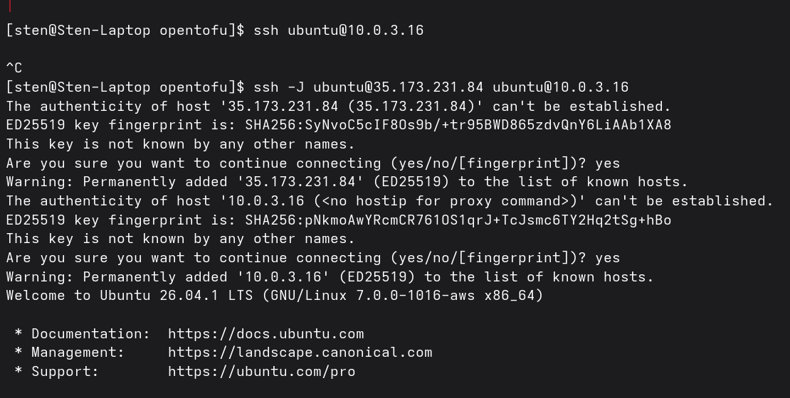

En ter controle in de AWS-console dat dit ook echt de juiste IP's zijn: alle vier de web-/app-instances hebben geen publiek IPv4-adres, alleen de bastion heeft er één (`35.173.231.84`):

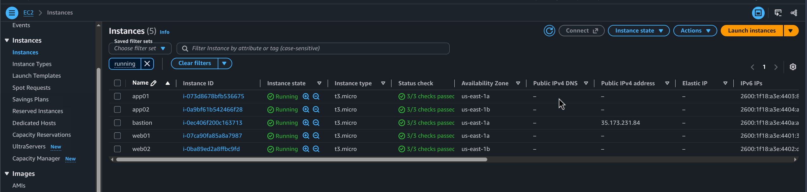

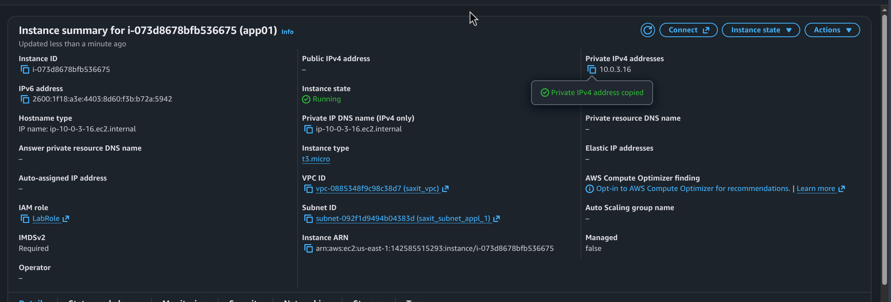

Bronnen: [AWS: wat is een bastion host](https://docs.aws.amazon.com/whitepapers/latest/aws-fault-isolation-boundaries/bastion-hosts.html), [SSH ProxyJump (OpenSSH)](https://www.ssh.com/academy/ssh/proxyjump).
