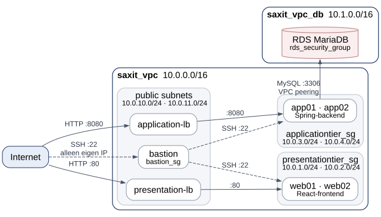

# Week 1: Shared Responsibility Model

Cloud security is het geheel van technieken, beleid en maatregelen dat data, applicaties en infrastructuur in de cloud beschermt [(Check Point Software Technologies, z.d.)](https://www.checkpoint.com/cyber-hub/cloud-security/what-is-cloud-security/). Het verschil met een eigen serverruimte is dat je dat niet alleen doet. Een deel regelt de cloudprovider, een deel regel je zelf. AWS noemt die verdeling het Shared Responsibility Model [(Amazon Web Services, z.d.-c)](https://aws.amazon.com/compliance/shared-responsibility-model/).

AWS vat het samen als "security of the cloud" tegenover "security in the cloud". AWS beveiligt de infrastructuur waar alle diensten op draaien: de datacenters, de hardware, het netwerk en de virtualisatielaag. De klant is verantwoordelijk voor alles wat hij daarop bouwt en instelt. Hoeveel dat is, hangt af van de dienst [(Amazon Web Services, z.d.-b)](https://docs.aws.amazon.com/wellarchitected/latest/security-pillar/shared-responsibility.html):

- Bij EC2 (IaaS) beheert de klant het besturingssysteem en de updates, de software op de server en de security groups.
- Bij een managed dienst zoals RDS patcht AWS de database-engine, maar de klant kiest wanneer dat gebeurt en regelt de toegang.
- Bij diensten zoals S3 doet AWS bijna alles, behalve de data zelf: de klant classificeert de data, kiest de encryptie en bepaalt wie erbij mag.

Het AWS Well-Architected Framework heeft een aparte Security Pillar met ontwerpprincipes, zoals least privilege, alles kunnen herleiden via logging en beveiliging op elke laag [(Amazon Web Services, 2024)](https://docs.aws.amazon.com/wellarchitected/latest/security-pillar/welcome.html). Die principes komen in de volgende weken steeds terug.

Deze week bestaat uit drie opdrachten. Paragraaf 1.1 beschrijft het opzetten van de proefopstelling en de netwerktekening. Paragraaf 1.2 bevat een advies aan SaxIT over wie waarvoor verantwoordelijk is, en in paragraaf 1.3 wordt een bastion host toegevoegd.

## 1.1 Proefopstelling en netwerktekening

Voor de eerste opdracht heb ik de beginomgeving uitgerold in het AWS Learner Lab. Het Learner Lab is een AWS-omgeving voor studenten, met beperkte rechten en tijdelijke inloggegevens. De omgeving wordt opgebouwd met twee scripts uit de handleiding:

1. `rds-bootstrap/rds.tf` maakt een aparte VPC (10.1.0.0/16) met een MariaDB-database in RDS. Na het aanmaken verwijder ik de lokale state van dit script, zoals de handleiding voorschrijft. Zo kan een `destroy` van de rest van de omgeving de database nooit meenemen.
2. `main.tf` maakt de applicatie-VPC (10.0.0.0/16) met subnets in twee availability zones, twee Application Load Balancers, vier EC2-instances (web01, web02, app01 en app02) en een VPC peering naar de database-VPC. De servers installeren bij het opstarten Docker en starten daarin de applicatie.

De module levert Terraform-scripts. Ik draai ze met OpenTofu, de open-source fork van Terraform [(OpenTofu, z.d.)](https://opentofu.org/). De taal en de providers zijn hetzelfde, dus de scripts blijven gelijk. Alleen het commando heet `tofu` in plaats van `terraform`. Ik werk lokaal op mijn laptop met de AWS CLI, niet in CloudShell. Hoe je de omgeving vanaf nul opzet, inclusief het inloggen met de tijdelijke Learner Lab-credentials, staat in [setup/README.md](../setup/README.md).


Beide load balancers staan op Active en zijn internet-facing. Niet alleen de presentation-lb is dus vanaf internet te bereiken, maar ook de application-lb. In deze beginsituatie praat de browser rechtstreeks met de backend. Dat is een zwak punt, want de backend hoort niet publiek te zijn. In week 3 beperk ik dat zo veel als de applicatie toelaat.


In de resource map is te zien hoe het verkeer loopt. De listener op HTTP-poort 80 stuurt alles door naar de target group met de twee webservers, en beide targets zijn healthy. De application-lb werkt op dezelfde manier, met een listener op poort 8080 en app01 en app02 als targets.


Deze screenshot laat zien dat de hele keten werkt. De pagina komt binnen via de DNS-naam van de presentation-lb, met status 200 OK in de Network-tab rechts. De productenlijst komt van de backend, en die haalt hem uit de database. Product 3, "S24 Ultra van Sten", heb ik zelf toegevoegd. Daarmee is ook aangetoond dat schrijven naar de database werkt.

### Netwerktekening



De tekening laat de omgeving zien zoals die nu in de code staat, inclusief de bastion host uit 1.3. Ik heb hem als code gemaakt met Graphviz in plaats van in Cloudcraft, zodat hij in de repository staat en meeverandert met de OpenTofu-code. De bron staat in `images/netwerktekening.dot`.

De applicatie-VPC (10.0.0.0/16) heeft drie soorten subnets, elk verdeeld over twee availability zones:

- de public subnets (10.0.10.0/24 en 10.0.11.0/24) met de twee load balancers en de bastion host;
- de presentation tier (10.0.1.0/24 en 10.0.2.0/24) met web01 en web02 in presentationtier_sg;
- de application tier (10.0.3.0/24 en 10.0.4.0/24) met app01 en app02 in applicationtier_sg.

De database staat in een aparte VPC (10.1.0.0/16) in rds_security_group. De app-servers bereiken hem via VPC peering op poort 3306. De doorgetrokken pijlen zijn het verkeer van gebruikers, de gestippelde pijlen het beheer via SSH.

## 1.2 Advies: wie is waarvoor verantwoordelijk

Dit ontwerp gebruikt VPC's, security groups, EC2, RDS, Elastic Load Balancing, IAM en S3 (voor de OpenTofu state). Per onderdeel staat hieronder wat AWS regelt en wat SaxIT zelf moet regelen.

| Onderdeel | AWS regelt | SaxIT regelt |
|---|---|---|
| VPC, subnets, routetabellen en peering | Het netwerk eronder en de scheiding tussen klanten | De indeling in tiers, welke subnets publiek zijn, de routes en welke VPC's met elkaar praten |
| Security groups | Dat de firewall werkt | Welke poorten open staan en voor wie. In deze opstelling zijn ze nog te ruim. |
| EC2 (web01, web02, app01, app02, bastion) | De hardware en de hypervisor | Het besturingssysteem en de updates, Docker en de applicatie, de SSH-sleutels en de user data. Daar staat nu nog een databasewachtwoord in platte tekst in. |
| RDS (MariaDB) | De hardware, de database-engine en de patches daarvan, het back-upmechanisme | De gebruikers en wachtwoorden, wie erbij mag, encryptie en TLS aanzetten, het onderhoudsvenster kiezen |
| Elastic Load Balancers | Beschikbaarheid en meeschalen | Listeners, target groups, intern of publiek, en HTTPS. Nu gaat alles nog over HTTP. |
| IAM | Dat IAM zelf werkt en veilig is | Welke gebruikers, rollen en policies er zijn, en hoe strikt least privilege is |
| S3 (OpenTofu state) | Duurzame opslag en de encryptie-opties | Block Public Access, encryptie, en wie bij de state mag. De state bevat gegevens over de hele omgeving. |

Mijn advies aan SaxIT is om er niet van uit te gaan dat iets veilig is omdat het in de cloud staat. AWS beveiligt de onderkant, maar bijna alle zwakke plekken in deze proefopstelling zitten aan de kant van SaxIT: te ruime security groups, een wachtwoord in de user data en geen HTTPS. Bepaal daarom bij elke nieuwe AWS-dienst eerst wat AWS regelt, en maak dan duidelijk wat SaxIT zelf nog moet doen en wie daar eigenaar van is.

Voor dit ontwerp betekent dat:

- het databasewachtwoord uit de user data halen (week 2);
- de security groups dichtzetten tot wat echt nodig is (week 3);
- beheer alleen via de bastion host laten lopen (1.3);
- HTTPS op de load balancers en encryptie op de data (week 4);
- logging en monitoring aanzetten, zodat een aanval opvalt (week 6).

## 1.3 Bastion host

Een bastion host (ook wel jump host) is één goed beveiligde server die de enige ingang is voor beheer. Je logt eerst in op de bastion en springt van daaruit door naar de interne servers. De andere servers accepteren SSH dan alleen nog vanaf de bastion.

Dit maakt de omgeving van SaxIT veiliger:

- Het aanvalsoppervlak wordt kleiner. In plaats van vier servers met SSH open naar internet is er nog maar één, en die accepteert alleen het IP-adres van de beheerder.
- De web- en app-servers hebben voor beheer geen publiek IPv4-adres meer nodig.
- Er is één plek om logins in de gaten te houden en snel te patchen, in plaats van vier.
- Met ProxyJump blijft de private key op de laptop van de beheerder. De bastion stuurt de verbinding alleen door [(The OpenBSD Project, 2026)](https://man.openbsd.org/ssh_config.5).

In `opentofu/bastion.tf` heb ik een EC2-instance toegevoegd in de public subnet (10.0.10.0/24), aan de voorkant van de presentation tier. Die krijgt een eigen security group, bastion_sg, die SSH alleen toelaat vanaf mijn eigen IP-adres. De security groups van de presentation tier en de application tier laten poort 22 nu alleen nog toe vanaf bastion_sg:

```hcl
resource "aws_vpc_security_group_ingress_rule" "presentation_ssh_from_bastion" {
  security_group_id            = aws_security_group.presentationtier_sg.id
  from_port                    = 22
  to_port                      = 22
  ip_protocol                  = "tcp"
  referenced_security_group_id = aws_security_group.bastion_sg.id
}
```

De regel verwijst naar bastion_sg in plaats van naar een IP-range. Daardoor blijft hij kloppen, ook als de bastion opnieuw wordt uitgerold en een ander IP-adres krijgt.


De eerste poging, `ssh ubuntu@10.0.3.16` rechtstreeks naar app01, blijft hangen en heb ik afgebroken. De tweede poging gaat met `-J` via de bastion (35.173.231.84) en logt meteen in op app01.


In het overzicht van de instances is te zien dat app01, app02, web01 en web02 geen publiek IPv4-adres hebben. Alleen de bastion heeft er één.

Als volgende stap adviseer ik SaxIT om de bastion te vervangen door AWS Systems Manager Session Manager. Dan is er helemaal geen open SSH-poort meer nodig, loopt de toegang via IAM en wordt elke sessie gelogd [(Amazon Web Services, z.d.-a)](https://docs.aws.amazon.com/prescriptive-guidance/latest/patterns/access-a-bastion-host-by-using-session-manager-and-amazon-ec2-instance-connect.html).

## Bronnen

Amazon Web Services. (z.d.-a). *Access a bastion host by using Session Manager and Amazon EC2 Instance Connect*. AWS Prescriptive Guidance. https://docs.aws.amazon.com/prescriptive-guidance/latest/patterns/access-a-bastion-host-by-using-session-manager-and-amazon-ec2-instance-connect.html

Amazon Web Services. (z.d.-b). *Shared responsibility*. Security Pillar: AWS Well-Architected Framework. https://docs.aws.amazon.com/wellarchitected/latest/security-pillar/shared-responsibility.html

Amazon Web Services. (z.d.-c). *Shared responsibility model*. https://aws.amazon.com/compliance/shared-responsibility-model/

Amazon Web Services. (2024). *Security pillar: AWS Well-Architected Framework*. https://docs.aws.amazon.com/wellarchitected/latest/security-pillar/welcome.html

Check Point Software Technologies. (z.d.). *What is cloud security?* https://www.checkpoint.com/cyber-hub/cloud-security/what-is-cloud-security/

OpenTofu. (z.d.). *Open-source infrastructure as code*. https://opentofu.org/

The OpenBSD Project. (2026). *ssh_config(5)*. OpenBSD manual pages. https://man.openbsd.org/ssh_config.5
