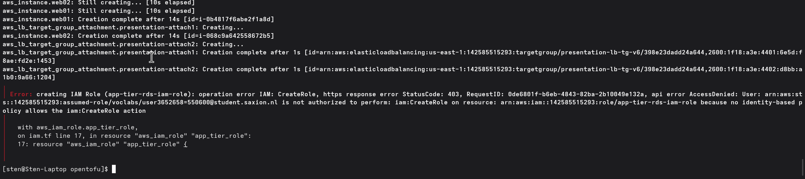

# Week 2

In de beginsituatie staat het databasewachtwoord van `cloudsecdb` in platte tekst in `user_data` van `app01` en `app02` (zichtbaar voor iedereen die EC2-instance-metadata van die VM kan lezen, en zichtbaar in het OpenTofu-bestand zelf). Ik beschrijf hoe ik dat zonder wachtwoord oplos met IAM-authenticatie (2.1), doe de AWS Academy-labstof (2.2), en schrijf een advies over least privilege en Entra ID (2.3).

## 2.1 IAM-authenticatie naar RDS in plaats van een wachtwoord

In de Learner Lab heb ik geen rechten om IAM-rollen/policies aan te maken (`iam:CreateRole`/`iam:CreatePolicy` staan niet toe op een studentenaccount). Ik kan de stappen dus wel voorbereiden, maar `tofu apply` eindigt met een rode `AccessDenied`. Dat is ook precies wat de opdracht vraagt: de stappen laten zien, ondanks de foutmelding. Wat wel/niet mag in de Lab: [setup/README.md](../setup/README.md#wat-welniet-mag-in-de-learner-lab).

Zo zou ik app01/app02 zonder wachtwoord bij de database laten komen:

1. **IAM-rol en policy** ([`opentofu/iam.tf`](../opentofu/iam.tf)): `app-tier-rds-iam-role`, met een policy die alleen `rds-db:connect` toestaat, afgebakend tot precies `app_iam_user` op deze ene RDS-instance. Faalt met `AccessDenied` bij `tofu apply`.
2. **Instance profile**: die rol zou ik koppelen via `iam_instance_profile`. In de praktijk draaien `app01`/`app02` nu met de voorgedefinieerde `LabInstanceProfile`, dat mag een student wel koppelen. Of de policy achter `LabRole` `rds-db:connect` toestaat kon ik niet checken: het policy-document zelf mag ik niet inzien.
3. **IAM-authenticatie aan op de RDS-instance**: `iam_database_authentication_enabled = true` in [`opentofu/rds-bootstrap/rds.tf`](../opentofu/rds-bootstrap/rds.tf).
4. **Databasegebruiker die IAM-tokens accepteert**, via SQL (geen OpenTofu-resource hiervoor binnen RDS):
   ```sql
   CREATE USER 'app_iam_user'@'%' IDENTIFIED WITH AWSAuthenticationPlugin AS 'RDS';
   GRANT SELECT, INSERT, UPDATE, DELETE ON cloudsecdb.* TO 'app_iam_user'@'%';
   ```
5. **De applicatie**: i.p.v. `SPRING_DATASOURCE_PASSWORD=password123` in `user_data` haalt de backend een token op met `aws rds generate-db-auth-token ...` (geldig 15 minuten, dus periodiek verversen) en gebruikt dat als wachtwoord. Spring Boot doet dit niet out-of-the-box; dat vraagt een kleine custom `DataSource` of een sidecar die het token ververst. Geen AWS-key of wachtwoord meer nodig in code, user-data of git.

Simpeler alternatief: wachtwoord laten staan maar uit OpenTofu/user-data halen, in **AWS Secrets Manager** met rotatie, app haalt het op via dezelfde instance profile. Minder native, wel sneller te bouwen.

De rode foutmelding bij `tofu apply`, precies wat gevraagd wordt:



## 2.2 AWS Academy Cloud Security Foundations: Lab 3.1 en Knowledge check

Dit moet ik zelf doen in de AWS Academy-leeromgeving; dat kan ik niet namens jou uitvoeren, dat is online door de docent te controleren.

**Bewijs:**
- **Module 3 Knowledge Check: 90/100**, zie het volledige cijferoverzicht bij week 7.4 ([`week-7/images/aws-academy-grades-overzicht.pdf`](../week-7/images/aws-academy-grades-overzicht.pdf)).
- **Lab 3.1 ("Using Resource-Based Policies to Secure an S3 Bucket") zelf doorlopen**: de policy die ik daarbij in de lab-omgeving heb aangemaakt/gebruikt staat in [`week-2/lab-3.1-developergrouppolicy.json`](lab-3.1-developergrouppolicy.json).

**Let op - bekende AWS Academy-eigenaardigheid:** het cijferoverzicht laat bij "Labs" standaard `- / 100` zien, ook nadat een lab echt is doorlopen. Dat is geen afwijking bij mij specifiek; de lab-omgeving (een aparte Vocareum-sandbox) en het Canvas-cijferboek syncen niet betrouwbaar met elkaar, iets wat ook bij andere studenten in deze module voorkomt. Het gedownloade policy-bestand hierboven is daarom het eigenlijke bewijs dat de lab is uitgevoerd, naast de wél correct geregistreerde Knowledge Check-score.

## 2.3 Advies: least privilege en Entra ID-federatie

**Least privilege.** Elke identiteit krijgt precies genoeg rechten voor zijn taak, niet meer. Geldt voor IAM net zo goed als voor de security groups uit week 1/3. Voor SaxIT concreet:

- Eigen smalle policy per rol i.p.v. één brede "PowerUser"-rol. Hier: `app-tier-rds-iam-role` mag alleen `rds-db:connect`, op één databasegebruiker.
- Rollen voor VM's/services i.p.v. lange-termijn access keys die in code terecht kunnen komen.
- Rechten die "om het werkend te krijgen" breed stonden (zoals nu het wachtwoord in `user_data`) achteraf versmallen, niet voor altijd zo laten staan.
- Voor het CMDB-systeem: elke klant mag alleen bij zijn eigen tenant-data. Dat is least privilege op applicatieniveau.

**Entra ID-federatie.** SaxIT gebruikt al Microsoft Entra ID. In plaats van losse IAM-gebruikers met eigen wachtwoorden zou ik Entra ID koppelen via **IAM Identity Center** (SAML 2.0) of directe OIDC/SAML-federatie naar IAM-rollen: een medewerker logt in met zijn Entra ID-account en krijgt via een gekoppelde groep tijdelijke AWS-credentials. Voordeel: één plek voor onboarding/offboarding (AWS-toegang vervalt automatisch met het Entra ID-account), MFA/conditional access werkt meteen door, geen losse IAM-wachtwoorden om bij te houden.

Bronnen: [AWS Well-Architected: Identity and access management](https://docs.aws.amazon.com/wellarchitected/latest/security-pillar/identity-and-access-management.html), [Principle of least privilege (Cloudflare)](https://www.cloudflare.com/learning/access-management/principle-of-least-privilege/), [IAM-authenticatie voor RDS](https://mafiaguy.medium.com/a-comprehensive-guide-to-iam-authentication-for-amazon-rds-instances-b1ac96c52233), [AWS IAM Identity Center: SAML/externe IdP](https://docs.aws.amazon.com/singlesignon/latest/userguide/what-is.html), [Microsoft Entra ID federatie met AWS](https://learn.microsoft.com/en-us/entra/identity/saas-apps/amazon-web-service-tutorial).
