# Week 3

Ik verscherp de security groups uit week 1 op twee niveaus (north-south en east-west), zet immutable infrastructure op met een pipeline, en schrijf een advies over infrastructure protection (3.4).

## 3.1 North-South segmentatie

North-South verkeer is verkeer dat de grens van mijn datacenter/VPC oversteekt: van buiten naar binnen en andersom. In de beginsituatie (week 1) stond de `applicationtier_sg` nog open voor de hele poortrange 80-9000 vanaf `0.0.0.0/0`, overgenomen uit de aangeleverde module-baseline, maar veel ruimer dan nodig. In [`opentofu/main.tf`](../opentofu/main.tf) heb ik dat vernauwd tot precies poort 8080:

```hcl
resource "aws_vpc_security_group_ingress_rule" "application_http_from_lb" {
  security_group_id            = aws_security_group.applicationtier_sg.id
  description                  = "HTTP 8080 ingress - alleen van de application load balancer"
  from_port                    = 8080
  to_port                      = 8080
  ip_protocol                  = "tcp"
  referenced_security_group_id = aws_security_group.applicationtier_sg.id
}
```

Een security-group-naar-security-group-regel in plaats van een CIDR-blok: zelfs als het IP-bereik ooit verandert, blijft de regel kloppen. Let op de zelf-referentie (`applicationtier_sg` naar `applicationtier_sg`, niet naar `presentationtier_sg`): `application-lb` zit zelf óók in `applicationtier_sg`, dus verkeer van de load balancer naar `app01`/`app02` heeft als bron-SG `applicationtier_sg`. Een regel die naar `presentationtier_sg` verwijst (wat ik er eerst per ongeluk in had staan) matcht dat verkeer nooit en blokkeert zo de load balancer's eigen health checks.

**Eerlijkheidshalve: deze regel alleen was niet genoeg.** De frontend (React, draait in de bezoekers-browser) roept `application-lb` rechtstreeks aan vanuit de browser (geen server-side proxy via `web01`/`web02`) - dus moet de load balancer zelf ook publiek bereikbaar zijn op 8080, niet alleen voor eigen health checks:

```hcl
resource "aws_vpc_security_group_ingress_rule" "application_http_public_ipv4" {
  security_group_id = aws_security_group.applicationtier_sg.id
  description        = "HTTP 8080 ingress (IPv4) - publiek, voor de frontend in de browser"
  from_port          = 8080
  to_port             = 8080
  ip_protocol         = "tcp"
  cidr_ipv4           = "0.0.0.0/0"
}
```

Dat is dus minder streng dan "alleen via de presentation tier" - een bewuste afweging die volgt uit hoe de applicatie zelf is gebouwd (directe browser-naar-API-calls), niet een gat dat ik over het hoofd heb gezien. North-South blijft wel degelijk verscherpt: van de oorspronkelijke 80-9000 naar precies 8080, en `app01`/`app02` hebben zelf geen publiek IP (zie week 1, 1.3) - alleen de load balancer is van buiten bereikbaar, nooit de instances direct.

Bewijs: een directe `curl` naar `app01` op 8080 (zonder de load balancer ertussen) vanaf mijn eigen laptop loopt gewoon vast op een timeout, want `app01` heeft geen publiek IP:

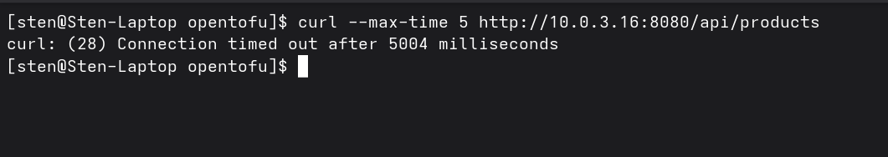

De applicatie werkt intussen gewoon via de load balancers (zie het bewijs in week 1, 1.1).

## 3.2 East-West segmentatie (microsegmentatie)

East-West verkeer is verkeer tussen servers onderling, binnen de infrastructuur. In de beginsituatie stond `rds_security_group` nog open voor MariaDB (3306) vanaf `0.0.0.0/0`, puur omdat de VPC-peering nog niet bestond toen `rds.tf` voor het eerst los gedraaid werd. Dat is nooit aangepast.

In [`opentofu/rds-bootstrap/rds.tf`](../opentofu/rds-bootstrap/rds.tf) heb ik dat beperkt tot alleen de twee applicationtier-subnets:

```hcl
ingress {
  description = "SQL ingress - alleen vanaf de applicationtier-subnets (east-west)"
  from_port   = 3306
  to_port     = 3306
  protocol    = "tcp"
  cidr_blocks = ["10.0.3.0/24", "10.0.4.0/24"]
}
```

Ik gebruik hier CIDR-blokken van de applicationtier-subnets in plaats van een verwijzing naar `applicationtier_sg` zelf: die security group staat in de andere, gepeerde VPC, en niet elke AWS-omgeving (zeker niet een Learner Lab) staat cross-VPC security-group-referenties via peering toe. Subnet-CIDR's zijn hier het betrouwbare alternatief en bereiken hetzelfde doel: alleen de app-servers mogen nog bij de database, de webservers (presentationtier) en de rest van het internet niet meer.

Bewijs, eerst de regel zelf in de AWS-console (`rds_security_group`, inbound rules): twee regels, allebei TCP 3306, bron `10.0.3.0/24` en `10.0.4.0/24` - exact de twee applicationtier-subnets, niets anders:

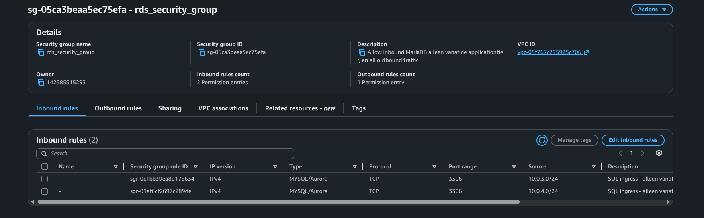

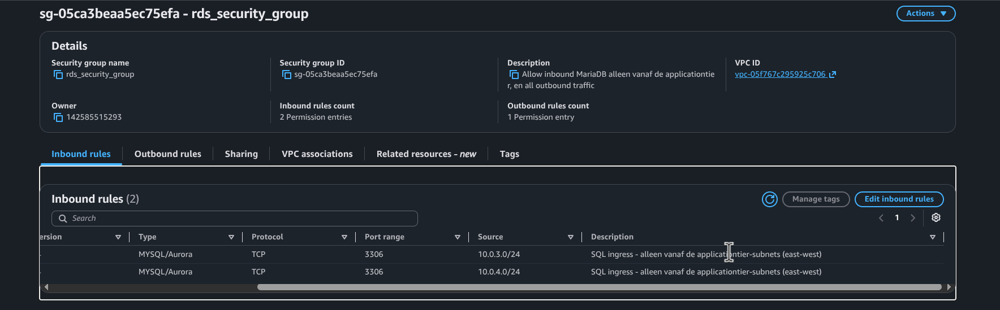

En dan de praktijktest: een TCP-verbinding naar de database, vanaf `app01` (applicationtier, moet lukken) versus vanaf `web01` (presentationtier, moet mislukken):

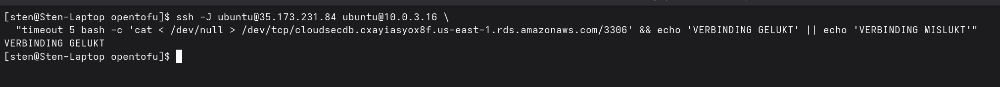

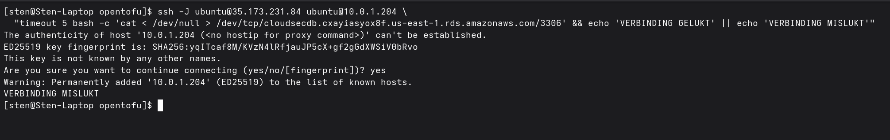

Beide tests gebruiken dezelfde, simpele raw-TCP-check (`/dev/tcp/<endpoint>/3306` in bash, geen database-client nodig) naar exact dezelfde hostnaam - het enige verschil is welke subnet de instance in zit, en dat is precies wat de security group afdwingt.

## 3.3 Immutable infrastructure via een pipeline

Ik heb [`.github/workflows/opentofu.yml`](../.github/workflows/opentofu.yml) toegevoegd: bij elke wijziging in `opentofu/*.tf` (dus `main.tf` en `bastion.tf`) draait de pipeline `tofu init`, `tofu plan`, en op `uitwerkingen` ook `tofu apply`. Op een pull request draait alleen `plan`, zodat een foute wijziging al opvalt vóór de merge, net als bij de applicatie-pipeline ([`build.yml`](../.github/workflows/build.yml)). De pipeline gebruikt OpenTofu (zie week 1), niet HashiCorp Terraform.

`opentofu/rds-bootstrap/` staat bewust buiten het werkpad van deze job (`working-directory: opentofu`, en OpenTofu leest alleen `.tf`-bestanden in die ene map, niet in submappen). Zo raakt de pipeline de RDS-instance nooit aan, precies de uitzondering die de opdracht vraagt.

```yaml
on:
  push:
    branches: [uitwerkingen]
    paths: ["opentofu/*.tf"]
  pull_request:
    paths: ["opentofu/*.tf"]

jobs:
  opentofu:
    defaults:
      run:
        working-directory: opentofu
    steps:
      - uses: actions/checkout@...
      - uses: aws-actions/configure-aws-credentials@...   # Learner Lab: tijdelijke sessie-credentials als secrets
      - uses: opentofu/setup-opentofu@...
      - run: tofu init -input=false -backend-config="bucket=${{ secrets.TF_STATE_BUCKET }}"
      - run: tofu plan -input=false
      - run: tofu apply -input=false -auto-approve
        if: github.ref == 'refs/heads/uitwerkingen'
```

**Een echte bug, gevonden tijdens de eerste live run.** De `bucket` voor de S3-backend staat expres niet in `main.tf` zelf (dat zou mijn account-ID in de publieke repo zetten, zie het commentaar daar) en komt lokaal uit het gitignored `backend.hcl`. De pipeline had die waarde dus helemaal niet, en zonder `-backend-config`/`-input=false` op de `init`-stap vraagt OpenTofu interactief om de bucketnaam - een prompt die in CI (geen tty) nooit beantwoord wordt. De job bleef daardoor gewoon oneindig hangen op "Run tofu init" in plaats van een duidelijke fout te geven:

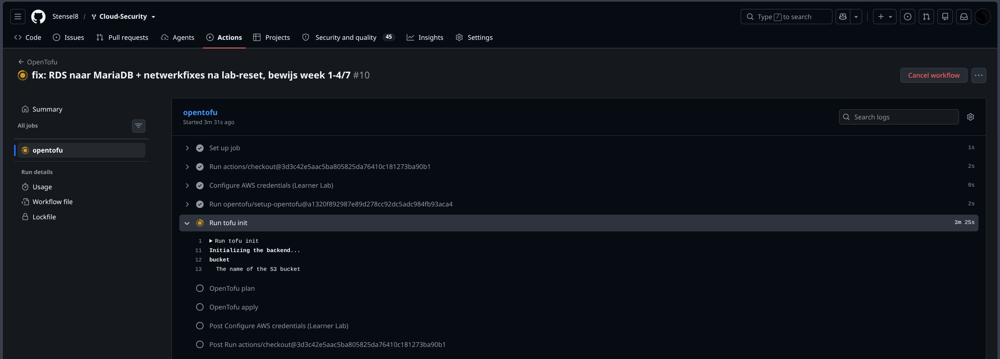

Fix: de bucketnaam als extra secret (`TF_STATE_BUCKET`) meegeven aan `-backend-config`, en `-input=false` toevoegen aan `tofu init` zodat een ontbrekende waarde voortaan een duidelijke fout geeft in plaats van een stille hang.

**Dezelfde soort fout, nog twee keer.** Na deze fix kwam `tofu init` wél doorheen, maar `tofu plan` faalde alsnog: `lab_profile`, `sshkey` en `my_ip` staan alleen in het gitignored `terraform.tfvars`, dus had de pipeline die nooit. `lab_profile` wordt bovendien rechtstreeks gebruikt in de AWS-provider (`profile = var.lab_profile`) - in CI bestaat er helemaal geen named profile (alleen de credentials uit de `configure-aws-credentials`-stap), dus die kon sowieso nooit werken. Fix in [`opentofu/variables.tf`](../opentofu/variables.tf): `lab_profile` krijgt `default = null`, zodat de AWS-provider in CI gewoon de normale credential-chain gebruikt.

Voor `sshkey`, `my_ip`, en de drie rds-bootstrap-waardes (`db_vpc_id`, `db_route_table_id`, `rds_endpoint`) ligt het anders: die heeft `main.tf` echt nodig om te weten met welke al-bestaande resources (keypair, database-VPC) het moet werken - zie de toelichting daarover verderop in dit document. Een lege/foute waarde zou de pipeline niet laten hangen, maar zou een *geslaagde* apply met kapotte peering/connection-strings opleveren, tegen de live omgeving aan. Daarom staan die vijf nu als secrets, als `TF_VAR_*`-omgevingsvariabelen op het hele job (OpenTofu pikt die automatisch op), met exact dezelfde waardes als in mijn eigen `terraform.tfvars`:

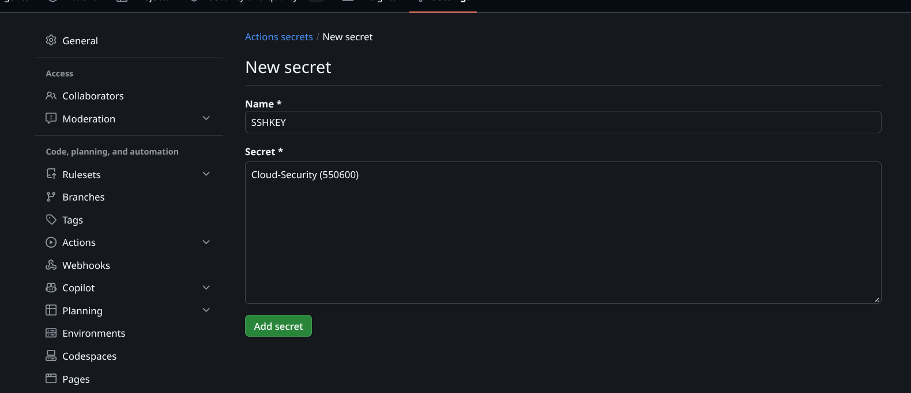

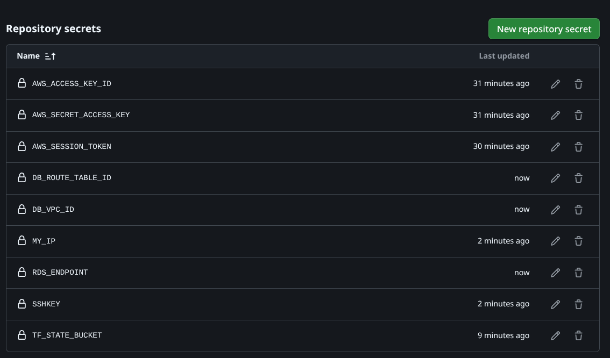

Een belangrijke beperking van een AWS Academy Learner Lab: de credentials zijn tijdelijk en verlopen na een paar uur. Dat betekent dat `AWS_ACCESS_KEY_ID`, `AWS_SECRET_ACCESS_KEY` en `AWS_SESSION_TOKEN` in de GitHub secrets ververst moeten worden telkens als ik een nieuwe labsessie start. In een echte productieomgeving zou dit met rollen en kortlevende, automatisch ververste credentials lopen (zie ook mijn advies in 3.4 en in week 2.3).

De vier secrets staan inmiddels in de repository (Settings → Secrets and variables → Actions). GitHub laat de waarde van een secret normaal nooit meer zien nadat je hem hebt opgeslagen, alleen de naam en wanneer hij voor het laatst is bijgewerkt:

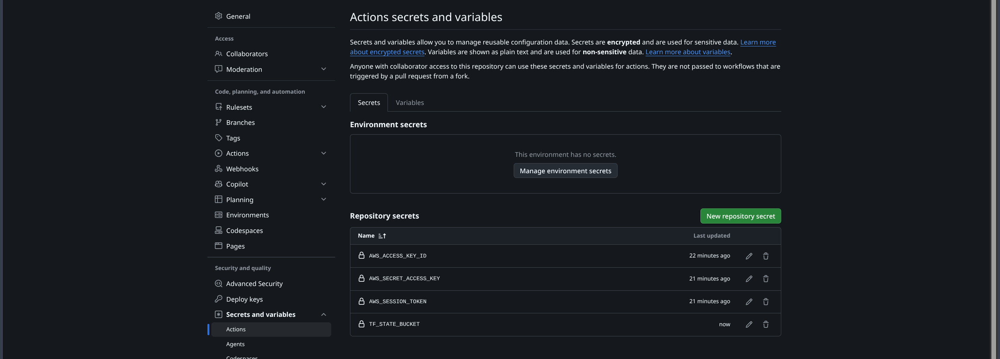

Voor `TF_STATE_BUCKET` laat ik hieronder, bewust en eenmalig, ook het invoermoment zien (vóór het opslaan, dus mét de waarde). Normaal zou ik dat niet doen, maar dit is geen gevoelige waarde zoals een wachtwoord of toegangssleutel - gewoon een bucketnaam - en zo kan de docent controleren dat ik hier echt de juiste waarde heb ingevuld, in plaats van op mijn woord te moeten vertrouwen:

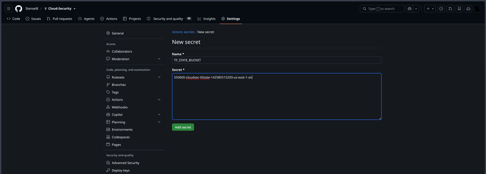

**En toen werkte de pipeline-mechaniek eindelijk - en raakte meteen de bekende IAM-beperking.** Met alle bovenstaande fixes erin slaagt `tofu plan` volledig (3 to add: precies de IAM-rol/policy/instance-profile uit week 2.1), en breekt `tofu apply` op exact dezelfde bewuste `iam:CreateRole`-AccessDenied die we al de hele module tegenkomen - niet een pipeline-bug, maar hetzelfde verwachte resultaat als elke lokale apply:

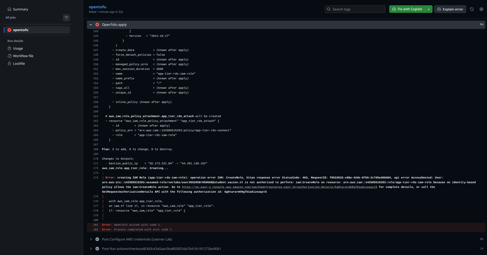

Ik heb de `apply`-stap daarom `continue-on-error: true` gegeven: deze ene, bewuste fout mag de hele job niet rood laten uitslaan, want dat zou precies het punt verbergen dat de opdracht wil laten zien (zie week-2/README.md, 2.1).

**Nog te doen (bewijs):** een screenshot van de daardoor geslaagde run op `uitwerkingen`, en van een plan-only run op een pull request die laat zien dat er niet automatisch wordt toegepast.

## 3.4 Advies: infrastructure protection voor SaxIT

Infrastructure protection draait om het beschermen van alles onder de applicatielaag: het netwerk, de compute-instances en hoe die met elkaar en met de buitenwereld mogen praten. Voor SaxIT's 3-tier omgeving bestaat dat uit een paar onderdelen die ik in deze en vorige weken ook daadwerkelijk heb toegepast:

**Micro segmentatie en East-West.** Verkeer tússen servers onderling, van de applicationtier naar de database bijvoorbeeld, hoort net zo streng behandeld te worden als verkeer van buitenaf. In de beginsituatie kon elke machine ter wereld rechtstreeks bij de database (3.2), wat betekent dat één gecompromitteerde server waar dan ook op internet potentieel bij klantgegevens kon. Door `rds_security_group` te beperken tot alleen de applicationtier-subnets, kan zelfs een gehackte `web01` niet meer rechtstreeks bij de database.

**North-South.** Verkeer van en naar het publieke internet moet door een smalle, voorspelbare trechter. Door de applicationtier alleen nog bereikbaar te maken via de presentation-load-balancer (3.1) en SSH alleen via de bastion host (week 1, 1.3), is er nog maar een handvol plekken waar SaxIT normaal en afwijkend verkeer van elkaar hoeft te onderscheiden, in plaats van op elke server apart.

**Immutable infrastructure.** Door de infrastructuur als code te beschrijven en bij elke wijziging automatisch opnieuw uit te rollen (3.3), voorkom ik "configuration drift": handmatige aanpassingen die iemand ooit op een server maakte en die nergens staan vastgelegd. Een gecompromitteerde of verkeerd geconfigureerde server vervang ik door opnieuw te deployen, in plaats van er met SSH doorheen te gaan spitten en te hopen dat ik alles terugvind. Dat is ook meteen een stuk sneller bij een incident (zie week 5).

**Network automation.** Omdat dit alles in OpenTofu staat, is elke security-group-regel en elke subnet-indeling reviewbaar in een pull request, getest in een pipeline, en consistent tussen omgevingen. Een handmatige wijziging in de AWS-console die "even snel" een poort openzet, overleeft de volgende `tofu apply` niet. De code is de waarheid, niet de console.

Mijn advies aan SaxIT: pas deze vier principes niet alleen toe op deze proefopstelling, maar maak ze onderdeel van hoe elke nieuwe omgeving wordt opgezet. Begin met het netwerk in lagen (micro segmentatie), trechter al het north-south verkeer door een klein aantal bewaakte punten (load balancer, bastion host), en leg de hele infrastructuur vast als code zodat niemand meer handmatig aan de productieomgeving hoeft te zitten.

Bronnen: [AWS Well-Architected: Infrastructure protection](https://docs.aws.amazon.com/wellarchitected/latest/security-pillar/infrastructure-protection.html), [Network segmentation (Zscaler)](https://www.zscaler.com/resources/security-terms-glossary/what-is-network-segmentation), [Network automation met IaC (AWS)](https://docs.aws.amazon.com/wellarchitected/latest/security-pillar/sec_network_auto_protect.html), [Immutable infrastructure (DigitalOcean)](https://www.digitalocean.com/community/tutorials/what-is-immutable-infrastructure).
