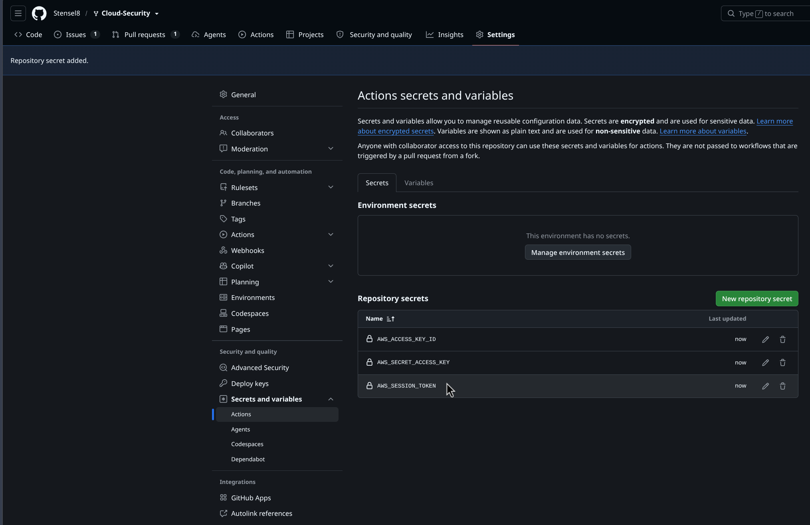

# Week 3

Ik verscherp de security groups uit week 1 op twee niveaus (north-south en east-west), zet immutable infrastructure op met een pipeline, en schrijf een advies over infrastructure protection (3.4).

> **Status:** net als week 1 staat dit nog "in klad": de OpenTofu-wijzigingen staan in de code, maar zijn nog niet toegepast in het Learner Lab. **Nog te doen (bewijs):**-regels markeren wat ik nog moet aantonen.

## 3.1 North-South segmentatie

North-South verkeer is verkeer dat de grens van mijn datacenter/VPC oversteekt: van buiten naar binnen en andersom. In de beginsituatie (week 1) stond de `applicationtier_sg` nog open voor de hele poortrange 80-9000 vanaf `0.0.0.0/0`, overgenomen uit de aangeleverde module-baseline, maar veel ruimer dan nodig. De applicatie heeft alleen poort 8080 nodig, en alleen de presentation-load-balancer praat met de applicationtier, nooit het publieke internet rechtstreeks.

In [`opentofu/main.tf`](../opentofu/main.tf) heb ik dat vernauwd tot precies dat:

```hcl
ingress {
  description     = "HTTP 8080 ingress - alleen vanaf de presentation tier"
  from_port       = 8080
  to_port         = 8080
  protocol        = "tcp"
  security_groups = [aws_security_group.presentationtier_sg.id]
}
```

Een security-group-naar-security-group-regel in plaats van een CIDR-blok: zelfs als het IP-bereik van de presentationtier ooit verandert, blijft de regel kloppen, want hij volgt de security group, niet een IP-reeks.

**Nog te doen (bewijs):** `tofu apply` met deze wijziging, daarna aantonen dat de applicatie nog steeds werkt via de presentation-load-balancer (zelfde test als in week 1), en dat een directe `curl` naar `app01:8080` vanaf buiten de `presentationtier_sg` nu wordt geweigerd.

## 3.2 East-West segmentatie (microsegmentatie)

East-West verkeer is verkeer tussen servers onderling, binnen de infrastructuur. In de beginsituatie stond `rds_security_group` nog open voor MySQL (3306) vanaf `0.0.0.0/0`, puur omdat de VPC-peering nog niet bestond toen `rds.tf` voor het eerst los gedraaid werd. Dat is nooit aangepast.

In [`opentofu/rds-bootstrap/rds.tf`](../opentofu/rds-bootstrap/rds.tf) heb ik dat beperkt tot alleen de twee applicationtier-subnets:

```hcl
ingress {
  description = "SQL ingress - alleen vanaf de applicationtier-subnets (east-west)"
  from_port   = 3306
  to_port     = 3306
  protocol    = "tcp"
  cidr_blocks = ["10.0.3.0/24", "10.0.4.0/24"]
}
```

Ik gebruik hier CIDR-blokken van de applicationtier-subnets in plaats van een verwijzing naar `applicationtier_sg` zelf: die security group staat in de andere, gepeerde VPC, en niet elke AWS-omgeving (zeker niet een Learner Lab) staat cross-VPC security-group-referenties via peering toe. Subnet-CIDR's zijn hier het betrouwbare alternatief en bereiken hetzelfde doel: alleen de app-servers mogen nog bij de database, de webservers (presentationtier) en de rest van het internet niet meer.

**Nog te doen (bewijs):** opnieuw `tofu apply`, en aantonen (bijvoorbeeld met `mysql -h <rds-endpoint>` vanaf `app01` versus vanaf `web01`) dat alleen de applicationtier nog bij de database kan.

## 3.3 Immutable infrastructure via een pipeline

Ik heb [`.github/workflows/opentofu.yml`](../.github/workflows/opentofu.yml) toegevoegd: bij elke wijziging in `opentofu/*.tf` (dus `main.tf` en `bastion.tf`) draait de pipeline `tofu init`, `tofu plan`, en op `uitwerkingen` ook `tofu apply`. Op een pull request draait alleen `plan`, zodat een foute wijziging al opvalt vóór de merge, net als bij de applicatie-pipeline ([`build.yml`](../.github/workflows/build.yml)). De pipeline gebruikt OpenTofu (zie week 1), niet HashiCorp Terraform.

`opentofu/rds-bootstrap/` staat bewust buiten het werkpad van deze job (`working-directory: opentofu`, en OpenTofu leest alleen `.tf`-bestanden in die ene map, niet in submappen). Zo raakt de pipeline de RDS-instance nooit aan, precies de uitzondering die de opdracht vraagt.

```yaml
on:
  push:
    branches: [uitwerkingen]
    paths: ["opentofu/*.tf"]
  pull_request:
    paths: ["opentofu/*.tf"]

jobs:
  opentofu:
    defaults:
      run:
        working-directory: opentofu
    steps:
      - uses: actions/checkout@...
      - uses: aws-actions/configure-aws-credentials@...   # Learner Lab: tijdelijke sessie-credentials als secrets
      - uses: opentofu/setup-opentofu@...
      - run: tofu init
      - run: tofu plan -input=false
      - run: tofu apply -input=false -auto-approve
        if: github.ref == 'refs/heads/uitwerkingen'
```

Een belangrijke beperking van een AWS Academy Learner Lab: de credentials zijn tijdelijk en verlopen na een paar uur. Dat betekent dat `AWS_ACCESS_KEY_ID`, `AWS_SECRET_ACCESS_KEY` en `AWS_SESSION_TOKEN` in de GitHub secrets ververst moeten worden telkens als ik een nieuwe labsessie start. In een echte productieomgeving zou dit met rollen en kortlevende, automatisch ververste credentials lopen (zie ook mijn advies in 3.4 en in week 2.3).

De drie secrets staan inmiddels in de repository (Settings → Secrets and variables → Actions). GitHub laat de waarde van een secret nooit meer zien nadat je hem hebt opgeslagen, alleen de naam en wanneer hij voor het laatst is bijgewerkt — dus deze screenshot verraadt niks, alleen dát ze er zijn:



**Nog te doen (bewijs):** een commit die een kleine wijziging in `opentofu/main.tf` maakt, een screenshot van de geslaagde pipeline-run, en een `tofu plan` op een pull request die laat zien dat er niet automatisch wordt toegepast.

## 3.4 Advies: infrastructure protection voor SaxIT

Infrastructure protection draait om het beschermen van alles onder de applicatielaag: het netwerk, de compute-instances en hoe die met elkaar en met de buitenwereld mogen praten. Voor SaxIT's 3-tier omgeving bestaat dat uit een paar onderdelen die ik in deze en vorige weken ook daadwerkelijk heb toegepast:

**Micro segmentatie en East-West.** Verkeer tússen servers onderling, van de applicationtier naar de database bijvoorbeeld, hoort net zo streng behandeld te worden als verkeer van buitenaf. In de beginsituatie kon elke machine ter wereld rechtstreeks bij de database (3.2), wat betekent dat één gecompromitteerde server waar dan ook op internet potentieel bij klantgegevens kon. Door `rds_security_group` te beperken tot alleen de applicationtier-subnets, kan zelfs een gehackte `web01` niet meer rechtstreeks bij de database.

**North-South.** Verkeer van en naar het publieke internet moet door een smalle, voorspelbare trechter. Door de applicationtier alleen nog bereikbaar te maken via de presentation-load-balancer (3.1) en SSH alleen via de bastion host (week 1, 1.3), is er nog maar een handvol plekken waar SaxIT normaal en afwijkend verkeer van elkaar hoeft te onderscheiden, in plaats van op elke server apart.

**Immutable infrastructure.** Door de infrastructuur als code te beschrijven en bij elke wijziging automatisch opnieuw uit te rollen (3.3), voorkom ik "configuration drift": handmatige aanpassingen die iemand ooit op een server maakte en die nergens staan vastgelegd. Een gecompromitteerde of verkeerd geconfigureerde server vervang ik door opnieuw te deployen, in plaats van er met SSH doorheen te gaan spitten en te hopen dat ik alles terugvind. Dat is ook meteen een stuk sneller bij een incident (zie week 5).

**Network automation.** Omdat dit alles in OpenTofu staat, is elke security-group-regel en elke subnet-indeling reviewbaar in een pull request, getest in een pipeline, en consistent tussen omgevingen. Een handmatige wijziging in de AWS-console die "even snel" een poort openzet, overleeft de volgende `tofu apply` niet. De code is de waarheid, niet de console.

Mijn advies aan SaxIT: pas deze vier principes niet alleen toe op deze proefopstelling, maar maak ze onderdeel van hoe elke nieuwe omgeving wordt opgezet. Begin met het netwerk in lagen (micro segmentatie), trechter al het north-south verkeer door een klein aantal bewaakte punten (load balancer, bastion host), en leg de hele infrastructuur vast als code zodat niemand meer handmatig aan de productieomgeving hoeft te zitten.

Bronnen: [AWS Well-Architected: Infrastructure protection](https://docs.aws.amazon.com/wellarchitected/latest/security-pillar/infrastructure-protection.html), [Network segmentation (Zscaler)](https://www.zscaler.com/resources/security-terms-glossary/what-is-network-segmentation), [Network automation met IaC (AWS)](https://docs.aws.amazon.com/wellarchitected/latest/security-pillar/sec_network_auto_protect.html), [Immutable infrastructure (DigitalOcean)](https://www.digitalocean.com/community/tutorials/what-is-immutable-infrastructure).
