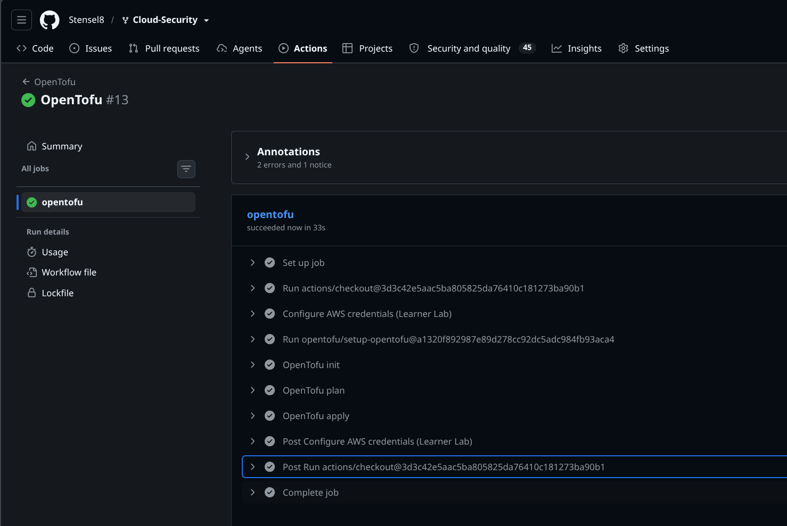
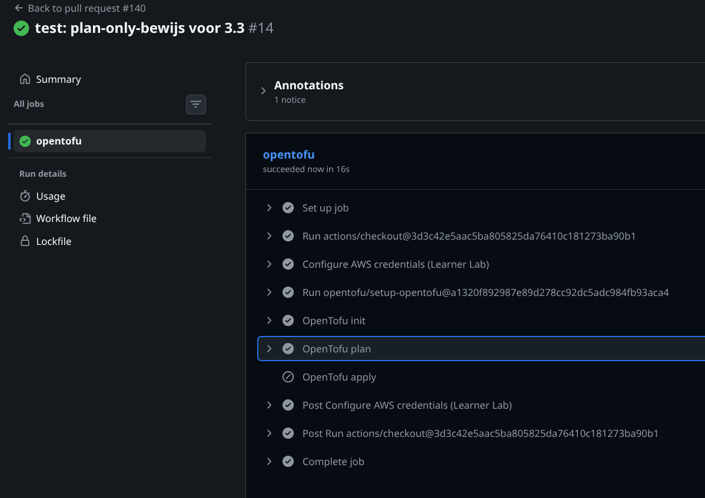

# Week 3

Ik verscherp de security groups uit week 1 op twee niveaus (north-south en east-west), zet immutable infrastructure op met een pipeline, en schrijf een advies over infrastructure protection (3.4).

## 3.1 North-South segmentatie

North-South is verkeer dat de VPC-grens oversteekt. In de beginsituatie stond `applicationtier_sg` open voor poortrange 80-9000 vanaf `0.0.0.0/0` (module-baseline, veel te ruim). Vernauwd tot poort 8080 in [`opentofu/main.tf`](../opentofu/main.tf):

```hcl
resource "aws_vpc_security_group_ingress_rule" "application_http_from_lb" {
  security_group_id            = aws_security_group.applicationtier_sg.id
  description                  = "HTTP 8080 ingress - alleen van de application load balancer"
  from_port                    = 8080
  to_port                      = 8080
  ip_protocol                  = "tcp"
  referenced_security_group_id = aws_security_group.applicationtier_sg.id
}
```

Security-group-naar-security-group i.p.v. een CIDR-blok, zodat de regel blijft kloppen als het IP-bereik verandert. Let op de zelf-referentie: `application-lb` zit zélf ook in `applicationtier_sg`, dus verkeer van de load balancer naar `app01`/`app02` heeft `applicationtier_sg` als bron. Had ik hier per ongeluk `presentationtier_sg` neergezet (eerste poging), dan matchen de load balancer's eigen health checks nooit.

**Deze regel alleen was niet genoeg.** De React-frontend roept `application-lb` rechtstreeks aan vanuit de browser, geen server-side proxy. Dus moet de load balancer ook gewoon publiek bereikbaar zijn op 8080:

```hcl
resource "aws_vpc_security_group_ingress_rule" "application_http_public_ipv4" {
  security_group_id = aws_security_group.applicationtier_sg.id
  description        = "HTTP 8080 ingress (IPv4) - publiek, voor de frontend in de browser"
  from_port          = 8080
  to_port             = 8080
  ip_protocol         = "tcp"
  cidr_ipv4           = "0.0.0.0/0"
}
```

Minder streng dan "alleen via presentation tier", maar een bewuste keuze. Volgt uit hoe de app is gebouwd, geen gat dat ik over het hoofd zag. North-South is nog steeds verscherpt: van 80-9000 naar precies 8080, en `app01`/`app02` hebben zelf geen publiek IP (zie 1.3). Alleen de load balancer is van buiten bereikbaar.

Bewijs: directe `curl` naar `app01:8080`, zonder load balancer ertussen, loopt vast op een timeout:


De applicatie werkt gewoon via de load balancers (bewijs in 1.1).

## 3.2 East-West segmentatie (microsegmentatie)

East-West is verkeer tussen servers onderling. `rds_security_group` stond open voor MariaDB (3306) vanaf `0.0.0.0/0`, een restant van toen `rds.tf` nog los draaide zonder VPC-peering, nooit aangepast. Beperkt tot de twee applicationtier-subnets in [`opentofu/rds-bootstrap/rds.tf`](../opentofu/rds-bootstrap/rds.tf):

```hcl
ingress {
  description = "SQL ingress - alleen vanaf de applicationtier-subnets (east-west)"
  from_port   = 3306
  to_port     = 3306
  protocol    = "tcp"
  cidr_blocks = ["10.0.3.0/24", "10.0.4.0/24"]
}
```

CIDR-blokken i.p.v. een verwijzing naar `applicationtier_sg` zelf: die SG zit in de andere, gepeerde VPC, en cross-VPC SG-referenties via peering werken niet betrouwbaar in een Learner Lab. Subnet-CIDR's bereiken hetzelfde, alleen de app-servers mogen nog bij de database.

Bewijs, eerst de regel in de console (`rds_security_group`, inbound): twee regels, TCP 3306, bron `10.0.3.0/24` en `10.0.4.0/24`:


Praktijktest: TCP-verbinding naar de database vanaf `app01` (moet lukken) versus `web01` (moet mislukken):


Zelfde raw-TCP-check (`/dev/tcp/<endpoint>/3306`), zelfde hostnaam. Enige verschil is het subnet, en dat is precies wat de security group afdwingt.

## 3.3 Immutable infrastructure via een pipeline

[`.github/workflows/opentofu.yml`](../.github/workflows/opentofu.yml): bij elke wijziging in `opentofu/*.tf` draait `tofu init` + `tofu plan`, en op `uitwerkingen` ook `tofu apply`. Op een pull request alleen `plan` (zelfde patroon als [`build.yml`](../.github/workflows/build.yml)).

`opentofu/rds-bootstrap/` zit buiten het werkpad (`working-directory: opentofu`, OpenTofu leest geen submappen). De pipeline raakt de RDS-instance dus nooit.

```yaml
on:
  push:
    branches: [uitwerkingen]
    paths: ["opentofu/*.tf"]
  pull_request:
    paths: ["opentofu/*.tf"]

jobs:
  opentofu:
    defaults:
      run:
        working-directory: opentofu
    steps:
      - uses: actions/checkout@...
      - uses: aws-actions/configure-aws-credentials@...   # Learner Lab: tijdelijke sessie-credentials als secrets
      - uses: opentofu/setup-opentofu@...
      - run: tofu init -input=false -backend-config="bucket=${{ secrets.TF_STATE_BUCKET }}"
      - run: tofu plan -input=false
      - run: tofu apply -input=false -auto-approve
        if: github.ref == 'refs/heads/uitwerkingen'
```

**Bug #1, eerste live run.** De S3-backend-bucket staat expres niet in `main.tf` (zou mijn account-ID in de publieke repo zetten) en komt lokaal uit gitignored `backend.hcl`. De pipeline had die waarde niet, en zonder `-backend-config`/`-input=false` vraagt OpenTofu interactief om de bucketnaam, een prompt die in CI nooit beantwoord wordt. Job bleef oneindig hangen op "Run tofu init":


Fix: bucketnaam als secret (`TF_STATE_BUCKET`) naar `-backend-config`, plus `-input=false`.

**Bug #2.** `tofu init` kwam nu door, maar `tofu plan` faalde: `lab_profile`, `sshkey`, `my_ip` staan alleen in gitignored `terraform.tfvars`. `lab_profile` wordt ook rechtstreeks gebruikt in de AWS-provider (`profile = var.lab_profile`), en in CI bestaat geen named profile, dus dat kon nooit werken. Fix in [`opentofu/variables.tf`](../opentofu/variables.tf): `lab_profile` krijgt `default = null`, provider valt terug op de normale credential-chain.

`sshkey`, `my_ip` en de drie rds-bootstrap-waardes (`db_vpc_id`, `db_route_table_id`, `rds_endpoint`) heeft `main.tf` wél echt nodig om met bestaande resources te matchen. Fout hierin laat de pipeline niet hangen maar geeft een *geslaagde* apply met kapotte peering tegen de live omgeving. Daarom staan die vijf als secrets, als `TF_VAR_*` op het hele job, met dezelfde waardes als mijn eigen `terraform.tfvars`:


Learner Lab-credentials zijn tijdelijk en verlopen na een paar uur, dus `AWS_ACCESS_KEY_ID`/`SECRET`/`SESSION_TOKEN` moeten ververst worden bij elke nieuwe labsessie. In productie zou dit met rollen en automatisch ververste credentials lopen (zie 3.4 en week 2.3).

De secrets staan in Settings → Secrets and variables → Actions. GitHub toont een waarde nooit meer terug na opslaan:


Voor `TF_STATE_BUCKET` laat ik eenmalig ook het invoermoment zien. Geen gevoelige waarde, gewoon een bucketnaam, zodat te checken is dat ik 'm goed invulde:


**Pipeline werkt, en raakt meteen de bekende IAM-beperking.** `tofu plan` slaagt volledig (3 to add: de IAM-rol/policy/instance-profile uit 2.1), `tofu apply` breekt op dezelfde `iam:CreateRole`-AccessDenied die we al de hele module tegenkomen. Geen pipeline-bug, hetzelfde verwachte resultaat als elke lokale apply:


`apply` kreeg `continue-on-error: true`: deze ene, bewuste fout mag de job niet rood laten uitslaan, dat zou het punt verbergen dat 2.1 net laat zien.

Met `continue-on-error` staat de run groen:



PR #140 bewijst het plan-only-gedrag: `OpenTofu apply` staat daar op "skipped", alleen `init`/`plan` draaiden.



Run: https://github.com/Stensel8/Cloud-Security/actions/runs/41314490078 (apply-stap: skipped)

## 3.4 Advies: infrastructure protection voor SaxIT

Infrastructure protection gaat over alles onder de applicatielaag: netwerk, compute, en hoe die met elkaar en de buitenwereld praten. Wat ik hier al toepas:

- Micro segmentatie/East-West: `rds_security_group` beperkt tot de applicationtier-subnets (3.2), een gehackte `web01` kan niet meer rechtstreeks bij de database.
- North-South: applicationtier alleen via de load balancer (3.1), SSH alleen via de bastion (1.3), een handvol bewaakte punten in plaats van elke server apart.
- Immutable infrastructure: infra als code, automatisch opnieuw uitgerold bij elke wijziging (3.3). Voorkomt configuration drift, en een gecompromitteerde server vervang ik door opnieuw te deployen in plaats van erin te spitten (sneller bij een incident, zie week 5).
- Network automation: alles in OpenTofu, dus reviewbaar in een PR en getest in een pipeline. Een handmatige poort-wijziging in de console overleeft de volgende `tofu apply` niet.

Advies: maak deze vier principes onderdeel van hoe elke nieuwe omgeving wordt opgezet, niet iets eenmaligs voor deze proefopstelling.

Bronnen: [AWS Well-Architected: Infrastructure protection](https://docs.aws.amazon.com/wellarchitected/latest/security-pillar/infrastructure-protection.html), [Network segmentation (Zscaler)](https://www.zscaler.com/resources/security-terms-glossary/what-is-network-segmentation), [Network automation met IaC (AWS)](https://docs.aws.amazon.com/wellarchitected/latest/security-pillar/sec_network_auto_protect.html), [Immutable infrastructure (DigitalOcean)](https://www.digitalocean.com/community/tutorials/what-is-immutable-infrastructure).
