# Week 4

Dataclassificatie en S3-buckets per classificatie (4.1–4.2), een eigen (BYOK) KMS-sleutel voor de geheime bucket (4.3), logging en alerting op die bucket (4.4), de AWS Academy-labstof (4.5), en een advies over AVG en encryptie (4.6).

## 4.1 Dataclassificatie

| Classificatie | Voorbeelden | Motivatie |
| --- | --- | --- |
| **Openbaar** | Persberichten, marketingmateriaal | Mag naar buiten, geen schade bij lekken, wel integriteit bewaken |
| **Intern** | Personeelsplanning, interne processen | Niet voor klanten/publiek, lek is geen ramp maar wel reputatieschade |
| **Geheim** | Klantgegevens CMDB, inloggegevens, persoonsgegevens | Valt onder de AVG (7.3), lek = meldingsplichtig datalek |

Nederlandse namen blijven de officiële termen, AWS-resources (bucketnamen, tags) zijn Engels: **Openbaar → `public`**, **Intern → `internal`**, **Geheim → `confidential`**.

Maatregelen per categorie:

| Maatregel | Openbaar | Intern | Geheim |
| --- | --- | --- | --- |
| Encryptie in transit | HTTPS aanbevolen | HTTPS verplicht | HTTPS verplicht, alleen interne routes |
| Encryptie at rest | SSE-S3 | SSE-S3 | SSE-KMS met eigen BYOK-sleutel (4.3) |
| IAM | Read voor hele org | Read/write medewerkers | Alleen specifieke rollen, least privilege (week 2) |
| Logging | CloudTrail management events | + CloudWatch-metrics | CloudTrail data events + EventBridge-alert per download (4.4) |
| DLP | Niet nodig | Macie periodiek (6.2) | Macie structureel + tag-policy die verkeerde uploads blokkeert (4.2) |

## 4.2 Drie buckets, één per classificatie

**Waarom een bash-script en geen OpenTofu.** Stond eerst als `aws_s3_bucket`-resources in `opentofu/data-protection.tf`. Die resource leest ook altijd de object lock-configuratie uit, en die leesactie is in de Learner Lab geblokkeerd door een org-brede Service Control Policy — niet op te lossen met IAM-rechten op mijn eigen rol. Bucket wordt wel aangemaakt, maar OpenTofu markeert 'm "tainted" en elke volgende `apply` loopt tegen dezelfde fout. Resultaat: oneindige lus (zie [setup/README.md](../setup/README.md#wat-welniet-mag-in-de-learner-lab) voor hoe het via OpenTofu wél lukt).

`aws s3api create-bucket` doet die leesactie niet, dus staat dit nu in [`week-4/scripts/data-protection-setup.sh`](scripts/data-protection-setup.sh), idempotent (opnieuw draaien hergebruikt bestaande resources). Alleen de BYOK KMS-sleutel (4.3, geen last van dit probleem) blijft in [`opentofu/data-protection.tf`](../opentofu/data-protection.tf), met een vaste alias (`alias/saxit-confidential-byok`) zodat het script 'm kan opzoeken. Draaien:

```bash
./week-4/scripts/data-protection-setup.sh <unieke-suffix> <mailadres-voor-de-alert>
```

Het script zet per classificatiebucket (`saxit-data-public-*`, `saxit-data-internal-*`, `saxit-data-confidential-*`):

- **Standaardencryptie verplicht**: SSE-S3 voor public/internal, SSE-KMS met de sleutel uit 4.3 voor confidential.
- **Bucket policy** die alleen HTTPS toestaat, uploads zonder juiste `x-amz-server-side-encryption`-header weigert, en uploads zonder de bij déze bucket horende `classification`-tag weigert. Zo belandt een confidential bestand nooit per ongeluk als "public" getagd in de verkeerde bucket.
- **Block Public Access volledig aan** — "public" betekent hier intern leesbaar voor de hele organisatie, geen publiek-op-internet bucket.

```bash
{"Sid":"DenyWrongClassificationTag","Effect":"Deny","Principal":"*","Action":"s3:PutObject","Resource":"$arn/*","Condition":{"StringNotEquals":{"s3:RequestObjectTag/classification":"$classification"}}}
```

Demobestanden in [`demo-files/`](demo-files/) ([`public-press-release.txt`](demo-files/public-press-release.txt), [`internal-staff-planning.txt`](demo-files/internal-staff-planning.txt), [`confidential-customer-data.txt`](demo-files/confidential-customer-data.txt), allemaal nepdata). Upload met de bijbehorende tag:

```bash
aws s3api put-object --bucket saxit-data-public-<suffix> --key public-press-release.txt \
  --body demo-files/public-press-release.txt --tagging "classification=public" --server-side-encryption AES256

aws s3api put-object --bucket saxit-data-confidential-<suffix> --key confidential-customer-data.txt \
  --body demo-files/confidential-customer-data.txt --tagging "classification=confidential" --server-side-encryption aws:kms --ssekms-key-id <kms-key-id>
```

Een gebruiker beperken tot bepaalde buckets gaat via een IAM-policy met specifieke bucket-ARN's als `Resource` i.p.v. `*` — zelfde principe als de RDS-rol in 2.1. Kan ik hier niet aantonen (zelfde IAM-beperking), maar het idee is identiek.

Script gedraaid:

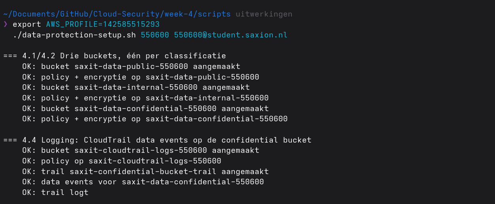

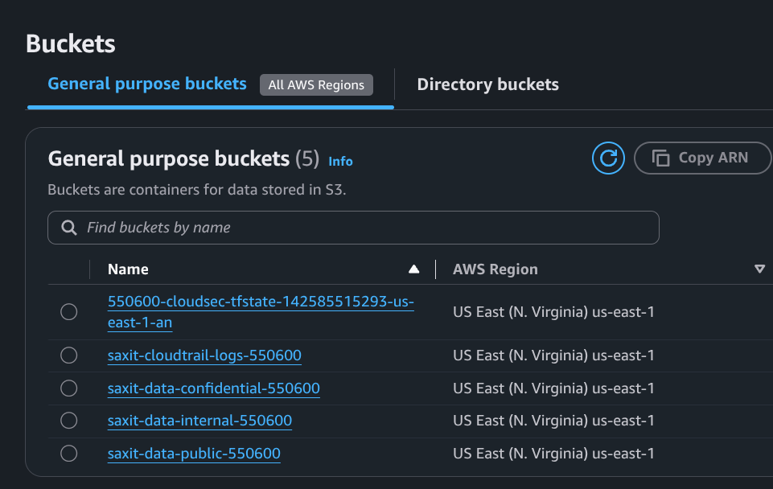

Geweigerde upload: `classification=confidential`-tag op een bestand richting de `public`-bucket:

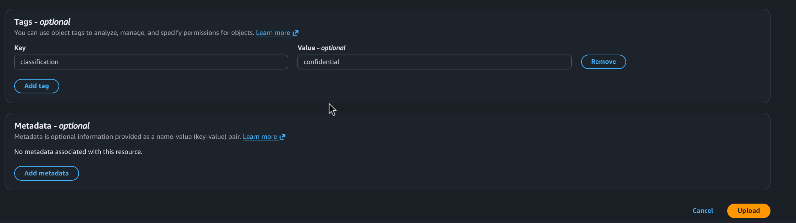
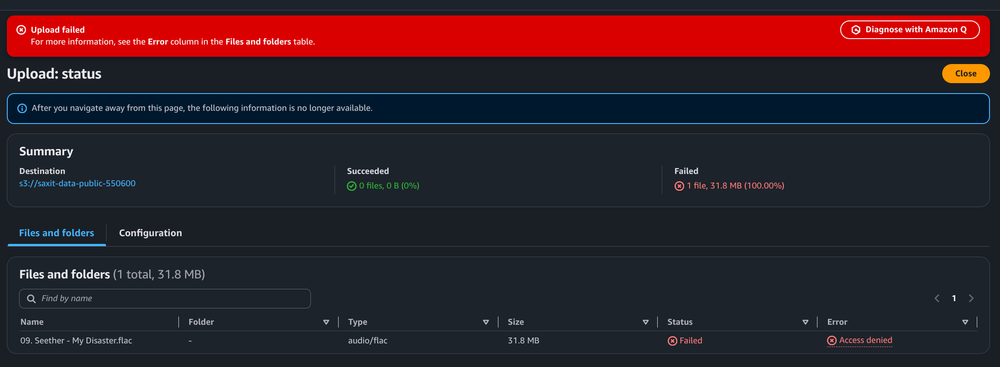

Bucket bleef leeg:

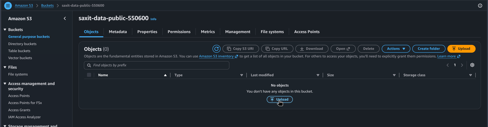

## 4.3 Bring your own key (BYOK) voor de geheime bucket

Voor de geheime bucket gebruik ik een KMS-sleutel met zelf gegenereerd keymateriaal (`aws_kms_external_key`, origin `EXTERNAL`) i.p.v. een door AWS beheerde sleutel. Het keymateriaal genereer ik lokaal, nooit in de console:

```bash
# 1. Eigen 256-bit AES-sleutelmateriaal genereren met OpenSSL
openssl rand -out plaintext-key.bin 32

# 2. Wrapping-key en import-token bij AWS opvragen voor deze KMS-sleutel
aws kms get-parameters-for-import \
  --key-id <key-id-van-de-aws_kms_external_key> \
  --wrapping-algorithm RSAES_OAEP_SHA_256 \
  --wrapping-key-spec RSA_2048

# 3. Het eigen keymateriaal versleutelen met die wrapping-key (nooit onversleuteld versturen)
openssl pkeyutl -encrypt -in plaintext-key.bin -out encrypted-key-material.bin \
  -pubin -inkey wrapping-key.pem -pkeyopt rsa_padding_mode:oaep -pkeyopt rsa_oaep_md:sha256

# 4. Het versleutelde materiaal importeren
aws kms import-key-material \
  --key-id <key-id> \
  --encrypted-key-material fileb://encrypted-key-material.bin \
  --import-token fileb://import-token.bin \
  --expiration-model KEY_MATERIAL_DOES_NOT_EXPIRE

# 5. Het lokale plaintext-sleutelmateriaal direct veilig wissen
shred -u plaintext-key.bin
```

[`week-4/scripts/data-protection-setup.sh`](scripts/data-protection-setup.sh) zoekt deze sleutel op via de alias (`alias/saxit-confidential-byok`) en zet 'm als standaardencryptie op de geheime bucket (zie 4.2 voor waarom via een los script).

Commando's zelf uitgevoerd; voor de exacte `aws kms`/`openssl`-aanroepen (jq, DER/PEM-conversie) heb ik Claude Sonnet 5 gebruikt.

Keymateriaal geïmporteerd:

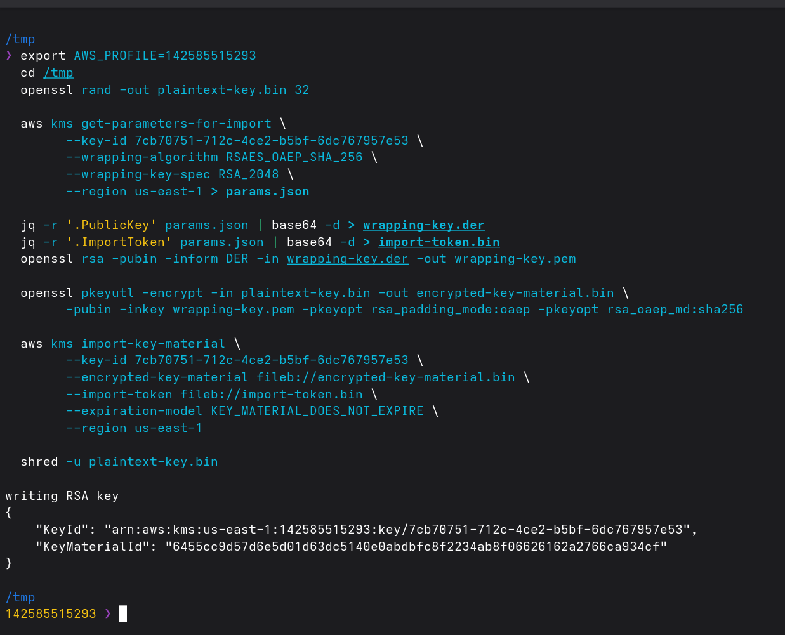
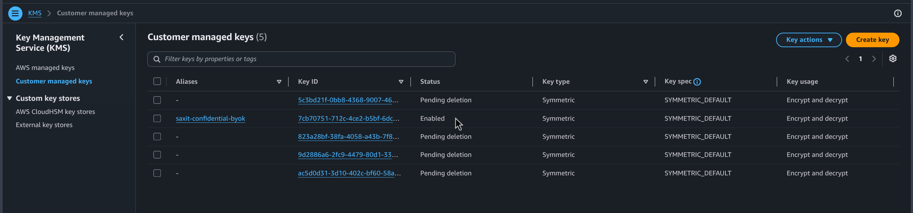

Encryptie-instelling van de geheime bucket wijst naar deze sleutel:

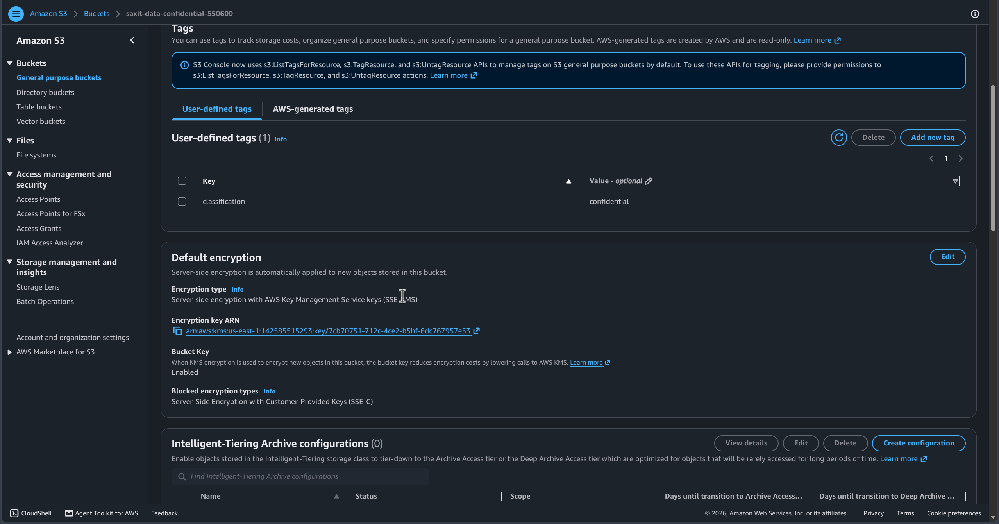

## 4.4 Logging en alerting op de geheime bucket

Ook via [`week-4/scripts/data-protection-setup.sh`](scripts/data-protection-setup.sh) (zie 4.2):

- **CloudTrail-trail** (`saxit-confidential-bucket-trail`) die data events (object-niveau) logt voor de geheime bucket, naar een aparte logs-bucket.
- **EventBridge-rule** (`saxit-confidential-object-read`) die matcht op `GetObject` en doorstuurt naar een **SNS-topic** met e-mail-abonnement — een mail bij elke download.
- **CloudWatch-dashboard** (`saxit-s3-classification`) met objectaantal en bucketgrootte per classificatie.

```json
{"source":["aws.s3"],"detail-type":["AWS API Call via CloudTrail"],"detail":{"eventSource":["s3.amazonaws.com"],"eventName":["GetObject"],"requestParameters":{"bucketName":["saxit-data-confidential-<suffix>"]}}}
```

Als `aws events put-rule` faalt (zelfde IAM-beperking als 2.1), vangt het script dat af en print het event pattern alsnog, zodat ik kan laten zien hóe de rule zou werken.

SNS-mail bevestigd:

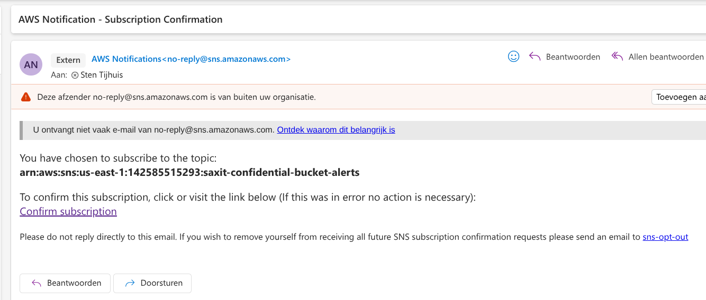
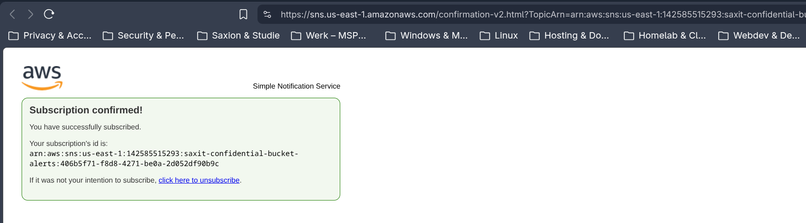

Demobestand geüpload naar de geheime bucket en weer gedownload, om de keten te triggeren:

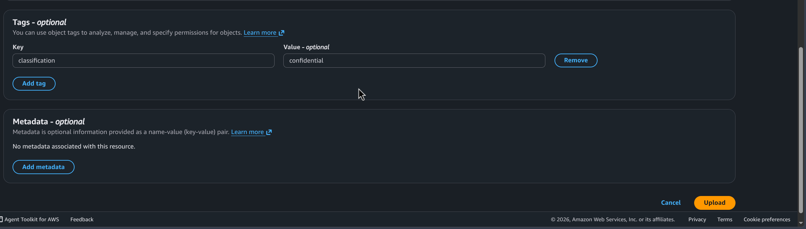
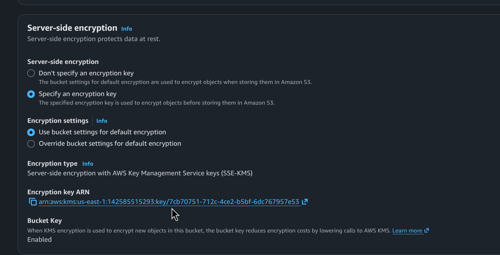
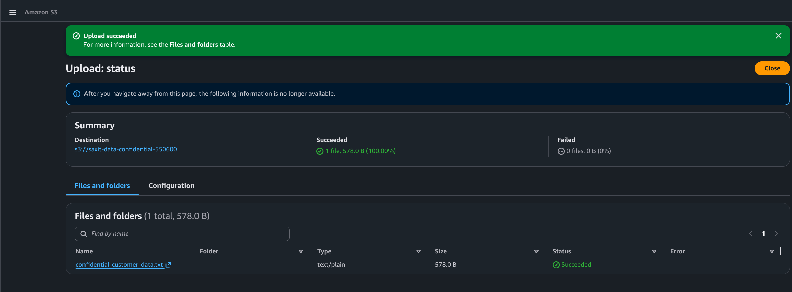
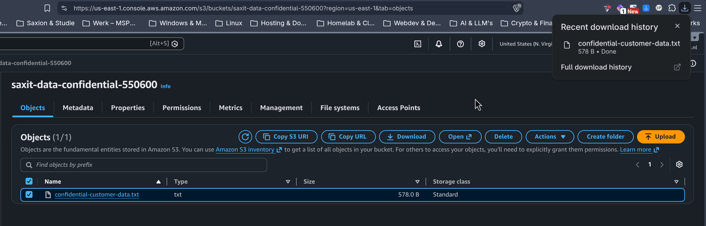

De alert-mail kwam binnen vóór het CloudTrail-logbestand zelf beschikbaar was (S3-levering heeft meer vertraging dan EventBridge) — de mail bevat het volledige CloudTrail-event, dus dat is bewijs voor beide:

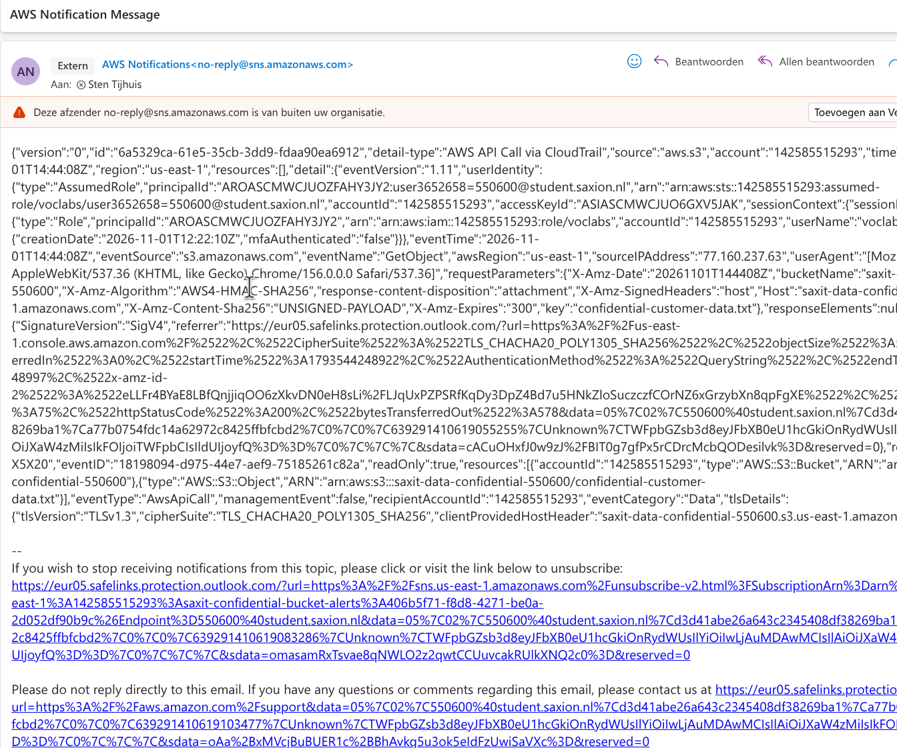

**CloudWatch-dashboard: "No data available".** Eerlijk: is me vandaag niet gelukt om hier data in te krijgen. S3's Storage Metrics worden maar **1x per dag** gepubliceerd, en de buckets zijn vandaag pas aangemaakt — eerste datapunt zou morgen moeten verschijnen. Widgets/metrics/bucketnamen staan in elk geval goed.

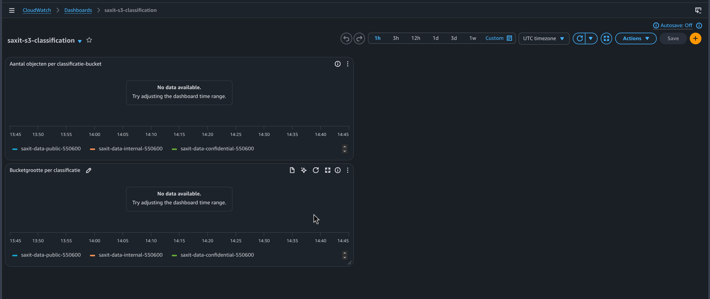

## 4.5 AWS Academy Cloud Security Foundations: Lab 5.1

**Bewijs:** **Module 5 Knowledge Check: 100/100**, zie het volledige cijferoverzicht bij week 7.4 ([`week-7/images/aws-academy-grades-overzicht.pdf`](../week-7/images/aws-academy-grades-overzicht.pdf)). Zie week 2.2 voor de toelichting over AWS Academy's onbetrouwbare labs-voltooiingsregistratie (Labs blijven daar standaard op `- / 100` staan).

## 4.6 Advies: AVG en encryptie op de S3-buckets

**Relatie met de AVG.** Artikel 32 AVG verplicht "passende technische en organisatorische maatregelen" bij persoonsgegevens (SaxIT's klantgegevens, zie 4.1), en noemt encryptie expliciet. Dataclassificatie (4.1) is de eerste stap, encryptie at rest + eigen sleutel (4.2/4.3) de technische invulling; logging/alerting (4.4) ondersteunt zowel de meldplicht datalekken (binnen 72 uur weten wát er lekte, zie 5.1/7.3) als accountability — wie was wanneer bij welke data.

**Encryptievormen op S3, van zwak naar sterk:**

- **SSE-S3** (`AES256`): AWS beheert de sleutel volledig. Eenvoudigst, geen controle/zicht op de sleutel.
- **SSE-KMS**: sleutel staat in KMS met eigen toegangsbeleid en CloudTrail-audit van elk gebruik. SaxIT kan nu afdwingen én loggen wie mag ontsleutelen.
- **SSE-KMS met eigen (BYOK) keymateriaal** (4.3): zoals SSE-KMS, maar SaxIT genereerde het materiaal zelf en kan het intrekken — data wordt dan onherstelbaar onleesbaar, ook voor AWS ("crypto-shredding").
- **SSE-C** (niet gebruikt hier): sleutel per request door de klant meegegeven, nog meer controle maar ook meer kans op een menselijke fout (sleutel kwijt = data kwijt).

Voor de geheime bucket is SSE-KMS met eigen keymateriaal de juiste keuze: audit-trail van KMS, plus de garantie dat alleen SaxIT het keymateriaal ooit in bezit had.

Het materiaal gaat nooit onversleuteld naar AWS: lokaal gegenereerd met OpenSSL, versleuteld met een door KMS geleverde wrapping-key, en pas dát pakket gaat naar AWS, waar het met een privésleutel die AWS nooit verlaat wordt uitgepakt.

Bronnen: [AWS Well-Architected: Data protection](https://docs.aws.amazon.com/wellarchitected/latest/security-pillar/data-protection.html), [AVG/GDPR uitgelegd (Europese Commissie)](https://commission.europa.eu/law/law-topic/data-protection/data-protection-explained_en), [Client-side encryption (AWS)](https://docs.aws.amazon.com/AmazonS3/latest/userguide/UsingClientSideEncryption.html), [BYOK: eigen keymateriaal importeren in KMS](https://docs.aws.amazon.com/kms/latest/developerguide/importing-keys.html), [Keymateriaal versleutelen voor import](https://docs.aws.amazon.com/kms/latest/developerguide/importing-keys-encrypt-key-material.html), [S3-encryptie met customer managed keys](https://medium.com/@dyavanapellisujal7/aws-s3-encryption-with-customer-managed-keys-using-sse-kms-for-secure-object-storage-045f6fddeea5), [S3 object tagging](https://docs.aws.amazon.com/AmazonS3/latest/userguide/object-tagging.html).
