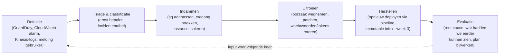

# Week 5

Een incident response plan voor de 3-tier omgeving (5.1), een advies over application security (5.2), en een STRIDE-threatmodel van diezelfde omgeving (5.3). Dit hoofdstuk is volledig deskresearch/ontwerp, geen AWS-omgeving nodig, dus hier staat geen "nog te doen (bewijs)".

## 5.1 Incident response plan

Uitgangspunt is de 3-tier omgeving uit week 1: internet → presentation-load-balancer → `web01`/`web02` → application-load-balancer → `app01`/`app02` → RDS (`cloudsecdb`), met een bastion host als enige SSH-ingang.

### Incidententabel

| # | Type incident | Voorbeeld in deze omgeving | Ernst | Detectie | Eerste respons |
| --- | --- | --- | --- | --- | --- |
| 1 | Brute-force/credential stuffing op SSH | Herhaalde mislukte SSH-pogingen op de bastion host (vergelijkbaar met wat ik in 6.5 analyseerde) | Midden | GuardDuty, CloudWatch-alarm op mislukte logins, Kinesis-logs (week 6) | Bron-IP blokkeren in `bastion_sg`, wachtwoord/keys roteren, loggen wie toegang had |
| 2 | Gecompromitteerde app-server | Onverwachte uitgaande verbindingen vanaf `app01` naar onbekend IP | Hoog | GuardDuty-melding, afwijkend netwerkpatroon | Instance isoleren (security group leegmaken), forensische snapshot maken, nieuwe instance uitrollen vanuit Terraform (immutable infra, week 3) |
| 3 | Datalek uit de database | Ongebruikelijk grote `SELECT`-queries of een export vanaf een onbekend IP | Kritiek | RDS-logs, CloudTrail, Macie-achtige monitoring op S3 (week 4) | Toegang direct intrekken (IAM-token, week 2), wachtwoorden roteren, vaststellen wélke data geraakt is, meldplicht AVG beoordelen (zie 7.3) |
| 4 | DDoS/overbelasting op de load balancer | Piek in requests op `presentation-lb`, applicatie reageert traag of niet meer | Midden | CloudWatch-alarm op request-rate/latency | AWS Shield/WAF overwegen, autoscaling, communicatie naar klanten over status |
| 5 | Kwetsbaarheid in een afhankelijkheid (CVE) | Een package in de React- of Spring-app blijkt een kritieke CVE te hebben | Midden tot hoog, afhankelijk van CVSS | Inspector (week 6.2), Dependabot/Renovate-achtige scanning | Patchen en herdeployen via de pipeline (immutable infra), tijdelijk extra monitoring op dat component |

### RACI-tabel

| Activiteit | Security officer (ik/SaxIT security) | DevOps/infra-engineer | App-developer | Management/communicatie | AWS Support |
| --- | --- | --- | --- | --- | --- |
| Detectie & melding | R/A | C | C | I | I |
| Triage & classificatie | A | R | C | I | - |
| Indammen (containment) | A | R | C | I | C |
| Herstel (eradication/recovery) | C | R/A | R | I | C |
| Communicatie naar klanten/toezichthouder | R | I | I | A | - |
| Evaluatie achteraf (lessons learned) | A | R | R | C | - |

*(R = Responsible, A = Accountable, C = Consulted, I = Informed)*

### Procesdiagram

Dit volgt het klassieke NCSC-stramien (voorbereiden → detecteren → analyseren → indammen → herstellen → evalueren), toegespitst op deze omgeving: omdat de infrastructuur als code vastligt (week 3), is "herstellen" hier vaak letterlijk "opnieuw uitrollen" in plaats van handmatig een server opschonen.

Bronnen: [NCSC: incident respons, waar begin ik](https://www.ncsc.nl/wat-kun-je-zelf-doen/weerbaarheid/reageren/incident-respons-waar-begin-ik).

## 5.2 Application security: wat het inhoudt en advies voor SaxIT

Application security gaat over het beveiligen van de applicatie zelf (de code, de afhankelijkheden en hoe de applicatie met gebruikers en andere systemen praat), in aanvulling op de infrastructuur eromheen (weken 1 en 3). Een perfect dichtgetimmerd netwerk helpt niet als de applicatie zelf SQL-injectie of een kapotte autorisatiecheck heeft: de aanvaller komt dan gewoon binnen via de voordeur die toch open moet staan (poort 80/8080).

Voor de React/Spring-applicatie van SaxIT zou ik concreet adviseren:

- **OWASP Top 10 als basis.** Voor deze stack is vooral relevant: injection (SQL via JPA/Hibernate als er ooit losse queries bijkomen), broken access control (kan klant A bij de CMDB-data van klant B?), en kwetsbare/verouderde afhankelijkheden (npm-packages in de React-frontend, Maven-dependencies in de Spring-backend).
- **Input-validatie en output-encoding** aan beide kanten: de React-frontend mag nooit de enige verdedigingslinie zijn (een aanvaller praat gewoon rechtstreeks met de Spring-API), dus validatie hoort ook, en vooral, in de backend te zitten.
- **Dependency-scanning in de pipeline**, vergelijkbaar met wat er in [`build.yml`](../.github/workflows/build.yml) al aan linting/tests gebeurt: een stap die `npm audit`/Dependabot voor de frontend en een OWASP-dependency-check voor de Maven-backend draait, zodat een kwetsbare library opvalt vóór de merge, niet pas in productie.
- **SAST en DAST**, net als in mijn DevOps Security-vak: SAST (bijvoorbeeld Snyk Code of CodeQL) op de broncode tijdens Plan/Code, DAST (bijvoorbeeld OWASP ZAP) tegen de draaiende omgeving ná een deploy, zodat ook configuratiefouten opvallen die in de code zelf niet zichtbaar zijn.
- **Secrets nooit in code of logs.** Zie week 2: het databasewachtwoord hoort niet in `user_data` of git te staan.
- **Threat modeling vooraf** (zie 5.3) bij elke nieuwe feature, niet achteraf als de code al in productie staat.

Bronnen: [OWASP Top 10](https://owasp.org/www-project-top-ten/), [OWASP Application Security Verification Standard](https://owasp.org/www-project-application-security-verification-standard/), [OWASP Dependency-Check](https://owasp.org/www-project-dependency-check/), [OWASP ZAP](https://www.zaproxy.org/).

## 5.3 STRIDE-threatmodel

STRIDE kijkt per onderdeel van het systeem naar zes soorten dreigingen. Toegepast op de 3-tier omgeving:

| STRIDE-categorie | Voorbeeld in deze omgeving | Tegenmaatregel (al toegepast of advies) |
| --- | --- | --- |
| **S**poofing (identiteit vervalsen) | Iemand doet zich voor als een geldige gebruiker van het CMDB, of een VM doet zich voor als `app01` binnen het netwerk | Authenticatie voor gebruikers, IAM-rollen i.p.v. gedeelde wachtwoorden tussen servers (week 2), instance profiles die aan één specifieke instance gebonden zijn |
| **T**ampering (gegevens manipuleren) | Iemand past tijdens transport een request van frontend naar backend aan, of schrijft rechtstreeks in de database buiten de applicatie om | HTTPS/TLS voor al het verkeer (nu nog ontbrekend, alles loopt over HTTP, zie "wat nog openstaat" hieronder), database alleen bereikbaar vanaf de applicationtier (week 3.2) |
| **R**epudiation (ontkennen van acties) | Een gebruiker ontkent een actie in het CMDB te hebben uitgevoerd, en er is geen logging om het tegendeel te bewijzen | CloudTrail voor AWS-acties (week 4.4), applicatie-logging met gebruikers-ID en tijdstip, centrale, niet-lokaal-wisbare logs via Kinesis (week 6.1) |
| **I**nformation disclosure (ongeautoriseerde inzage) | De RDS-database was in de beginsituatie vanaf heel het internet bereikbaar (0.0.0.0/0 op poort 3306) | Microsegmentatie: database alleen bereikbaar vanaf de applicationtier (week 3.2), encryptie at rest/in transit en dataclassificatie (week 4) |
| **D**enial of service | Een aanvaller overspoelt de presentation-load-balancer met requests, of vult de database met rommeldata | Load balancer + meerdere instances per tier (al in het ontwerp), CloudWatch-alarmen (week 6.2), eventueel AWS WAF/Shield |
| **E**levation of privilege (rechten verhogen) | Een gecompromitteerde webserver (`web01`) gebruikt zijn toegang om bij de database te komen in plaats van alleen bij de applicationtier | Least privilege per tier (security groups, week 3; IAM-rol per rol, niet één brede rol, week 2) |

**Wat nog openstaat (eerlijk, niet verbloemd):** al het verkeer in dit ontwerp loopt nog over gewoon HTTP, niet HTTPS. Dat is een reëel Tampering/Information-disclosure-risico dat deze opdrachten (nog) niet oplossen. Dat zou ik SaxIT als vervolgstap adviseren: TLS-certificaten op beide load balancers, vergelijkbaar met hoe ik dat in mijn andere vak (DevOps Security) met een Ingress-controller voor Kubernetes deed.

**Waarom SaxIT threat modeling zou moeten toepassen:** STRIDE dwingt me om systematisch per onderdeel te kijken wat er mis kan gaan, in plaats van alleen de dreigingen te zien die toevallig voor de hand liggen. Zonder dit model had ik de open RDS-security-group (Information disclosure) of het ontbreken van TLS (Tampering) misschien pas gevonden bij een scan of, erger, bij een incident. Voor een bedrijf als SaxIT dat security als speerpunt heeft (zie `Casus SaxIT.docx`) is dat een voorwaarde: threat modeling bij elke nieuwe feature of architectuurwijziging betekent dat zwakke plekken vóór de livegang worden gevonden, niet erna, en dat is goedkoper en betrouwbaarder dan alleen vertrouwen op scanners en monitoring achteraf.

Bronnen: [OWASP Threat Modeling](https://owasp.org/www-community/Threat_Modeling), [Microsoft STRIDE](https://learn.microsoft.com/en-us/azure/security/develop/threat-modeling-tool-threats).
