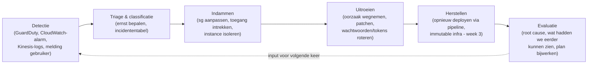

# Week 5

Een incident response plan voor de 3-tier omgeving (5.1), een advies over application security (5.2), en een STRIDE-threatmodel van diezelfde omgeving (5.3). Dit hoofdstuk is volledig deskresearch/ontwerp, geen AWS-omgeving nodig, dus hier staat geen "nog te doen (bewijs)".

## 5.1 Incident response plan

Uitgangspunt is de 3-tier omgeving uit week 1: internet → presentation-load-balancer → `web01`/`web02` → application-load-balancer → `app01`/`app02` → RDS (`cloudsecdb`), met een bastion host als enige SSH-ingang.

### Incidententabel

| # | Type incident | Voorbeeld | Ernst | Detectie | Eerste respons |
| --- | --- | --- | --- | --- | --- |
| 1 | Brute-force op SSH | Herhaalde mislukte SSH-pogingen op de bastion (zie ook 6.5) | Midden | GuardDuty, CloudWatch-alarm, Kinesis-logs (week 6) | Bron-IP blokkeren in `bastion_sg`, keys roteren, loggen wie toegang had |
| 2 | Gecompromitteerde app-server | Onverwachte uitgaande verbindingen vanaf `app01` | Hoog | GuardDuty, afwijkend netwerkpatroon | Instance isoleren, forensische snapshot, nieuwe instance uitrollen (immutable infra, week 3) |
| 3 | Datalek uit de database | Ongebruikelijk grote queries of export vanaf onbekend IP | Kritiek | RDS-logs, CloudTrail, Macie op S3 (week 4) | Toegang intrekken (week 2), wachtwoorden roteren, impact vaststellen, AVG-meldplicht checken (7.3) |
| 4 | DDoS op de load balancer | Piek in requests, app reageert traag/niet | Midden | CloudWatch-alarm op request-rate/latency | AWS Shield/WAF, autoscaling, klantcommunicatie |
| 5 | Kwetsbaarheid in een dependency | Kritieke CVE in een React/Spring-package | Midden-hoog | Inspector (6.2), Dependabot | Patchen en herdeployen via de pipeline |

### RACI-tabel

| Activiteit | Security officer (ik/SaxIT security) | DevOps/infra-engineer | App-developer | Management/communicatie | AWS Support |
| --- | --- | --- | --- | --- | --- |
| Detectie & melding | R/A | C | C | I | I |
| Triage & classificatie | A | R | C | I | - |
| Indammen (containment) | A | R | C | I | C |
| Herstel (eradication/recovery) | C | R/A | R | I | C |
| Communicatie naar klanten/toezichthouder | R | I | I | A | - |
| Evaluatie achteraf (lessons learned) | A | R | R | C | - |

*(R = Responsible, A = Accountable, C = Consulted, I = Informed)*

### Procesdiagram

Volgt het NCSC-stramien (voorbereiden → detecteren → analyseren → indammen → herstellen → evalueren). Omdat de infra als code vastligt (week 3) is "herstellen" hier vaak letterlijk opnieuw uitrollen, niet handmatig opschonen.

Bronnen: [NCSC: incident respons, waar begin ik](https://www.ncsc.nl/wat-kun-je-zelf-doen/weerbaarheid/reageren/incident-respons-waar-begin-ik).

## 5.2 Application security: wat het inhoudt en advies voor SaxIT

Application security beveiligt de applicatie zelf — code, dependencies, hoe 'ie met gebruikers/systemen praat — als aanvulling op de infra (week 1/3). Een dichtgetimmerd netwerk helpt niet tegen SQL-injectie of een kapotte autorisatiecheck: die komt gewoon binnen via de voordeur die toch open moet staan.

Voor de React/Spring-app concreet:

- **OWASP Top 10**: vooral injection (SQL via JPA/Hibernate), broken access control (klant A bij CMDB-data van klant B?), kwetsbare dependencies (npm, Maven).
- **Input-validatie in de backend**, niet alleen in React — een aanvaller praat direct met de Spring-API.
- **Dependency-scanning in de pipeline**: `npm audit`/Dependabot voor de frontend, OWASP dependency-check voor Maven, naast wat [`build.yml`](../.github/workflows/build.yml) al doet.
- **SAST/DAST**: SAST (Snyk Code/CodeQL) op de broncode, DAST (OWASP ZAP) tegen de draaiende omgeving ná deploy.
- **Secrets nooit in code of logs** — zie week 2.
- **Threat modeling vooraf** (5.3), niet achteraf.

Bronnen: [OWASP Top 10](https://owasp.org/www-project-top-ten/), [OWASP Application Security Verification Standard](https://owasp.org/www-project-application-security-verification-standard/), [OWASP Dependency-Check](https://owasp.org/www-project-dependency-check/), [OWASP ZAP](https://www.zaproxy.org/).

## 5.3 STRIDE-threatmodel

STRIDE kijkt per onderdeel van het systeem naar zes soorten dreigingen. Toegepast op de 3-tier omgeving:

| STRIDE | Voorbeeld | Tegenmaatregel |
| --- | --- | --- |
| **S**poofing | Iemand doet zich voor als CMDB-gebruiker, of een VM als `app01` | IAM-rollen i.p.v. gedeelde wachtwoorden (week 2), instance profiles gebonden aan één instance |
| **T**ampering | Request onderweg aangepast, of rechtstreeks in de database geschreven | HTTPS/TLS ontbreekt nog (zie hieronder), database alleen bereikbaar vanaf applicationtier (3.2) |
| **R**epudiation | Gebruiker ontkent een actie in het CMDB, geen logging om het tegendeel te bewijzen | CloudTrail (4.4), applicatie-logging met gebruikers-ID, centrale logs via Kinesis (6.1) |
| **I**nformation disclosure | RDS stond in de beginsituatie open voor heel het internet | Microsegmentatie (3.2), encryptie + classificatie (week 4) |
| **D**enial of service | Load balancer overspoeld met requests, database vol rommeldata | Meerdere instances per tier, CloudWatch-alarmen (6.2), eventueel WAF/Shield |
| **E**levation of privilege | Gecompromitteerde `web01` probeert bij de database te komen | Least privilege per tier (SG's week 3, IAM per rol week 2) |

**Wat nog openstaat:** al het verkeer loopt nog over HTTP, niet HTTPS — een reëel Tampering/Information-disclosure-risico. Vervolgstap: TLS op beide load balancers.

STRIDE dwingt me systematisch per onderdeel te kijken, niet alleen naar wat toevallig opvalt — zo vond ik de open RDS-SG en het ontbreken van TLS vóórdat het een incident werd. Voor SaxIT (security als speerpunt) is dat de voorwaarde om zwakke plekken vóór livegang te vinden, niet erna.

Bronnen: [OWASP Threat Modeling](https://owasp.org/www-community/Threat_Modeling), [Microsoft STRIDE](https://learn.microsoft.com/en-us/azure/security/develop/threat-modeling-tool-threats).
