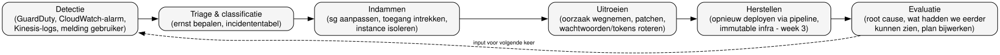

# Week 5: Incident response en application security

Ook met goede beveiliging kan het misgaan. Daarom is het belangrijk om vooraf te weten wat je doet als er een incident is. Het NCSC maakt daarbij onderscheid tussen een gebeurtenis, een alert en een cyberincident. Een mislukte inlogpoging is een gebeurtenis die gewoon in het normale werk wordt afgehandeld. Een incidentresponsplan is voor de gevallen waarin dat niet meer genoeg is, omdat de impact te groot is of omdat er besluiten van het management nodig zijn [(Nationaal Cyber Security Centrum, z.d.)](https://www.ncsc.nl/wat-kun-je-zelf-doen/weerbaarheid/reageren/incident-respons-waar-begin-ik).

NIST koppelt incidentrespons in de nieuwste versie van SP 800-61 aan de zes functies van het Cybersecurity Framework 2.0: govern, identify, protect, detect, respond en recover [(Nelson et al., 2025)](https://csrc.nist.gov/pubs/sp/800/61/r3/final). Incidentrespons is dan niet iets losstaands, maar onderdeel van het hele risicobeheer.

Application security gaat over de beveiliging van de applicatie zelf: de code, de onderdelen van derden, en hoe de applicatie met gebruikers en andere systemen praat. Een goed afgeschermd netwerk helpt niet tegen bijvoorbeeld SQL-injectie, want die komt binnen via de voordeur die toch open moet staan. De OWASP Top 10 is de bekendste lijst van de grootste risico's in webapplicaties [(OWASP Foundation, z.d.-b)](https://owasp.org/www-project-top-ten/).

Deze week bestaat uit drie opdrachten. Paragraaf 5.1 bevat een incident response plan voor de omgeving uit week 1. Paragraaf 5.2 legt uit wat application security inhoudt en geeft SaxIT advies, en paragraaf 5.3 bevat een threat model volgens STRIDE. Deze week bestaat uit ontwerp en onderzoek; er hoort geen AWS-omgeving bij.

## 5.1 Incident response plan

Het plan gaat uit van de omgeving uit week 1. Verkeer komt binnen via de presentation-lb, gaat naar web01 en web02, dan via de application-lb naar app01 en app02, en die praten met de database cloudsecdb in RDS. Beheer loopt via de bastion host.

### Incidententabel

| Type incident | Voorbeeld | Ernst | Detectie | Eerste reactie |
| --- | --- | --- | --- | --- |
| Brute force op SSH | Veel mislukte SSH-pogingen op de bastion (zie ook 6.5) | Midden | GuardDuty, CloudWatch-alarm, logs via Kinesis (week 6) | Het IP-adres blokkeren in bastion_sg, sleutels vervangen, nagaan wie toegang had |
| Overgenomen app-server | Onverwachte uitgaande verbindingen vanaf app01 | Hoog | GuardDuty, afwijkend netwerkverkeer | De server isoleren, een snapshot maken voor onderzoek, een nieuwe server uitrollen (week 3) |
| Datalek uit de database | Ongewoon grote queries of een export vanaf een onbekend IP-adres | Kritiek | RDS-logs, CloudTrail, Macie op S3 (week 4) | Toegang intrekken (week 2), wachtwoorden vervangen, de schade vaststellen, de meldplicht van de AVG nagaan (7.3) |
| DDoS op de load balancer | Een piek in verzoeken, de applicatie reageert traag of niet | Midden | CloudWatch-alarm op het aantal verzoeken en de reactietijd | AWS Shield en WAF, automatisch opschalen, klanten informeren |
| Kwetsbaarheid in een onderdeel van derden | Een kritieke CVE in een React- of Spring-package | Midden tot hoog | Inspector (6.2), Dependabot | Bijwerken en opnieuw uitrollen via de pipeline |

### RACI-tabel

| Activiteit | Security officer | DevOps- en infra-engineer | Applicatieontwikkelaar | Management en communicatie | AWS Support |
| --- | --- | --- | --- | --- | --- |
| Detectie en melding | R/A | C | C | I | I |
| Triage en classificatie | A | R | C | I | - |
| Indammen | A | R | C | I | C |
| Uitroeien en herstellen | C | R/A | R | I | C |
| Communicatie met klanten en toezichthouder | R | I | I | A | - |
| Evaluatie achteraf | A | R | R | C | - |

R = Responsible (voert uit), A = Accountable (eindverantwoordelijk), C = Consulted (denkt mee), I = Informed (wordt op de hoogte gehouden).

### Procesdiagram

Een incident begint met een melding: van GuardDuty, een CloudWatch-alarm, de logs of een gebruiker. Bij de triage wordt bepaald of het echt een incident is en hoe ernstig, met de tabel hierboven. Daarna wordt het incident ingedamd, bijvoorbeeld door een security group aan te passen of toegang in te trekken. Dan wordt de oorzaak weggenomen en wordt de omgeving hersteld. Omdat de infrastructuur in code staat (week 3), is herstellen hier meestal opnieuw uitrollen in plaats van met de hand opruimen. Na afloop volgt een evaluatie: wat was de oorzaak, wat hadden we eerder kunnen zien, en wat moet er in dit plan veranderen.

In de functies van NIST valt de detectie onder detect, de triage tot en met het uitroeien onder respond, en het herstellen onder recover. De evaluatie zorgt dat SaxIT beter voorbereid is op het volgende incident.

## 5.2 Application security: wat het inhoudt en advies voor SaxIT

Voor de React- en Spring-applicatie van SaxIT adviseer ik het volgende:

- **Let vooral op de risico's uit de OWASP Top 10 die hier spelen.** Dat zijn injection (SQL via JPA en Hibernate), broken access control (kan klant A bij de CMDB-gegevens van klant B?) en kwetsbare onderdelen van derden (npm en Maven).
- **Controleer invoer in de backend, niet alleen in React.** Een aanvaller kan de frontend overslaan en rechtstreeks met de Spring-API praten.
- **Scan de onderdelen van derden in de pipeline.** Bijvoorbeeld met `npm audit` of Dependabot voor de frontend en OWASP Dependency-Check voor Maven, naast wat [`build.yml`](../.github/workflows/build.yml) al doet.
- **Test de code en de draaiende applicatie.** Met SAST, zoals Snyk Code of CodeQL, wordt de broncode gecontroleerd. Met DAST, zoals ZAP, wordt de draaiende omgeving na het uitrollen getest [(ZAP, z.d.)](https://www.zaproxy.org/).
- **Zet nooit secrets in code of logs**, zie week 2.
- **Gebruik een vaste lat.** De OWASP Application Security Verification Standard (ASVS) is een lijst met eisen waaraan een applicatie moet voldoen. Die kan SaxIT gebruiken bij het bouwen en testen [(OWASP Foundation, z.d.-a)](https://owasp.org/www-project-application-security-verification-standard/).
- **Maak een threat model voordat er gebouwd wordt**, niet achteraf (5.3).

## 5.3 STRIDE-threatmodel

Bij threat modeling kijk je vooraf systematisch wat er mis kan gaan in een ontwerp, en wat je daartegen doet [(OWASP Foundation, z.d.-c)](https://owasp.org/www-community/Threat_Modeling). STRIDE is een methode van Microsoft die daarbij zes soorten dreigingen onderscheidt: spoofing, tampering, repudiation, information disclosure, denial of service en elevation of privilege [(Microsoft, 2017)](https://learn.microsoft.com/en-us/azure/security/develop/threat-modeling-tool-threats). Toegepast op de omgeving van SaxIT:

| STRIDE | Voorbeeld | Maatregel |
| --- | --- | --- |
| Spoofing (je voordoen als een ander) | Iemand doet zich voor als CMDB-gebruiker, of een server als app01 | IAM-rollen in plaats van gedeelde wachtwoorden (week 2) |
| Tampering (gegevens aanpassen) | Een verzoek wordt onderweg aangepast, of iemand schrijft rechtstreeks in de database | HTTPS ontbreekt nog (zie hieronder). De database is alleen bereikbaar vanaf de application tier (3.2). |
| Repudiation (ontkennen) | Een gebruiker ontkent een actie in de CMDB, en er is geen logging om het tegendeel te bewijzen | CloudTrail (4.4), logging in de applicatie met het gebruikers-ID, centrale logs via Kinesis (6.1) |
| Information disclosure (gegevens lekken) | De database stond in de beginsituatie open voor heel internet | Segmentatie (3.2), encryptie en classificatie (week 4) |
| Denial of service (onbereikbaar maken) | De load balancer wordt overspoeld met verzoeken, of de database met rommeldata | Meerdere servers per laag, CloudWatch-alarmen (6.2), eventueel WAF en Shield |
| Elevation of privilege (meer rechten krijgen) | Een overgenomen web01 probeert bij de database te komen | Least privilege per laag: security groups (week 3) en IAM per rol (week 2) |

Wat nog openstaat, is HTTPS. Al het verkeer loopt nog over HTTP, en dat is een echt risico voor tampering en information disclosure. De volgende stap is TLS op beide load balancers.

STRIDE helpt om per onderdeel naar alle soorten dreigingen te kijken, en niet alleen naar wat toevallig opvalt. Zo kwamen de open security group van de database en het ontbreken van HTTPS naar boven voordat ze tot een incident leidden. Mijn advies aan SaxIT is om bij elke nieuwe dienst of grote wijziging zo'n threat model te maken, voordat het live gaat.

## Bronnen

Microsoft. (2017, 17 augustus). *Threats: Microsoft Threat Modeling Tool*. Microsoft Learn. https://learn.microsoft.com/en-us/azure/security/develop/threat-modeling-tool-threats

Nationaal Cyber Security Centrum. (z.d.). *Incidentrespons: waar begin ik?* https://www.ncsc.nl/wat-kun-je-zelf-doen/weerbaarheid/reageren/incident-respons-waar-begin-ik

Nelson, A., Rekhi, S., Souppaya, M., & Scarfone, K. (2025). *Incident response recommendations and considerations for cybersecurity risk management: A CSF 2.0 community profile* (NIST Special Publication 800-61r3). National Institute of Standards and Technology. https://csrc.nist.gov/pubs/sp/800/61/r3/final

OWASP Foundation. (z.d.-a). *OWASP Application Security Verification Standard*. https://owasp.org/www-project-application-security-verification-standard/

OWASP Foundation. (z.d.-b). *OWASP Top 10*. https://owasp.org/www-project-top-ten/

OWASP Foundation. (z.d.-c). *Threat modeling*. https://owasp.org/www-community/Threat_Modeling

ZAP. (z.d.). *ZAP*. https://www.zaproxy.org/
