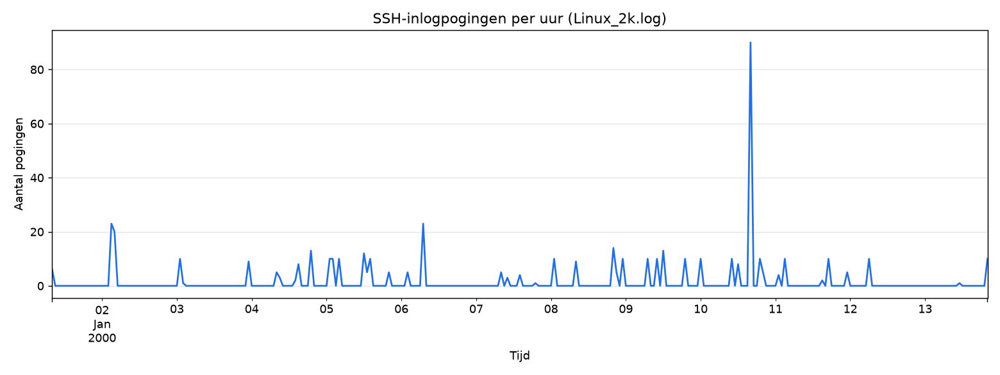
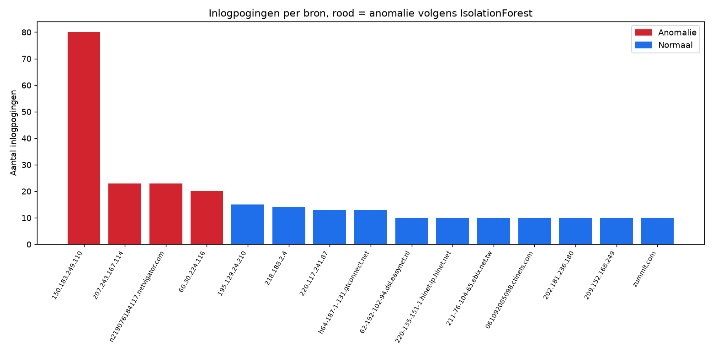

# Week 6

Centrale logging met Kinesis (6.1), advies over de AWS-detectiediensten (6.2), de AWS Academy-labstof (6.3), Security Hub met malwarescan (6.4), en een log-analyse van SSH-brute-force-pogingen met Python en IsolationForest (6.5).

> **Status:** "in klad". 6.1 en 6.4 hebben een draaiend Learner Lab nodig en staan hier als ontwerp + **Nog te doen (bewijs)**. 6.5 heb ik echt uitgevoerd, zie hieronder inclusief de uitvoer.

## 6.1 Centrale logging met Kinesis

Ik maak een Kinesis Data Stream aan en installeer op alle vier de VM's (`web01`, `web02`, `app01`, `app02`) de Amazon Kinesis Agent, geconfigureerd om de Docker-logs van de containers naar die stream te sturen.

```hcl
resource "aws_kinesis_stream" "docker_logs" {
  name             = "saxit-docker-logs"
  shard_count      = 1
  retention_period = 24
}
```

Op elke VM (toe te voegen aan de `user_data` in `terraform/main.tf`, of achteraf handmatig via de bastion host):

```bash
sudo yum install -y aws-kinesis-agent   # of apt-get op Ubuntu, via het juiste repo
sudo tee /etc/aws-kinesis/agent.json >/dev/null <<'JSON'
{
  "cloudwatch.emitMetrics": true,
  "kinesis.endpoint": "",
  "flows": [
    {
      "filePattern": "/var/lib/docker/containers/*/*.log",
      "kinesisStream": "saxit-docker-logs"
    }
  ]
}
JSON
sudo service aws-kinesis-agent start
```

Hoe SaxIT dit zou kunnen gebruiken: Kinesis is de centrale "voordeur" voor logdata uit alle tiers, los van waar een VM staat of hoe lang die bestaat. Vanuit de stream kan een Lambda-functie of Kinesis Data Firehose de logs doorzetten naar bijvoorbeeld S3 (goedkope, lange-termijn opslag voor audits) of OpenSearch (doorzoekbaar, voor dashboards en alerting). Het belangrijkste voordeel voor security: ook als een server wordt overgenomen door een aanvaller, staan de logs van vóór dat moment al ergens anders. De aanvaller kan de centrale geschiedenis dus niet meer wissen door lokaal de logs te verwijderen.

**Nog te doen (bewijs):** printscreens van de Kinesis-stream met binnenkomende data (via de Data Viewer in de AWS-console of een `GetRecords`-call).

## 6.2 Advies: AWS-detectiediensten voor SaxIT

| Dienst | Wat het doet | Waarom relevant voor SaxIT | Richtprijs (indicatie, regio us-east-1) |
| --- | --- | --- | --- |
| **Amazon Inspector** | Scant EC2, container-images en Lambda automatisch op bekende kwetsbaarheden (CVE's) en netwerkblootstelling | Vindt kwetsbare software op `web01/02`, `app01/02` vóórdat een aanvaller dat doet, vergelijkbaar met Docker Scout/Trivy maar dan op OS-niveau | Circa \$0,01–\$0,15 per scan/instance-uur, afhankelijk van het type scan; voor 4 kleine instances typisch een paar dollar per maand |
| **Amazon GuardDuty** | Continue bedreigingsdetectie op basis van VPC Flow Logs, DNS-logs en CloudTrail: ongebruikelijke API-calls, communicatie met bekende kwaadaardige IP's, etc. | Vangt bijvoorbeeld een gecompromitteerde `app01` die opeens naar een command-and-control-server praat | Vanaf ongeveer \$1–\$4 per miljoen events/GB geanalyseerde logs per maand; voor deze kleine omgeving typisch enkele tientjes per maand |
| **Amazon Macie** | Scant S3-buckets automatisch op gevoelige data (persoonsgegevens, creditcardnummers) met machine learning | Relevant zodra SaxIT klantdata in S3 zet (zie week 4): laat zien of de "Geheim"-bucket ook echt alleen gevoelige data bevat, en signaleert als gevoelige data per ongeluk in een "Openbaar"-bucket belandt | Circa \$1 per GB voor de eerste scan, plus een klein bedrag per 1.000 objecten voor doorlopende monitoring |
| **Amazon Detective** | Visualiseert en correleert gegevens van GuardDuty, VPC Flow Logs en CloudTrail tot een onderzoekbare tijdlijn | Handig ná een GuardDuty-melding: in plaats van handmatig logs te combineren, laat Detective in een paar klikken zien welke resources met elkaar praatten rond het incident | Geen vast bedrag; typisch enkele dollars per GB verwerkte logdata per maand, vooral relevant zodra er al GuardDuty/CloudTrail-data is |
| **Amazon CloudWatch** | Metrics, logs en alarmen voor alle AWS-resources | De basis onder alles hierboven: dashboards (zie week 4.4) en alarmen op bijvoorbeeld CPU-pieken of mislukte inlogpogingen | Grotendeels in het free tier voor deze schaal; betaald vanaf een paar custom metrics/dashboards, meestal een paar dollar per maand |

Mijn advies: begin met **GuardDuty en CloudWatch** aan (relatief goedkoop, dekt het grootste deel van "iemand doet iets geks in mijn omgeving"), zet **Inspector** aan zodra er meer dan een handvol EC2's/images zijn, en voeg **Macie** pas toe zodra er echt klantdata in S3 staat (anders betaalt SaxIT voor het scannen van lege of irrelevante buckets). **Detective** is het meest waard zodra er al genoeg GuardDuty-meldingen zijn om onderzoek de moeite waard te maken. Voor een hele kleine omgeving als deze proefopstelling is dat nog niet meteen nodig, maar bij een paar klanten in productie wel.

Bronnen: [Amazon Inspector pricing](https://aws.amazon.com/inspector/pricing/), [Amazon GuardDuty pricing](https://aws.amazon.com/guardduty/pricing/), [Amazon Macie pricing](https://aws.amazon.com/macie/pricing/), [Amazon Detective pricing](https://aws.amazon.com/detective/pricing/), [Amazon CloudWatch pricing](https://aws.amazon.com/cloudwatch/pricing/). *(Prijzen zijn richtprijzen op basis van de AWS-pricingpagina's; voor een exacte opgave reken ik dit door in de AWS Pricing Calculator met de echte volumes van SaxIT.)*

## 6.3 AWS Academy Cloud Security Foundations: Lab 6.1

**Nog te doen:** zelf af te ronden in de AWS Academy-leeromgeving, bewijsscherm hier plakken.

## 6.4 Security Hub en malwarescan

AWS Security Hub verzamelt en prioriteert meldingen uit GuardDuty, Inspector, Macie en andere diensten op één dashboard, met een security-score tegen bekende standaarden (bijvoorbeeld de AWS Foundational Security Best Practices of CIS AWS Foundations Benchmark). De malwarescan op de EC2's loopt via **GuardDuty Malware Protection for EC2**: zodra GuardDuty verdacht gedrag op een instance signaleert, maakt het automatisch een snapshot van de EBS-volumes en scant die op malware, zonder dat de instance zelf hoeft te stoppen.

Stappen: Security Hub activeren in de regio, de standaarden aanvinken die SaxIT wil volgen, GuardDuty (met Malware Protection) aanzetten zodat de bevindingen automatisch doorstromen naar Security Hub, en vervolgens op elke EC2 een scan afdwingen of afwachten tot GuardDuty er zelf een triggert.

Mijn advies aan SaxIT: gebruik Security Hub niet als los dashboard maar als het centrale startpunt voor de security-operatie. Stel alerting in (bijvoorbeeld via EventBridge naar e-mail of Slack, zie ook week 4.4) op nieuwe High/Critical-bevindingen, en neem de security-score mee als terugkerend agendapunt, niet als eenmalige check.

**Nog te doen (bewijs):** screenshot van Security Hub met het resultaat van de malwarescan op alle EC2's.

Bronnen: [AWS Security Hub](https://aws.amazon.com/security-hub/), [GuardDuty Malware Protection for EC2](https://docs.aws.amazon.com/guardduty/latest/ug/malware-protection.html).

## 6.5 Log-analyse met Python en IsolationForest

### Wat het script doet

[`scripts/analyze_linux_log.py`](scripts/analyze_linux_log.py) leest `Linux_2k.log` (2.000 regels uit een voorbeeld-Linux-server) en pakt met een regex alleen de sshd-authenticatieregels eruit (`authentication failure` en `check pass; user unknown`), samen met het bron-adres (`rhost=`). In totaal zijn dat 479 regels met een geldig tijdstip en bron.

- **Grafiek 1 (gewone scripting, geen AI):** de pogingen worden met pandas per uur geteld (`resample("1h")`) en als lijn geplot over de hele periode die het logbestand beslaat.
- **Grafiek 2 (AI/machine learning):** per bron-adres bereken ik twee kenmerken: het totaal aantal pogingen, en het hoogste aantal pogingen dat die bron in één minuut deed (de "burst"). Die twee kenmerken gaan in een `IsolationForest` uit scikit-learn, die per bron aangeeft of die normaal of een anomalie is. De top-15 bronnen (op aantal pogingen) worden geplot, rood gekleurd als het model ze als anomalie ziet.

### Resultaten

```
479 sshd-authenticatieregels ingelezen uit Linux_2k.log
Piekuur: 2000-01-10 16:00:00 met 90 pogingen

Door IsolationForest als anomalie aangemerkte bronnen (top van de lijst):
rhost                           attempts  max_per_minute
150.183.249.110                       80              46
207.243.167.114                       23              12
n219076184117.netvigator.com          23              12
60.30.224.116                         20              10
```





De eerste grafiek laat één duidelijke piek zien rond 10 januari, 16:00 uur: 90 pogingen in dat uur, tegen een achtergrond van meestal 0–15 pogingen per uur. De tweede grafiek laat zien wélk adres die piek veroorzaakt: `150.183.249.110` met 80 pogingen in totaal, waarvan 46 in één minuut. Dat kan geen mens zijn die zijn wachtwoord een paar keer verkeerd typt, dat is een geautomatiseerde brute-force-poging. Het model markeert daarnaast nog drie bronnen (`207.243.167.114`, `n219076184117.netvigator.com`, `60.30.224.116`) als afwijkend: die hebben minder pogingen, maar wel duidelijk meer dan de meeste andere bronnen (die typisch maar 1-10 pogingen doen), mogelijk kleinere of tragere scanpogingen.

### Waarom IsolationForest

IsolationForest is gemaakt voor precies dit soort probleem: afwijkende punten vinden zonder dat je van tevoren hoeft te weten hoe een "aanval" eruitziet of gelabelde voorbeelden hebt. Het idee is dat een afwijkend punt makkelijker te isoleren is dan een normaal punt: het algoritme bouwt willekeurige beslissingsbomen die steeds een kenmerk en een splitspunt kiezen, en een bron die heel anders scoort dan de rest (zoals 80 pogingen met 46 in één minuut, tegen een mediaan van een paar pogingen) heeft maar een paar willekeurige splitsingen nodig om helemaal alleen in zijn eigen tak te staan. Normale bronnen, die dicht bij elkaar clusteren, hebben veel meer splitsingen nodig om geïsoleerd te raken. Hoe minder splitsingen een punt nodig heeft, hoe hoger de anomaliescore. Dat past bij dit log-probleem: ik weet niet vooraf wat een brute-force-poging precies kenmerkt (dat verschilt per aanval), maar ik weet wel dat zo'n poging er statistisch heel anders uitziet dan de rest van het verkeer. En dat is exact wat IsolationForest detecteert, zonder dat ik zelf een harde drempelwaarde ("meer dan X pogingen is verdacht") hoef te verzinnen.

### Prompting

Ik heb dit script samen met Claude Code (mijn AI-assistent in de editor) geschreven: ik heb gevraagd om een Python-script dat de sshd-authenticatieregels uit `Linux_2k.log` haalt, een grafiek maakt van het aantal pogingen per uur met gewone pandas/matplotlib-scripting, en met `sklearn.ensemble.IsolationForest` per bron-IP bepaalt of die afwijkend is op basis van het totale aantal pogingen en de pogingen-per-minuut-burst, met een tweede grafiek die de bronnen plot en de anomalieën rood markeert. Het script heb ik vervolgens zelf laten draaien en de uitvoer (hierboven) en de twee PNG's gecontroleerd op de uitslag.

### Advies aan SaxIT

Dit soort analyse zou ik niet als eenmalig Python-scriptje laten draaien, maar structureel inzetten: de logs die via Kinesis binnenkomen (6.1) kunnen periodiek (bijvoorbeeld elk uur, met een Lambda-functie) door hetzelfde soort IsolationForest-model gehaald worden, met een alarm (via SNS of EventBridge) zodra een bron als anomalie wordt gezien. Dat voorkomt dat iemand elke ochtend handmatig door duizenden logregels moet spitten, en vangt een brute-force-poging zoals hierboven binnen het uur op in plaats van pas bij een handmatige review achteraf. Voor SaxIT's CMDB-omgeving is dat precies het soort "threat detection & incident response"-uitdaging die in de casus genoemd wordt.
