# Week 6

Centrale logging met Kinesis (6.1), advies over de AWS-detectiediensten (6.2), de AWS Academy-labstof (6.3), Security Hub met malwarescan (6.4), en een log-analyse van SSH-brute-force-pogingen met Python en IsolationForest (6.5).

## 6.1 Centrale logging met Kinesis

Kinesis Data Stream aangemaakt, Docker-logs van de VM's (`web01`, `web02`, `app01`, `app02`) ernaartoe gestuurd.

```bash
aws kinesis create-stream --stream-name saxit-docker-logs --shard-count 1 --profile 142585515293 --region us-east-1
```

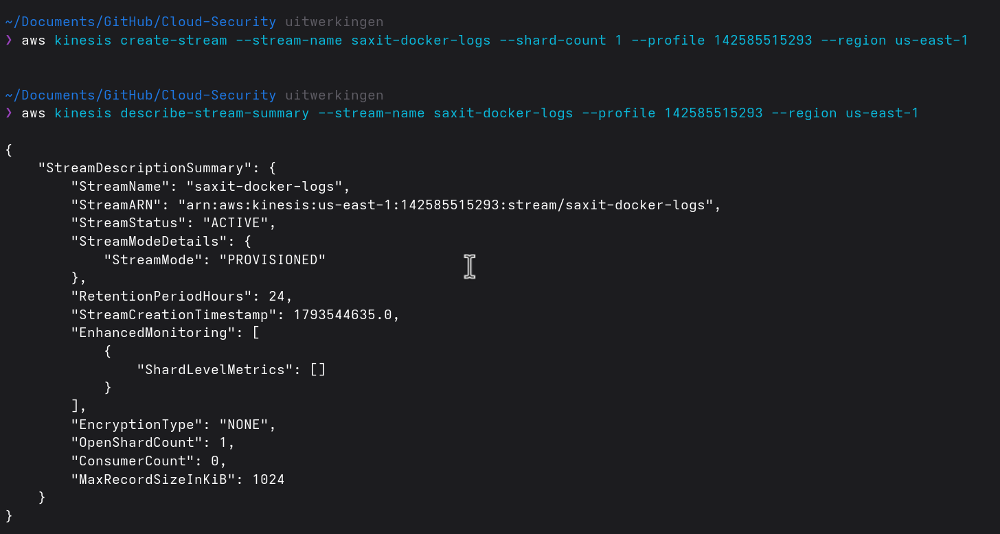

**Afwijking van het plan (eerlijk):** de officiële **Amazon Kinesis Agent** installeren was het plan, maar die is Amazon Linux/RHEL-gericht (yum/RPM) — geen apt-pakket voor Ubuntu, en zelf bouwen kost tijd die er niet was. In plaats daarvan: `docker logs` ophalen en per regel een `kinesis put-record` via de AWS CLI, met credentials uit de instance's eigen `LabInstanceProfile` (IMDS). Zelfde doel, alleen zonder de permanente achtergrond-daemon.

```bash
# Op de instance zelf (AWS CLI v2, IMDS-credentials via LabRole)
sudo docker logs $(sudo docker ps -q) --tail 10 | while read -r line; do
  echo "$line" | aws kinesis put-record --stream-name saxit-docker-logs --partition-key app01 \
    --data "$(echo "$line" | base64 -w0)" --region us-east-1 --cli-binary-format raw-in-base64-out
done
```

Bevestigd dat de stream echt `ACTIVE` is en de put-records goed binnenkwamen:


Bevestigd via CloudWatch dat de records ook echt aankwamen (`IncomingRecords`-metric, 5 records over twee minuten):

```bash
aws cloudwatch get-metric-statistics --namespace AWS/Kinesis --metric-name IncomingRecords \
  --dimensions Name=StreamName,Value=saxit-docker-logs --period 60 --statistics Sum \
  --start-time ... --end-time ... --profile 142585515293 --region us-east-1
```

**Zelf uitgelezen met de CLI.** Een `GetRecords`-call heeft een shard-iterator nodig. Let op: in fish (mijn shell) werkt de bash-syntax `VAR=$(...)` niet, dat moet `set VAR (...)` zijn:

```fish
set ITER (aws kinesis get-shard-iterator --stream-name saxit-docker-logs --shard-id shardId-000000000000 \
  --shard-iterator-type TRIM_HORIZON --profile 142585515293 --region us-east-1 --query ShardIterator --output text)
aws kinesis get-records --shard-iterator "$ITER" --profile 142585515293 --region us-east-1
```

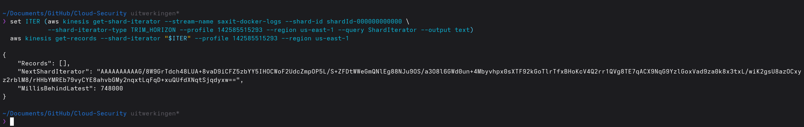 0" width="800">

Eerste poging kwam leeg terug (`"Records": []`), maar met `"MillisBehindLatest": 748000` — data zit er wel, alleen verderop in de shard. Normaal Kinesis-gedrag: met `NextShardIterator` een paar keer opnieuw pollen brengt je verder. CloudWatch bevestigt dezelfde activiteit:

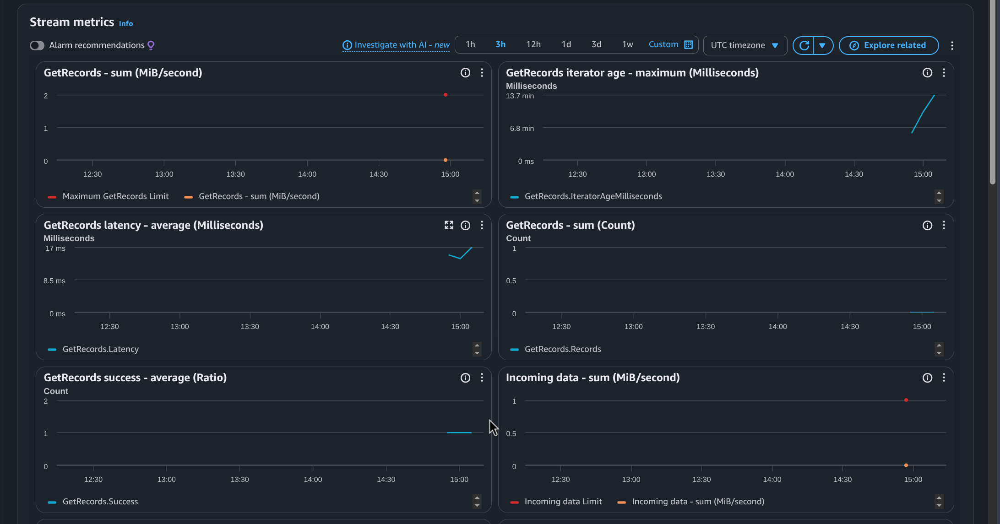

**Via de Data Viewer in de console** ging het eerst mis, toen goed. Starting position "Latest" gaf niks terug — logisch, "Latest" leest alleen nieuwe records ná het moment van de aanvraag, en de 5 records waren al binnen:

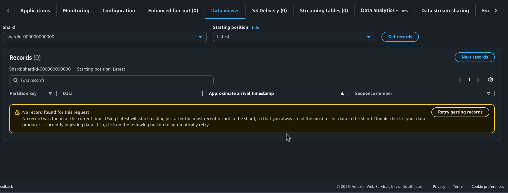

Met starting position "Trim horizon" (vanaf het begin van de shard) staan alle 5 records er wel, allemaal van `app01`:

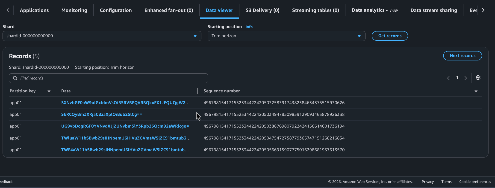

Voor SaxIT is Kinesis de centrale "voordeur" voor logdata uit alle tiers. Vanuit de stream kan Firehose of een Lambda de logs doorzetten naar S3 (lange-termijn, audits) of OpenSearch (doorzoekbaar, dashboards/alerting). Grootste voordeel: ook als een server wordt overgenomen, staan de logs van ervoor al ergens anders — de aanvaller kan de geschiedenis niet wissen door lokaal te wissen. Voor productie zou ik alsnog een echte achtergrond-daemon willen (de officiële agent op Amazon Linux, of Fluent Bit met Kinesis-output, dat wél een Ubuntu-pakket heeft) in plaats van dit handmatige commando.

## 6.2 Advies: AWS-detectiediensten voor SaxIT

| Dienst | Wat het doet | Relevant voor SaxIT | Richtprijs |
| --- | --- | --- | --- |
| **Inspector** | Scant EC2/containers/Lambda op CVE's en netwerkblootstelling | Kwetsbare software op `web01/02`/`app01/02` vinden vóór een aanvaller dat doet | ~\$0,01–0,15/scan-uur, voor 4 instances een paar dollar/maand |
| **GuardDuty** | Bedreigingsdetectie op VPC Flow Logs, DNS, CloudTrail | Vangt bv. een `app01` die opeens met een C2-server praat | ~\$1–4/miljoen events, typisch enkele tientjes/maand |
| **Macie** | Scant S3 op gevoelige data met ML | Checkt of de geheime bucket (week 4) ook echt alleen gevoelige data bevat | ~\$1/GB eerste scan + klein bedrag/1000 objecten |
| **Detective** | Correleert GuardDuty/Flow Logs/CloudTrail tot een tijdlijn | Handig ná een GuardDuty-melding, snel zien wat met wat praatte | Geen vast bedrag, enkele dollars/GB |
| **CloudWatch** | Metrics, logs, alarmen | Basis onder alles hierboven (dashboards, CPU-alarmen) | Grotendeels free tier op deze schaal |

Advies: begin met **GuardDuty + CloudWatch** (goedkoop, dekt het meeste), **Inspector** erbij zodra er meer dan een handvol EC2's zijn, **Macie** pas als er echt klantdata in S3 staat, **Detective** zodra er genoeg GuardDuty-meldingen zijn om onderzoek de moeite waard te maken.

Bronnen: [Inspector](https://aws.amazon.com/inspector/pricing/), [GuardDuty](https://aws.amazon.com/guardduty/pricing/), [Macie](https://aws.amazon.com/macie/pricing/), [Detective](https://aws.amazon.com/detective/pricing/), [CloudWatch](https://aws.amazon.com/cloudwatch/pricing/) pricing. *(Richtprijzen; voor een exacte opgave reken ik dit door in de AWS Pricing Calculator.)*

## 6.3 AWS Academy Cloud Security Foundations: Lab 6.1

**Bewijs:** **Module 6 Knowledge Check: 80/100**, zie het volledige cijferoverzicht bij week 7.4 ([`week-7/images/aws-academy-grades-overzicht.pdf`](../week-7/images/aws-academy-grades-overzicht.pdf)). Zie week 2.2 voor de toelichting over AWS Academy's onbetrouwbare labs-voltooiingsregistratie (Labs blijven daar standaard op `- / 100` staan).

## 6.4 Security Hub en malwarescan

Security Hub verzamelt meldingen uit GuardDuty, Inspector, Macie e.d. op één dashboard, met een security-score tegen standaarden (AWS Foundational Security Best Practices, CIS). De malwarescan loopt via **GuardDuty Malware Protection for EC2**: bij verdacht gedrag maakt het automatisch een EBS-snapshot en scant die, zonder de instance te stoppen.

Stappen: Security Hub activeren, standaarden aanvinken, GuardDuty (met Malware Protection) aanzetten zodat bevindingen doorstromen, dan per EC2 een scan afdwingen of afwachten.

Advies: Security Hub niet als los dashboard maar als centraal startpunt gebruiken — alerting op nieuwe High/Critical-bevindingen (EventBridge naar mail/Slack, zie 4.4), security-score als terugkerend agendapunt.

Bronnen: [AWS Security Hub](https://aws.amazon.com/security-hub/), [GuardDuty Malware Protection for EC2](https://docs.aws.amazon.com/guardduty/latest/ug/malware-protection.html).

**Bewijs.** GuardDuty en Security Hub aangezet (30-dagen trial, alle features):

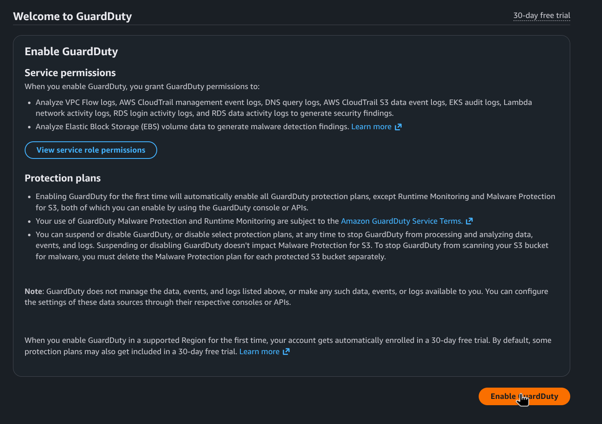
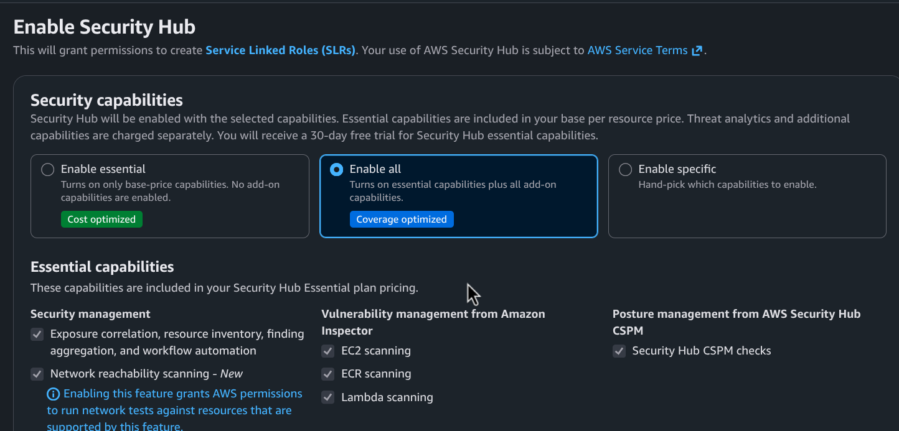

Security Hub had binnen enkele minuten al 192 findings, inclusief relevante: een Critical (SSM-documenten met publieke sharing aan), een High (CloudTrail niet multi-region), en informational over security groups die RDP (3389) open hebben staan vanaf `0.0.0.0/0`:

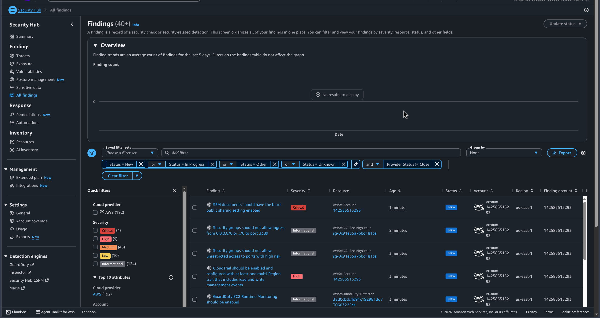

GuardDuty's Runtime Monitoring kreeg alle 5 instances als "Unhealthy": een VPC-endpoint voor de agent vereist `enableDnsSupport` én `enableDnsHostnames`, en die laatste stond niet aan op `saxit_vpc`.

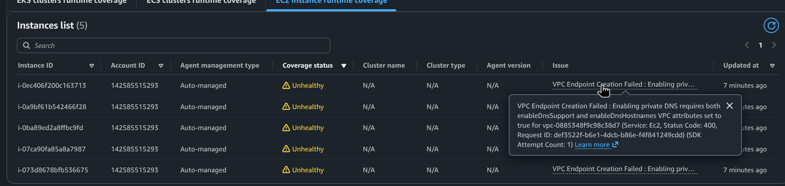

Fix in [`opentofu/main.tf`](../opentofu/main.tf): `enable_dns_support`/`enable_dns_hostnames` toegevoegd aan `aws_vpc.saxit_vpc` (geen recreate, alleen een attribuut-update):

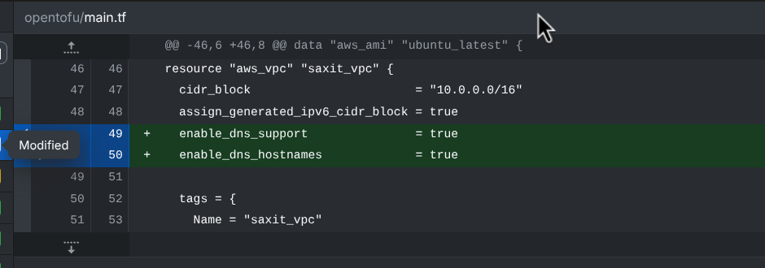

```hcl
resource "aws_vpc" "saxit_vpc" {
  cidr_block                       = "10.0.0.0/16"
  assign_generated_ipv6_cidr_block = true
  enable_dns_support               = true
  enable_dns_hostnames             = true
  ...
}
```

Toegepast met `tofu apply`: `enable_dns_hostnames` ging van `false` naar `true`, VPC in-place aangepast (geen recreate, 2 seconden):

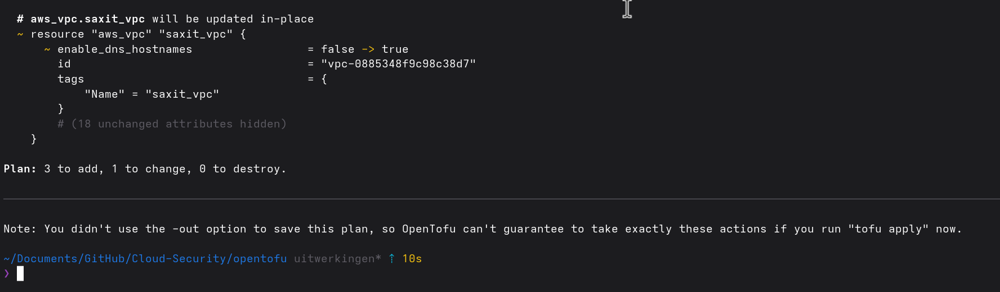 true" width="800">
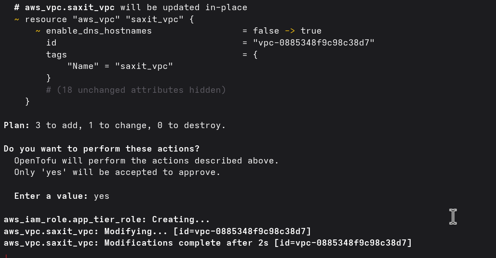

## 6.5 Log-analyse met Python en IsolationForest

### Wat het script doet

[`scripts/analyze_linux_log.py`](scripts/analyze_linux_log.py) leest `Linux_2k.log` (2.000 regels) en pakt met een regex de sshd-authenticatieregels eruit, samen met het bron-adres. 479 regels met geldig tijdstip en bron.

- **Grafiek 1 (gewone scripting):** pogingen per uur geteld met pandas (`resample("1h")`), geplot als lijn.
- **Grafiek 2 (ML):** per bron-adres totaal aantal pogingen + hoogste burst per minuut, door een `IsolationForest` (scikit-learn) gehaald. Top-15 bronnen geplot, rood als het model ze als anomalie ziet.

### Resultaten

```
479 sshd-authenticatieregels ingelezen uit Linux_2k.log
Piekuur: 2000-01-10 16:00:00 met 90 pogingen

Door IsolationForest als anomalie aangemerkte bronnen (top van de lijst):
rhost                           attempts  max_per_minute
150.183.249.110                       80              46
207.243.167.114                       23              12
n219076184117.netvigator.com          23              12
60.30.224.116                         20              10
```

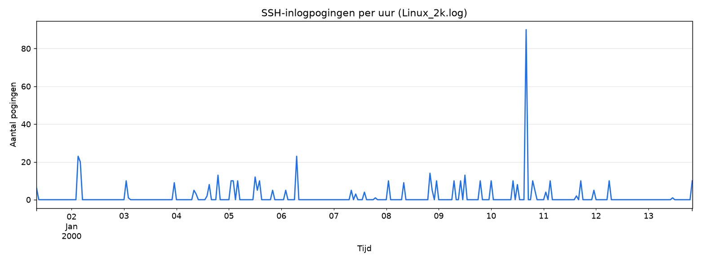

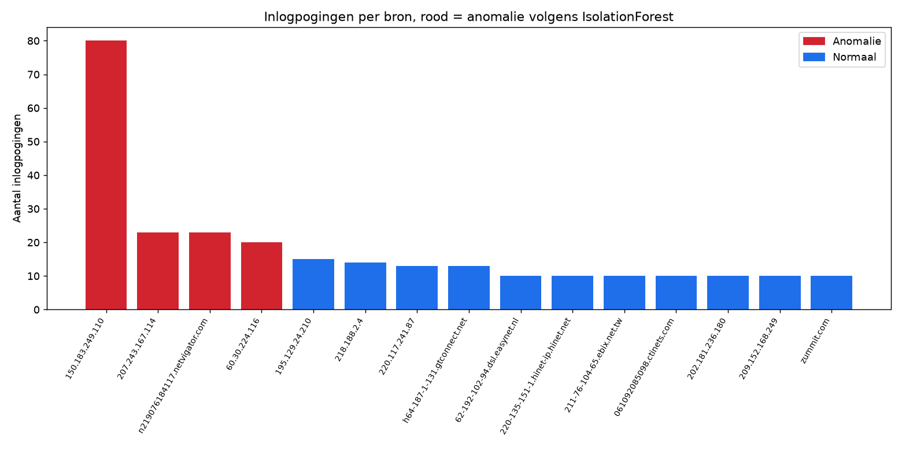

Eerste grafiek: duidelijke piek op 10 januari, 16:00 uur (90 pogingen, tegen normaal 0-15/uur). Tweede grafiek wijst de boosdoener aan: `150.183.249.110`, 80 pogingen totaal, 46 in één minuut — geen mens die zijn wachtwoord verkeerd typt, een geautomatiseerde brute-force. Drie andere bronnen (`207.243.167.114`, `n219076184117.netvigator.com`, `60.30.224.116`) markeert het model ook als afwijkend: minder pogingen, maar duidelijk meer dan de rest (typisch 1-10) — mogelijk tragere scans.

### Waarom IsolationForest

IsolationForest vindt afwijkende punten zonder vooraf te weten hoe een aanval eruitziet of gelabelde voorbeelden te hebben. Idee: een afwijkend punt is makkelijker te isoleren dan een normaal punt — het algoritme bouwt willekeurige beslissingsbomen, en een uitschieter (80 pogingen, 46/minuut, tegen een mediaan van een paar) heeft maar een paar splitsingen nodig om alleen te staan. Hoe minder splitsingen, hoe hoger de anomaliescore. Precies wat hier nodig is: ik weet niet vooraf wat een brute-force kenmerkt, maar wel dat het statistisch afwijkt — zonder zelf een harde drempel te hoeven verzinnen.

### Prompting

Script geschreven met Claude Code: gevraagd om de sshd-regels uit `Linux_2k.log` te halen, een pandas/matplotlib-grafiek van pogingen per uur, en een IsolationForest-grafiek per bron-IP op basis van totaal aantal pogingen + burst-per-minuut. Zelf laten draaien en de output/PNG's gecontroleerd.

### Advies aan SaxIT

Niet als eenmalig scriptje laten draaien, maar structureel: logs uit Kinesis (6.1) periodiek (bv. elk uur, via Lambda) door hetzelfde IsolationForest-model, met een alarm via SNS/EventBridge zodra een bron als anomalie wordt gezien. Voorkomt handmatig door logregels spitten, en vangt een brute-force binnen het uur op in plaats van bij een review achteraf.
