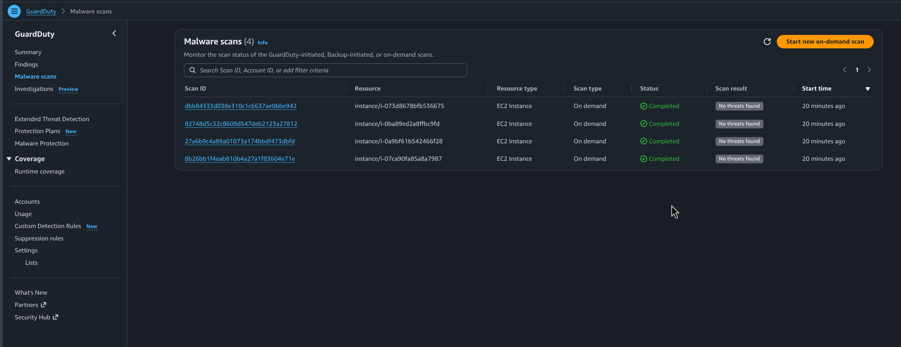
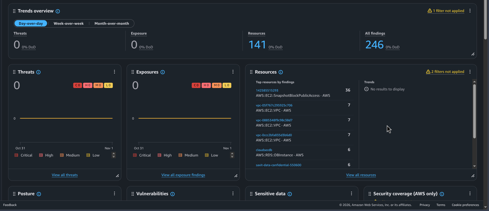
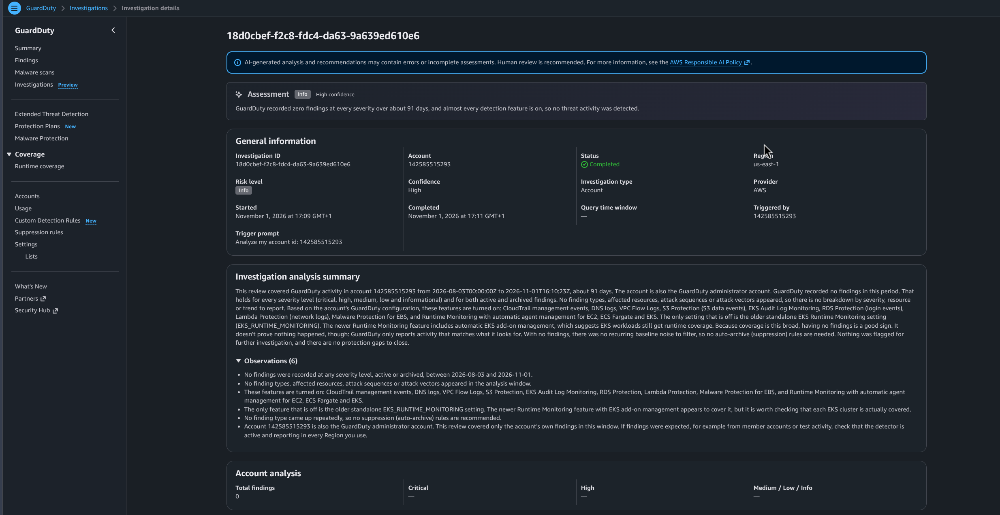

# Week 6: Logging, monitoring en detectie

Om een aanval op te merken, moet je kunnen zien wat er in de omgeving gebeurt. Dat begint met logging op een centrale plek. Als een server wordt overgenomen, staan de logs van daarvoor dan al ergens anders, en kan de aanvaller ze niet meer wissen. Daarna komt detectie: diensten en scripts die in die gegevens zoeken naar wat afwijkt.

Amazon Kinesis Data Streams is een dienst die grote hoeveelheden data, zoals logregels, in realtime opvangt en doorgeeft aan andere diensten [(Amazon Web Services, z.d.-h)](https://docs.aws.amazon.com/streams/latest/dev/introduction.html). Voor detectie heeft AWS onder andere GuardDuty, Inspector, Macie en Detective. Security Hub CSPM brengt de meldingen van die diensten samen op één plek en vergelijkt de omgeving met standaarden voor security [(Amazon Web Services, z.d.-g)](https://docs.aws.amazon.com/securityhub/latest/userguide/what-is-securityhub.html).

Deze week bestaat uit vijf opdrachten. Paragraaf 6.1 beschrijft hoe de logs van de servers naar Kinesis gaan. Paragraaf 6.2 bevat een advies over de detectiediensten van AWS, en paragraaf 6.3 gaat over een lab uit AWS Academy. Paragraaf 6.4 beschrijft Security Hub en een malwarescan, en paragraaf 6.5 de analyse van een logbestand met Python en machine learning.

## 6.1 Centrale logging met Kinesis

Voor deze opdracht heb ik een Kinesis-stream aangemaakt, `saxit-docker-logs`, waar de Docker-logs van de servers naartoe gaan.


Mijn plan was om de Kinesis Agent van AWS op de servers te installeren. Die is gemaakt voor Amazon Linux en Red Hat en wordt met `yum` geïnstalleerd [(Amazon Web Services, z.d.-i)](https://docs.aws.amazon.com/streams/latest/dev/writing-with-agents.html). Mijn servers draaien Ubuntu, en de agent zelf bouwen paste niet in de tijd. Daarom stuur ik de logs met de AWS CLI: `docker logs` ophalen, en elke regel met `kinesis put-record` naar de stream sturen. De CLI gebruikt daarvoor de rol van de server zelf, dus er staan geen access keys op de server:

```bash
sudo docker logs $(sudo docker ps -q) --tail 10 | while read -r line; do
  echo "$line" | aws kinesis put-record --stream-name saxit-docker-logs --partition-key app01 \
    --data "$(echo "$line" | base64 -w0)" --region us-east-1 --cli-binary-format raw-in-base64-out
done
```

In CloudWatch is te zien dat de records binnenkomen:


In de Data Viewer van de console zag ik eerst niets. Ik had de startpositie op "Latest" staan, en die laat alleen records zien die na het openen binnenkomen. Met de startpositie "Trim horizon" leest de viewer vanaf het begin van de stream, en dan staan alle vijf records van app01 er wel:


Voor SaxIT kan Kinesis de centrale ingang zijn voor de logs van alle lagen. Vanuit de stream kunnen de logs door naar S3, om ze lang te bewaren voor audits, of naar OpenSearch, om ze te doorzoeken en er alarmen op te zetten. Voor productie raad ik wel een programma aan dat de logs vanzelf blijft doorsturen, in plaats van mijn commando. Op Ubuntu kan dat bijvoorbeeld Fluent Bit zijn, dat logs rechtstreeks naar Kinesis kan sturen [(Fluent Bit, z.d.)](https://docs.fluentbit.io/manual/pipeline/outputs/kinesis).

## 6.2 Advies: AWS-detectiediensten voor SaxIT

| Dienst | Wat het doet | Waarom voor SaxIT | Hoe de prijs werkt |
| --- | --- | --- | --- |
| Inspector | Scant servers, containers en Lambda-functies op bekende kwetsbaarheden | Vindt kwetsbare software op de web- en app-servers voordat een aanvaller dat doet | Per server per maand, met een proefperiode van 15 dagen [(Amazon Web Services, z.d.-d)](https://aws.amazon.com/inspector/pricing/) |
| GuardDuty | Zoekt naar dreigingen in onder andere CloudTrail, DNS-verkeer en VPC Flow Logs | Ziet bijvoorbeeld dat app01 opeens praat met een bekende server van aanvallers | Naar de hoeveelheid geanalyseerde gebeurtenissen en logs [(Amazon Web Services, z.d.-c)](https://aws.amazon.com/guardduty/pricing/) |
| Macie | Zoekt in S3 naar gevoelige gegevens, zoals persoonsgegevens | Controleert of persoonsgegevens alleen in de geheime bucket staan (week 4) | Per bucket en per GB gescande data, met een proefperiode van 30 dagen [(Amazon Web Services, z.d.-e)](https://aws.amazon.com/macie/pricing/) |
| Detective | Zet meldingen en logs om in een tijdlijn, zodat je kunt onderzoeken wat er gebeurde | Handig na een melding van GuardDuty, om snel te zien wat met wat praatte | Per GB verwerkte data [(Amazon Web Services, z.d.-b)](https://aws.amazon.com/detective/pricing/) |
| CloudWatch | Metrics, logs en alarmen | De basis onder de rest: dashboards en alarmen | Er is een gratis laag; daarboven wordt per metric, per GB logs en per alarm betaald [(Amazon Web Services, z.d.-a)](https://aws.amazon.com/cloudwatch/pricing/) |

Mijn advies aan SaxIT is om te beginnen met GuardDuty en CloudWatch. Die zijn relatief goedkoop en dekken het meeste. Inspector komt erbij zodra er meer dan een paar servers zijn. Macie is pas nodig als er echt klantgegevens in S3 staan, en Detective als er genoeg meldingen zijn om onderzoek de moeite waard te maken. Wat het precies kost, hangt af van de hoeveelheid data. Dat kan SaxIT vooraf uitrekenen met de AWS Pricing Calculator.

## 6.3 AWS Academy: Lab 6.1 en de knowledge check

Lab 6.1 heb ik in AWS Academy doorlopen. Voor de knowledge check van module 6 haalde ik 80 van de 100 punten. Het cijferoverzicht staat bij [week 7.4](../week-7/README.md). Ook hier staat bij het lab `- / 100`, om dezelfde reden als in 2.2.

## 6.4 Security Hub en malwarescan

Voor deze opdracht heb ik Security Hub en GuardDuty aangezet. GuardDuty is de dienst van AWS die de omgeving bewaakt op dreigingen (zie 6.2). Voor de malwarescan gebruik ik het onderdeel GuardDuty Malware Protection for EC2. Bij verdacht gedrag maakt GuardDuty een snapshot van de schijf van een server en scant die. Een scan kan ook met de hand worden gestart [(Amazon Web Services, z.d.-f)](https://docs.aws.amazon.com/guardduty/latest/ug/malware-protection.html).

Ik heb GuardDuty en Security Hub aangezet met alle onderdelen, in de proefperiode van 30 dagen. Na een paar minuten had Security Hub al 192 bevindingen. Daaronder één kritieke (SSM-documenten die publiek gedeeld mogen worden), één hoge (CloudTrail logt niet in alle regio's) en meldingen over security groups waarin RDP (poort 3389) openstaat voor heel internet:


De Runtime Monitoring van GuardDuty zette alle vijf de servers op "Unhealthy". Daarvoor maakt GuardDuty een VPC-endpoint aan, en dat vraagt dat DNS-ondersteuning en DNS-hostnamen allebei aanstaan in de VPC. Dat laatste stond uit in saxit_vpc.


In [`opentofu/main.tf`](../opentofu/main.tf) heb ik beide instellingen aangezet, door `enable_dns_support` en `enable_dns_hostnames` op `true` te zetten. De VPC wordt daarbij aangepast en niet opnieuw aangemaakt; de apply duurde twee seconden.


De malwarescan uit de opdracht kan los van de Runtime Monitoring. Ik heb in GuardDuty met de hand een scan gestart op web01, web02, app01 en app02. Na een paar minuten waren ze alle vier klaar, zonder gevonden dreigingen:



Aan het eind telde Security Hub 246 bevindingen over 141 resources:



GuardDuty heeft ook een tabblad Investigations, waar een AI-assistent de gegevens van de afgelopen periode samenvat. Die bevestigt dat over 91 dagen alle bronnen worden bewaakt en dat er geen bevindingen zijn:



Mijn advies is om Security Hub te gebruiken als het centrale startpunt voor security. Zet een melding op elke nieuwe bevinding met de ernst hoog of kritiek, via EventBridge naar mail of chat, zoals in 4.4. En bespreek de score van Security Hub regelmatig, zodat de bevindingen ook echt worden opgelost.

## 6.5 Log-analyse met Python en IsolationForest

Voor deze opdracht heb ik een Python-script geschreven dat een logbestand analyseert. Het script [`scripts/analyze_linux_log.py`](scripts/analyze_linux_log.py) leest het bestand `Linux_2k.log`, met 2000 regels. Het haalt daar de inlogpogingen op SSH uit, met het adres waar ze vandaan kwamen. Dat zijn 479 regels. Daarna maakt het twee grafieken:

- het aantal pogingen per uur, geteld met pandas;
- per bron het totale aantal pogingen en het hoogste aantal in één minuut. Die gegevens gaan door een IsolationForest-model van scikit-learn. De vijftien bronnen met de meeste pogingen staan in de grafiek, in rood als het model ze afwijkend vindt.

```
479 sshd-authenticatieregels ingelezen uit Linux_2k.log
Piekuur: 2000-01-10 16:00:00 met 90 pogingen

Door IsolationForest als anomalie aangemerkte bronnen (top van de lijst):
rhost                           attempts  max_per_minute
150.183.249.110                       80              46
207.243.167.114                       23              12
n219076184117.netvigator.com          23              12
60.30.224.116                         20              10
```


In de eerste grafiek is een duidelijke piek te zien op 10 januari om 16:00 uur: 90 pogingen, terwijl het normaal 0 tot 15 per uur zijn. De tweede grafiek laat zien waar die vandaan kwam: 150.183.249.110, met 80 pogingen, waarvan 46 in één minuut. Dat is geen mens die zijn wachtwoord verkeerd typt, maar een geautomatiseerde brute-force-aanval. Het model ziet nog drie bronnen als afwijkend. Die deden minder pogingen, maar wel duidelijk meer dan de rest. Dat kunnen tragere scans zijn.

### Waarom IsolationForest

IsolationForest vindt afwijkende punten zonder dat je vooraf hoeft te weten hoe een aanval eruitziet. Het idee is dat een afwijkend punt makkelijker los te maken is van de rest dan een normaal punt [(Liu et al., 2008)](https://doi.org/10.1109/ICDM.2008.17). Het algoritme bouwt willekeurige beslisbomen. Een uitschieter, zoals een bron met 80 pogingen, staat na een paar splitsingen al alleen. Hoe minder splitsingen er nodig zijn, hoe hoger de score [(scikit-learn developers, z.d.)](https://scikit-learn.org/stable/modules/generated/sklearn.ensemble.IsolationForest.html).

Dat past hier goed. Ik weet niet precies hoe een brute-force-aanval er in deze logs uitziet, wel dat hij afwijkt van normaal gedrag. En ik hoef zelf geen grens te verzinnen, zoals "meer dan twintig pogingen".

### Hoe ik het script heb gemaakt

Het script heb ik geschreven met Claude Code. Ik heb gevraagd om de SSH-regels uit `Linux_2k.log` te halen, een grafiek van de pogingen per uur te maken met pandas en matplotlib, en een IsolationForest-grafiek per bron op basis van het totale aantal pogingen en het hoogste aantal per minuut. Het script heb ik zelf gedraaid, en de uitvoer en grafieken heb ik gecontroleerd.

### Advies aan SaxIT

Mijn advies is om dit niet één keer te doen, maar vast in te richten. Laat de logs uit Kinesis (6.1) bijvoorbeeld elk uur door hetzelfde model gaan, met een Lambda-functie, en stuur een melding via SNS zodra een bron als afwijkend wordt gezien. Dan hoeft niemand met de hand door logregels te zoeken, en valt een brute-force-aanval binnen het uur op in plaats van pas bij een controle achteraf.

## Bronnen

Amazon Web Services. (z.d.-a). *Amazon CloudWatch pricing*. https://aws.amazon.com/cloudwatch/pricing/

Amazon Web Services. (z.d.-b). *Amazon Detective pricing*. https://aws.amazon.com/detective/pricing/

Amazon Web Services. (z.d.-c). *Amazon GuardDuty pricing*. https://aws.amazon.com/guardduty/pricing/

Amazon Web Services. (z.d.-d). *Amazon Inspector pricing*. https://aws.amazon.com/inspector/pricing/

Amazon Web Services. (z.d.-e). *Amazon Macie pricing*. https://aws.amazon.com/macie/pricing/

Amazon Web Services. (z.d.-f). *GuardDuty Malware Protection for EC2*. Amazon GuardDuty User Guide. https://docs.aws.amazon.com/guardduty/latest/ug/malware-protection.html

Amazon Web Services. (z.d.-g). *Introduction to AWS Security Hub CSPM*. AWS Security Hub User Guide. https://docs.aws.amazon.com/securityhub/latest/userguide/what-is-securityhub.html

Amazon Web Services. (z.d.-h). *What is Amazon Kinesis Data Streams?* Amazon Kinesis Data Streams Developer Guide. https://docs.aws.amazon.com/streams/latest/dev/introduction.html

Amazon Web Services. (z.d.-i). *Write to Amazon Kinesis Data Streams using Kinesis Agent*. Amazon Kinesis Data Streams Developer Guide. https://docs.aws.amazon.com/streams/latest/dev/writing-with-agents.html

Fluent Bit. (z.d.). *Amazon Kinesis Data Streams*. Fluent Bit: Official Manual. https://docs.fluentbit.io/manual/pipeline/outputs/kinesis

Liu, F. T., Ting, K. M., & Zhou, Z.-H. (2008). Isolation forest. In *2008 Eighth IEEE International Conference on Data Mining* (pp. 413–422). IEEE. https://doi.org/10.1109/ICDM.2008.17

scikit-learn developers. (z.d.). *sklearn.ensemble.IsolationForest*. scikit-learn documentation. https://scikit-learn.org/stable/modules/generated/sklearn.ensemble.IsolationForest.html
